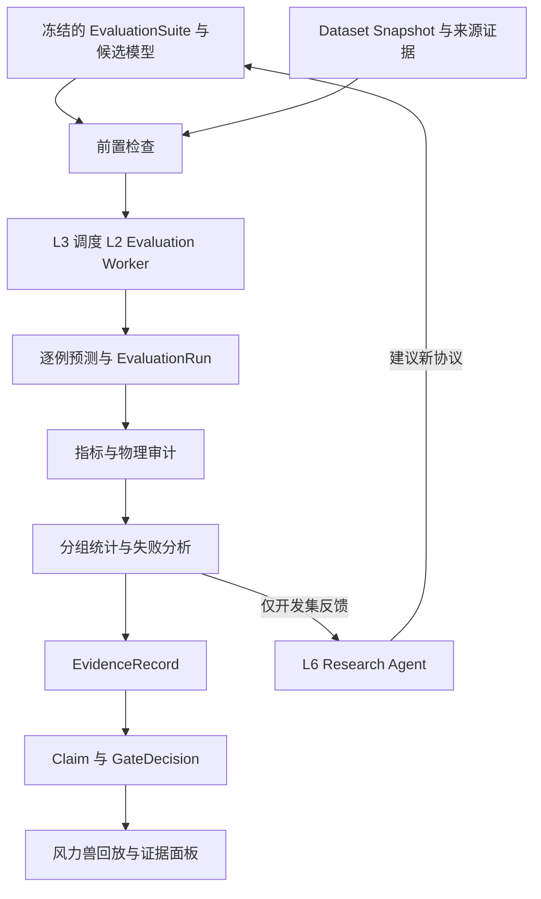
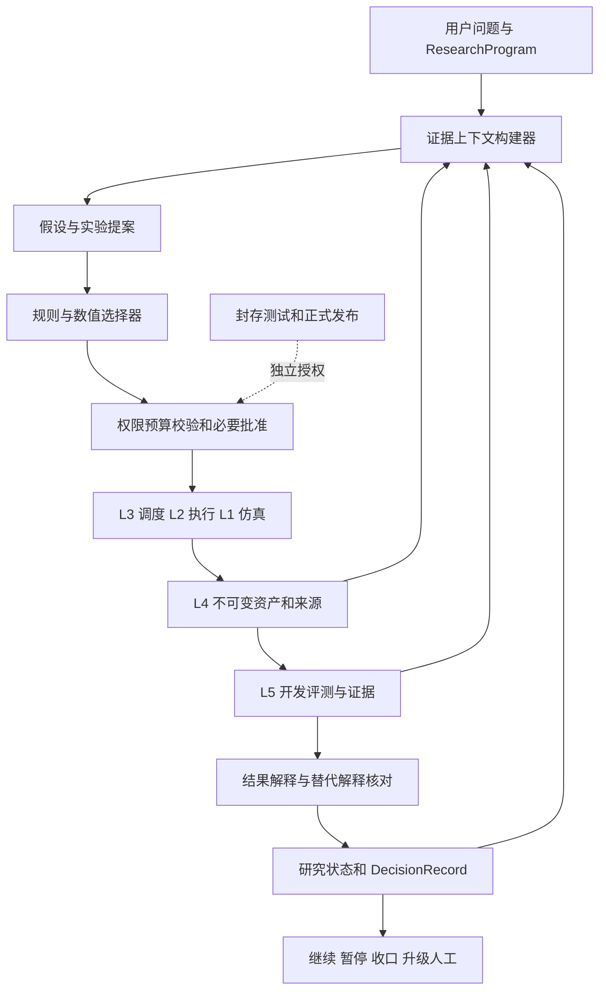
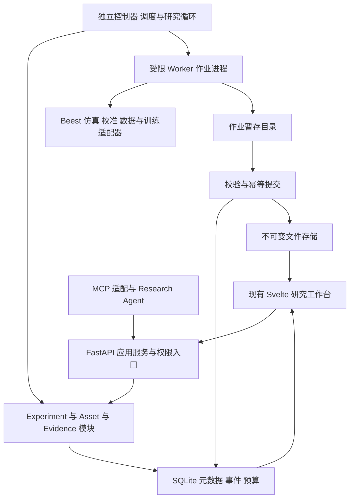

# Beest Model Experiment Harness 全部资料合订版

资料导出日期：2026-11-06（Asia/Singapore）。本文件包含 10 个来源页面的完整 Markdown 正文，以及供接手 Agent 使用的导读。不是项目代码或实际实验产物。

建议先阅读“开发交接提示”和第六课、实施交接规格；再按任务回查前五课。正文中的历史规划不等于当前已实现；以用户授权及当前工作副本为准。来源链接保留，正文已经内嵌，无须登录空间才能阅读。

## 开发交接提示

以下内容可连同资料包交给开发 Agent。工作目录、写入范围和资源授权以用户在接手会话中的指令为准；本文件不自动授权推送、发布、付费或实体设备操作。

## 项目与第一阶段目标

你将接手 `meiluosi/strandbeest-evolution` 的模型实验 Harness 改造。定位为“面向物理世界模型与具身智能研究的实验编排、模型训练、仿真验证和证据管理平台”。保留原有风力兽特色，在现有系统上补齐能力，不从零重建通用 MLOps。

先读 本合订版导读、第六课和实施交接规格，再按工作包回查相应课程。文档含历史建议，不能假设这些新增功能已实现。

第一目标是 M0＋M1：核对基线和契约，完成一条不依赖 LLM 的小模型真实实验链路。M1 中至少有可追溯源轨迹、不可变数据快照和分组切分、简单基线与学习模型、真实权重、评测输出和风力兽回放。先在本机可承受规模预检，再确定资源和重复数。

## 开始前

读取仓库实际 `AGENTS.md` 和相关模块约定，核对当前 commit、分支、依赖锁和未提交改动。历史参考基线是 `610dafc4f00de6e70b2807c07f3932f639c28a37`，不是要求 reset 到该版本。保护用户改动和历史实验产物。确认已有功能与规划缺口，记录差异而非盲目套用文档路径。

运行适用的现有检查并记录真实结果。若依赖、数据或硬件缺失，明确未运行项和阻塞原因，不伪造“全部通过”。在现有授权内先完成可执行部分。

## 实施约束

保留 Svelte/FastAPI 和领域引擎，公共 Schema/ID/单位/来源规则尽量复用。六层是职责，不是六套微服务。HTTP、CLI 和 MCP 共用权限、预算及任务状态逻辑。

重点遵守实施规格 I01–I12：冻结输入；区分 Trial 与 Attempt；有效代次唯一提交；产物校验后才成功；状态与事件一致；失败费用不丢失；共享依赖取消正确；评分与测试隔离；证据分级不越界；旧资产兼容；来源不被重建索引删除；上游证据可撤回。

不得用缓存当新统计重复，不得因 OOM 静默改变实验条件，不得用“租约过期”推定旧进程已释放资源。普通子进程不自动等于安全沙箱。旧 `clear_run_index`、启动恢复和任务领取路径是重点适配点，重新核对当前实现后再改。

使用可追溯真实执行数据；仿真来源和实测来源分别记账。工程小样例只验证程序机制。没有提升、物理证据未验证或结果不确定都是有效出口，不降低门槛制造正结果。

## 工作方式与交付

依据 HN01–HN08 拆任务，先做纵向贯通，再加固可靠性和接入研究 Agent。多 Agent 并行时指定契约与集成负责人，避免同时重定义状态机、Schema 和迁移规则。

每个阶段交付实际变更、测试命令、日志与产物位置，以及已完成、未完成、未运行和阻塞项。清楚区分工程链路通过、数值检查通过、独立物理证据与真实设备有效性。

阶段结束留下变更前后 commit 或工作区状态、兼容/回滚说明、可复现操作、已知限制和下一步任务。不要把占位曲线、文档或代码目录数量当作验收成果。

## 上下文与重要修订

本页为导出时整理的交接导航，不替换来源正文。定位及三项原则来自用户确认；具体模块、接口、技术取舍是课程建议，需与当前代码和开发授权核对。现状以实际工作副本为准，目标语义优先阅读第六课及实施规格。

## 项目背景

本分支专注主线 B：模型实验 Harness，区别于另一个全链路软件研发交付 Agent 项目，也不直接等同于真实机器人控制 Harness。长期可以连接三类系统，但首版不扩展到实体设备自动执行。

用户希望在风吹驱动的 Strandbeest 模拟平台上保留设计、演化、仿真、制造与实测特色，建立六层模型实验平台，并由其他开发 Agent 根据课程改造。三项原则是研究问题优先、实验可追溯可复现、AI 加速研究而证据需把关。

六课依次定义实验对象、编排、数据模型生命周期、评测证据、Research Agent、整体系统和实施规格。各课末尾保留讨论决策摘要，非逐字会话。

## 冲突与修订处理

| 早期简化或容易误读处 | 当前整合语义 | 来源 |
|---|---|---|
| 线性 Experiment→Trial→Job→Run | 分开归属、计算依赖、来源关系；共享 Job 与多 Run 均合法 | [第六课 §2.2](https://chatgpt.com/space/page_bdeb810ef078819183a23a70d00b46a7) |
| 一个 ModelVersion 表示模型 | 明确 ModelSpecRevision 与 ModelArtifact；结构与权重/前后处理不同身份 | [第六课 §4.5](https://chatgpt.com/space/page_bdeb810ef078819183a23a70d00b46a7) |
| 租约过期直接释放资源 | 先撤销提交权，再核实进程终止或隔离；未知资源不能直接重分配 | [实施规格 §5.4](https://chatgpt.com/space/page_89779898fc6c8191a40b24a0d0f87a90) |
| OOM 后减小 batch 当普通重试 | 有效 batch、精度或模型等变化影响科学条件；需已批准适配政策或新修订 | [第六课 §4.5](https://chatgpt.com/space/page_bdeb810ef078819183a23a70d00b46a7) |
| 完整 Checkpoint 保证任意环境精确恢复 | 区分完整恢复与 warm start；兼容和确定性在声明环境中验证 | [实施规格 §5.5](https://chatgpt.com/space/page_89779898fc6c8191a40b24a0d0f87a90) |
| 保证执行恰好一次 | 计算可能多次尝试，正式结果受有效代次与幂等提交约束 | [第六课 §4.4](https://chatgpt.com/space/page_bdeb810ef078819183a23a70d00b46a7) |
| 保存文件和 DB 是同一原子事务 | 完整发布不可变文件，再登记正式引用；明确孤儿产物与崩溃一致性 | [实施规格 §5.3](https://chatgpt.com/space/page_89779898fc6c8191a40b24a0d0f87a90) |
| ID、哈希、缓存与去重等同 | 业务 ID、内容版本、幂等键、缓存键各自承担不同语义 | [第六课 §2.3](https://chatgpt.com/space/page_bdeb810ef078819183a23a70d00b46a7) |
| 同 seed/缓存/重试增加独立样本数 | 不增加；独立复验需要明确 Trial、随机性和目的 | [实施规格 §5.5](https://chatgpt.com/space/page_89779898fc6c8191a40b24a0d0f87a90) |
| 最高 E0–E3 表示模型整体能力 | 按用途所需的每项 Claim 检查，几何证据不能转移给扭矩 | [第四课 §4.3–4.4](https://chatgpt.com/space/page_bc1e45d775408191b7328d225c816716) |
| 停转就是模型失败 | 区分物理停转、数值错误、预测错误和缺证据；停转可能是有效目标 | [第四课 §3.2](https://chatgpt.com/space/page_bc1e45d775408191b7328d225c816716) |
| 架构近似等参比较可解释规模效应 | 研究规模固定模型族；研究历史增加受控变体与容量对照 | [第四课 §1](https://chatgpt.com/space/page_bc1e45d775408191b7328d225c816716) |

## 开发时优先核对的现有代码边界

第六课记录的历史代码快照为 `610dafc4f00de6e70b2807c07f3932f639c28a37`。下列观察是该时点的静态审阅，不是本次重新核实的当前事实。

旧线程锁保护下 SELECT 再 UPDATE 的领取方式，不能直接推广到独立多进程。旧启动 `recover()` 将 running 标失败，新独立 Worker 生命周期需要重新定义。旧 `clear_run_index()` 同时清理 `provenance_edges`，新增权威血缘不能依赖被清空的投影。会话内预算和成功返回后计费需扩展为持久化预留/实耗；失败、重试和 LLM 费用保留。详见第六课与第五课代码映射。

## 已有方向与尚待落实

建议采用模块化后端、独立控制器与有界 Worker，保留 Svelte 和现有回放。SQLite＋本地不可变文件足以作为首版候选；不用先创建多机集群、多用户、向量数据库或多 Agent 团队。各项选择仍要通过预检与验收。

课程按用户此前的 MacBook Air M4 16GB 约束规划：CPU 小模型为起点，MPS 可选预检，不能把方案当硬件能力实测。接手时确认实际环境与预算。

第一步 M0 保护基线，M1 手工跑通轨迹→数据→训练→评测→回放。M2 加固可靠性，M3 接受控研究，M4 才整理发布。输入冻结、权限、基本幂等、产物完整性不能等到最后才补。

## 仍需开发 Agent 具体化的事项

本文档没有提供已通过测试的完整 JSON Schema、SQL 迁移或 OpenAPI 实现。工程启动需把契约草案落成可执行格式，并确定观测字段、数据来源、模型/训练预算、数值容差、资源 profile 与统计方案。差异应在工作区中记录来源、理由和影响，不能静默替换研究目标或伪造来源。

API、数据与模型引用中的 null 和占位内容是待绑定项，不应直接运行。没有实物测量不能声称真实世界验证；没有足够统计证据不能声称普适提升。

## 来源目录

- [SRC01 Beest Model Experiment Harness](#src01)
- [SRC02 文档目录与研究导航](#src02)
- [SRC03 00 项目总览与 Agent 交接上下文](#src03)
- [SRC04 01 Lesson 01 - 实验对象与数据模型](#src04)
- [SRC05 02 Lesson 02 - 实验编排与调度架构](#src05)
- [SRC06 03 Lesson 03 - Dataset 与 Model 生命周期](#src06)
- [SRC07 04 Lesson 04 模型评测与证据体系](#src07)
- [SRC08 05 Lesson 05 Research Agent 与自适应实验决策](#src08)
- [SRC09 06 Lesson 06 整体系统架构与开发规格](#src09)
- [SRC10 实施交接规格 契约 接口 迁移与验收](#src10)

---

<a id="src01"></a>
# SRC01 Beest Model Experiment Harness

来源：https://chatgpt.com/space/page_6aeca13ed9b08191baace0ffab03a6f1  
观察到的页面序列：1；来源更新时间：2026-11-05T16:08:16.291633Z。

<!-- BEGIN SOURCE page_6aeca13ed9b08191baace0ffab03a6f1 -->
# 模型实验 Harness 研究入口

面向物理世界模型与具身智能研究的实验编排、模型训练、仿真验证和证据管理平台。以 strandbeest-evolution 为基础，保留风力兽设计、仿真、演化与实测特色。这里保存研究课程、架构建议和 Agent 开发交接上下文；规划内容与已实现能力分别记录。

[文档目录与研究导航](https://chatgpt.com/space/page_6aeca3efb2ac8191bd53aaf9156103c2)

[项目总览与 Agent 交接上下文](https://chatgpt.com/space/page_6aeca182083c8191b4eeb85353d5dd6a)

课程正文、来源、当前建议和待验证项以目录中的各课文档为准。后续实施者先阅读相关课程，再检查仓库当前实现；未经明确授权不修改或发布代码。
<!-- END SOURCE page_6aeca13ed9b08191baace0ffab03a6f1 -->

---

<a id="src02"></a>
# SRC02 文档目录与研究导航

来源：https://chatgpt.com/space/page_6aeca3efb2ac8191bd53aaf9156103c2  
观察到的页面序列：3；来源更新时间：2026-11-05T17:24:02.721097Z。

<!-- BEGIN SOURCE page_6aeca3efb2ac8191bd53aaf9156103c2 -->
# Beest Model Experiment Harness：文档目录

## 项目定位

面向物理世界模型与具身智能研究的实验编排、模型训练、仿真验证和证据管理平台。以 strandbeest-evolution 为基础，保留风力兽设计、演化、仿真、制造与真实测量特色，补齐模型实验 Harness。

## 已确认架构原则

1. 研究问题优先于工具。

2. 实验结果可追溯、可复现。

3. AI 加速研究，人类把关证据。

## 六层架构

L1 Domain Engine；L2 Worker & Runtime；L3 Execution & Scheduling；L4 Model & Data Management；L5 Evaluation & Evidence；L6 Research Agent。

## 研究文档

- [项目总览与 Agent 交接上下文](https://chatgpt.com/space/page_6aeca182083c8191b4eeb85353d5dd6a)

- [Lesson 01：实验对象与数据模型](https://chatgpt.com/space/page_6aeca18f4df0819194d1c7c41a847ce7)

- [Lesson 02：实验编排与调度架构](https://chatgpt.com/space/page_6aeca1ebf67881918aca4942d04e0ee9)

- [Lesson 03：Dataset 与 Model 生命周期](https://chatgpt.com/space/page_6aeca3d3ccec8191a6020c75d829be68)

- [Lesson 04：模型评测与证据体系](https://chatgpt.com/space/page_bc1e45d775408191b7328d225c816716)

- [Lesson 05：Research Agent 与自适应实验决策](https://chatgpt.com/space/page_50ad9569c65881919236d6d80d2ab5fd)

- [Lesson 06：整体系统架构与开发规格](https://chatgpt.com/space/page_bdeb810ef078819183a23a70d00b46a7)

- [实施交接规格：契约、接口、迁移与验收](https://chatgpt.com/space/page_89779898fc6c8191a40b24a0d0f87a90)

首轮课程 01–06 的规划文档已归档。前五课分别定义实验对象、执行调度、数据与模型、评测证据及 Research Agent；第六课整合模块、进程、事务、迁移与界面设计，并配套 12 项不变条件、8 个工作包和 20 项故障与端到端验收。各课保留来源与交接要点；课程完成不代表六层系统已实现或科学实验已通过。

## 下一阶段实施

在用户授权的工作副本中，先完成 M0 基线与契约核对，再推进 M1 手动端到端实验：现有轨迹 → 冻结数据 → 小模型训练 → 评测与回放 → 有来源的限定结论。后续依次加固恢复与预算、接入受控研究循环。详细任务及依赖以实施交接规格为准；本轮只保存规划，未修改仓库或执行训练。

## 贯穿案例

从现有 SimulationRun 生成风力兽动力学数据，构建 Dataset Snapshot，训练 MLP/GRU 等学习模型，评测一步预测、长期 Rollout、跨设计/风场泛化和物理一致性。仿真器拟合不等于真实世界验证；真实验证必须依赖独立实测证据。

## Agent 交接要求

接手者先阅读项目总览和对应课程，再检查 GitHub 当前 main 分支。文档中的目标架构不代表代码已实现。未经用户明确授权，不修改仓库。所有实施均应有 Schema、迁移、契约测试、回归与证据记录。
<!-- END SOURCE page_6aeca3efb2ac8191bd53aaf9156103c2 -->

---

<a id="src03"></a>
# SRC03 00 项目总览与 Agent 交接上下文

来源：https://chatgpt.com/space/page_6aeca182083c8191b4eeb85353d5dd6a  
观察到的页面序列：0；来源更新时间：2026-11-05T15:32:20.873808Z。

<!-- BEGIN SOURCE page_6aeca182083c8191b4eeb85353d5dd6a -->
# Beest Model Experiment Harness

## 项目定位

面向物理世界模型与具身智能研究的实验编排、模型训练、仿真验证和证据管理平台。

以现有开源仓库 [meiluosi/strandbeest-evolution](https://github.com/meiluosi/strandbeest-evolution) 为基础，在保留风力兽设计、演化、物理仿真、制造、测量和可视化特色的基础上，逐步补齐模型实验 Harness 能力。目标不是重写 Beest Engine，也不是另造通用 MLOps，而是在现有物理实验平台上建立可复现、可追溯、可评估、可迭代的研究闭环。

## 三个架构原则

1. **研究问题优先于工具**：所有模块服务于可检验的研究问题。

2. **实验结果可追溯、可复现**：结果关联数据、模型、配置、代码身份、环境、执行过程和来源。

3. **AI 加速研究，人类把关证据**：Agent 可以提出、规划、执行和分析实验，但不能自行宣布科学假设成立。

## 六层目标架构

1. **L1 Domain Engine**：Beest Core、MuJoCo、K2、Design、Scenario、Measurement。

2. **L2 Worker & Runtime**：Simulation、Data Processing、Training、Evaluation、Calibration、Optimization Workers。

3. **L3 Execution & Scheduling**：Experiment Graph、Job DAG、Scheduler、资源管理、恢复和预算。

4. **L4 Model & Data Management**：Dataset、Model、Checkpoint、Artifact、Lineage。

5. **L5 Evaluation & Evidence**：基线、多种子、泛化、鲁棒性、物理一致性、证据分级。

6. **L6 Research Agent**：假设生成、实验规划、失败分析、下一轮实验建议。

横向能力：Schema/Contract、Provenance、Observability、Budget、Permissions、Reproducibility。

## 研究课程

- Lesson 01：实验对象与数据模型。

- Lesson 02：实验编排与调度架构。

- Lesson 03：数据与模型生命周期。

- Lesson 04：模型评测与证据体系。

- Lesson 05：Research Agent。

- Lesson 06：整体系统架构与开发规格。

每课形成独立文档，最终汇总为可交给其他 Agent 实施的架构规划、Schema/API 契约、迁移路线与验收标准。

## 当前贯穿案例

研究问题：学习模型能否预测风力兽在不同状态、动作/驱动和环境条件下的未来运动？

以现有物理仿真器生成数据，训练 MLP、GRU 等时序模型，比较一步预测、长期 Rollout、跨设计/风场泛化与物理一致性。必须区分“拟合现有仿真器”与“验证真实物理世界”，不能把前者误称为后者。

## 现有仓库基础

已存在：

- Design、Scenario、Run、Measurement、Profile 等资产与 JSON Schema。

- packages/core：运动学、演化、编辑操作。

- packages/sim：MuJoCo、K2、场景、遥测、审计。

- packages/opt：CMA-ES、多保真、稳健优化、MAP-Elites。

- packages/calib、packages/rig：校准、测量导入与质量检查。

- packages/common：DAG、哈希、资产、证据、遥测。

- packages/agent：MCP、预算、权限、审计和 Agent Benchmark。

- apps/api：持久化 Job、取消、恢复处理、实验 API。

- apps/web-demo：设计、仿真、制造、实验室界面。

主要缺口：
Experiment/Condition/Trial 协议；通用 Dataset Snapshot；Model/TrainingRun/Checkpoint 生命周期；Training Worker；通用 EvaluationRun 与评测协议；长时任务 Checkpoint 恢复；Research Agent 研究闭环。

## Agent 交接规则

- 本 Space 是研究规划与架构文档的长期归档位置。

- GitHub 仓库是代码与现有项目事实的来源；不要仅凭规划文档假设功能已实现。

- 先读本总览和对应 Lesson，再检查仓库当前 main 分支及相关代码。

- 未经用户明确要求，不修改 GitHub 仓库、不提交、不发布。

- 每项规划区分：现有实现、建议设计、待验证假设、尚未实现。

- 变更现有 Schema 时必须考虑向后兼容、迁移、契约测试和历史数据。

- 保留负面结果、证据等级和未验证状态，不放宽阈值制造通过结果。

## 关键来源

- [GitHub 仓库](https://github.com/meiluosi/strandbeest-evolution)

- [当前架构](https://github.com/meiluosi/strandbeest-evolution/blob/main/docs/ARCHITECTURE.md)

- [平台设计](https://github.com/meiluosi/strandbeest-evolution/blob/main/docs/PLATFORM.md)

- [引擎蓝图](https://github.com/meiluosi/strandbeest-evolution/blob/main/docs/ENGINE.md)

- [验证与证据规则](https://github.com/meiluosi/strandbeest-evolution/blob/main/docs/VALIDATION.md)

- [实验记录](https://github.com/meiluosi/strandbeest-evolution/blob/main/docs/EXPERIMENTS.md)

版本说明：本总览记录 2026-11-05 的研究方向与课程进度。仓库实现状态以后续检查为准。
<!-- END SOURCE page_6aeca182083c8191b4eeb85353d5dd6a -->

---

<a id="src04"></a>
# SRC04 01 Lesson 01 - 实验对象与数据模型

来源：https://chatgpt.com/space/page_6aeca18f4df0819194d1c7c41a847ce7  
观察到的页面序列：0；来源更新时间：2026-11-05T15:32:34.709375Z。

<!-- BEGIN SOURCE page_6aeca18f4df0819194d1c7c41a847ce7 -->
# Lesson 01：实验对象与数据模型

## 1. 课程目标

建立统一的实验对象模型，区分研究协议、实验条件、独立试验、计算任务、执行记录和产物，为六层 Model Experiment Harness 提供数据基础。

## 2. 核心对象

| 对象 | 定义 | 主要职责 |
|---|---|---|
| Experiment | 一个完整的研究实验及其版本化协议 | 问题、假设、目标、变量、预算、验收条件 |
| Condition | 一组明确的实验条件 | 模型、数据、训练配置、环境参数 |
| Trial | 某个 Condition 下的一次独立实验重复 | 随机种子、重复编号、实验结果 |
| Job | 一个可调度的计算任务 | 输入、依赖、资源、执行状态 |
| Job Attempt | Job 的一次实际执行尝试 | 日志、错误、重试、恢复 |
| Run | 一次有明确领域语义的执行记录 | 仿真、训练、评测、数据处理等 |
| Artifact | 执行过程中产生的文件或数据产物 | 权重、数据集、日志、报告、遥测 |

## 3. 对象关系

Experiment → Condition → Trial → Job → Job Attempt → Typed Run → Artifact。

关系允许一对多：Experiment 包含多个 Condition；Condition 包含多个 Trial；Trial 包含多个 Job；Job 可以有多次 Attempt；Job 可以产生多个 Run 和 Artifact。

## 4. Run 的类型设计

保留现有 SimulationRun，不改变 schemas/run.schema.json 的领域语义。

建议新增 TrainingRun、EvaluationRun、DataProcessingRun、CalibrationRun。各类型共享基础执行身份、输入引用、状态和来源信息，但保留独立领域 Schema。

## 5. 生命周期

Experiment：draft → approved → running → analyzing → completed / archived。

Trial：planned → ready → running → evaluating → completed / failed / cancelled。

Job：queued → running → succeeded / failed / cancelled / blocked。

Job Attempt：started → succeeded / failed / interrupted / cancelled。

不同层次的状态不得直接互相替代。

## 6. 关键设计约束

1. Job 成功不代表 Trial 成功。

2. Trial 成功不代表科学假设成立。

3. Job 重试不等于新的独立 Trial。

4. 领域 Run 必须保留独立 Schema。

5. Artifact 必须具备稳定身份、内容哈希和来源关系。

6. 所有实验结果必须能够追溯到数据、模型、配置、代码和执行环境。

## 7. 现有项目映射

保留 Design、Scenario、SimulationRun、Measurement、Profile、packages/common/dag.py、apps/api JobStore、证据等级 E0–E3、输入哈希与实现身份。

新增 Experiment、Condition、Trial、Job Attempt、TrainingRun、EvaluationRun 和统一 Artifact 元数据协议。

## 8. 待进一步设计

- Experiment 与 Trial 的版本化及不可变性。

- Job DAG 的持久化与恢复。

- 多个 Trial 共享 Dataset Snapshot 的机制。

- Checkpoint 与训练恢复协议。

- 跨类型 Run 的来源图。

- 统计分析与研究结论之间的证据约束。

## 9. 验收标准

- 描述完整的多模型、多随机种子实验。

- 区分 Experiment、Condition、Trial 和 Job。

- 表示 Job 重试而不产生虚假的实验重复。

- 表示一次 Job 产生多个不同类型的执行产物。

- 保留 SimulationRun 兼容性。

- 从最终报告回溯到原始数据与执行记录。

## 10. 课程结论

Experiment 是研究协议，Condition 是比较条件，Trial 是独立重复，Job 是调度单元，Attempt 是执行尝试，Run 是领域执行记录，Artifact 是产物。不得把它们压成一个万能 Run。
<!-- END SOURCE page_6aeca18f4df0819194d1c7c41a847ce7 -->

---

<a id="src05"></a>
# SRC05 02 Lesson 02 - 实验编排与调度架构

来源：https://chatgpt.com/space/page_6aeca1ebf67881918aca4942d04e0ee9  
观察到的页面序列：0；来源更新时间：2026-11-05T15:34:07.176874Z。

<!-- BEGIN SOURCE page_6aeca1ebf67881918aca4942d04e0ee9 -->
# Lesson 02：实验编排与调度架构

> Beest Model Experiment Harness · Architecture Research · 2026-11-05  
> 前置课程：[Lesson 01：实验对象与数据模型](https://chatgpt.com/space/page_6aeca18f4df0819194d1c7c41a847ce7)

## 1. 本课目标

设计从研究实验协议到实际计算执行的中间层，回答：

1. Experiment Graph 如何编译为可执行 Job DAG？

2. Worker 如何统一承载仿真、数据处理、训练、评测和校准？

3. Scheduler 如何分配 CPU、GPU、内存、磁盘和预算？

4. Job 失败、进程重启或机器故障后如何安全恢复？

5. 如何处理并发、幂等、缓存、资源隔离与结果提交？

本课定义目标架构与契约，不代表这些功能已在仓库实现。

## 2. 核心判断：Experiment Graph 不等于 Job DAG

### 2.1 Experiment Graph：研究逻辑图

描述研究者想验证什么、需要哪些实验条件、对照与证据。它具有科学语义，长期保存、版本化、可审阅。

例：研究不同模型架构的长期动力学预测能力：

- 固定 Dataset Snapshot 与数据切分。

- 比较 MLP、GRU、Transformer 三种模型。

- 每种模型执行多个独立随机种子 Trial。

- 每个 Trial 训练后保存 Checkpoint。

- 所有 Checkpoint 使用同一 Evaluation Suite。

- 统计跨种子结果，分析长期 Rollout、OOD 和物理一致性。

Experiment Graph 描述“为什么做、比较什么、怎样才算完成”。

### 2.2 Job DAG：计算执行图

描述机器实际要执行的计算节点、依赖、资源和输入输出。它可由 Experiment Graph 编译产生，也可因缓存命中、失败重试、资源限制而发生执行层调整。

Job DAG 描述“具体执行什么、先后顺序、由谁运行、消耗多少资源”。

### 2.3 为什么必须分离

- 同一个 Experiment Graph 可在不同机器、不同 Scheduler 上执行。

- 相同研究计划可产生不同 Job DAG，例如缓存命中时跳过数据处理。

- Job DAG 可以因失败恢复而重排，但不应篡改研究假设。

- 科学条件变化应产生新的 Experiment/Condition 版本；单纯执行重试不应产生新的科学 Trial。

## 3. 目标执行架构

    Experiment Protocol (versioned)
              |
              v
    Experiment Planner / Compiler
              |
              v
    Job DAG (persistent, validated)
              |
              v
    Scheduler <---- Resource Manager / Budget Manager
              |
              v
    Worker Pool / Execution Runtimes
       |          |          |          |
       v          v          v          v
     Data      Training   Simulation  Evaluation
     Worker    Worker     Worker      Worker
       |          |          |          |
       +----------+----------+----------+
                         |
                         v
                Run / Artifact Commit
                         |
                         v
             Provenance + Event + Metrics

组件职责：

- Experiment Planner：把研究协议展开为 Conditions、Trials、任务模板和评测需求。

- DAG Compiler：解析依赖、插入共享数据准备、评测和汇总节点，检查循环与缺失输入。

- Scheduler：选择可运行 Job，检查资源、优先级、预算和并发限制。

- Worker Runtime：执行某种任务类型，报告进度、心跳、日志和产物。

- Artifact/Run Committer：验证产物完整性后原子登记结果与来源关系。

- Event Store：记录状态变更、调度决策、Attempt、资源消耗和异常。

## 4. DAG 编译示例

研究协议：

- Experiment：long-horizon dynamics prediction。

- Dataset Snapshot：ds-v3。

- Conditions：MLP-100K、GRU-100K、Transformer-100K。

- Trials：每个 Condition 使用 seeds 1、2、3。

- Evaluation Suite：rollout-v1。

执行图（简化）：

    Validate Dataset Snapshot
               |
    Prepare Shared Data Manifest
               |
       +-------+--------+
       |       |        |
    Train MLP Train GRU Train Transformer
       |       |        |
    Evaluate Evaluate  Evaluate
       |       |        |
       +-------+--------+
               |
       Aggregate Statistics
               |
         Research Report

实际 Job 粒度需要权衡：可将每个 seed 拆成独立 Job 以获得并行和失败隔离；也可将整组训练放在一个 Worker 内以减少启动开销。建议训练 Trial 独立调度，公共数据准备作为可缓存的共享依赖。

DAG 编译必须检查：

- 每个输入引用存在且版本固定。

- 无环，依赖关系完整。

- 评测节点绑定正确的 Dataset Split 与 Evaluation Suite。

- 不同 Trial 的随机种子和配置明确。

- 资源需求和预算可满足。

- 禁止训练阶段读取测试集标签或测试反馈。

## 5. Worker Protocol：统一接口，不统一内部框架

Worker 是执行任务的运行时插件。不同 Worker 可以用不同语言和依赖。

建议逻辑协议：

- describe()：声明 worker 类型、版本、能力、资源需求和输入输出 Schema。

- validate(input)：预检输入、依赖和环境。

- execute(context, input)：执行任务。

- report_progress(event)：报告阶段、step、指标和消息。

- checkpoint()：在支持的任务中保存恢复点。

- cancel()：响应取消并安全清理。

- finalize()：提交 Run、Artifact 和 Provenance。

- health()：心跳与健康状态。

Execution Context 应提供：

- Job ID、Attempt ID、Trial ID。

- 输入资产的只读引用和内容哈希。

- 输出目录与 Artifact 暂存区。

- 取消信号、超时和预算。

- 日志、指标、进度、心跳接口。

- 密钥与外部资源的受控访问。

首批 Worker：

1. DataProcessingWorker

2. TrainingWorker

3. SimulationWorker（适配现有 MuJoCo/K2）

4. EvaluationWorker

5. CalibrationWorker

6. OptimizationWorker

7. AnalysisWorker

Worker 不应自行修改 Experiment 协议，也不能绕过统一的产物提交与审计流程。

## 6. Scheduler 与资源管理

### 6.1 资源声明

Job 提交前声明资源需求：

| 资源 | 示例 |
|---|---|
| CPU | 4 cores |
| GPU | 1 张，指定显存下限或设备能力 |
| Memory | 12 GiB |
| GPU Memory | 10 GiB |
| Disk | 20 GiB 临时空间 |
| Wall Time | 2 小时 |
| Network | 是否需要外部数据访问 |

资源声明分为：

- Request：调度前要求可分配的资源。

- Limit：运行时不能超过的资源上限。

- Observed Usage：实际消耗，用于容量规划和成本分析。

CPU/GPU 不能只用一个抽象并发数表示。GPU 还涉及设备型号、显存、驱动/CUDA 兼容、共享策略和独占需求。

### 6.2 调度策略

第一阶段建议：

- 本机单用户：资源配额 + 有界 Worker Pool。

- CPU 任务与 GPU 任务分队列。

- 同一 GPU 的训练任务默认限制并发，避免显存超卖。

- Job 优先级分为交互、普通实验、批量后台。

- 采用公平性约束，避免一个大 sweep 占满所有资源。

- 预算在提交前预留，执行后按实际用量结算。

未来才考虑多机、Kubernetes、Slurm 或云端弹性资源；不在首版引入复杂集群依赖。

### 6.3 资源预留与释放

调度器必须保证：

- 只有资源预留成功才能将 Job 标记为 running。

- Worker 退出、崩溃或超时后，租约会过期并释放资源。

- Attempt 的资源使用有独立记录。

- 资源计数不能仅依赖内存变量，服务重启后要能重建。

- GPU 设备不可用或环境不兼容时，应在执行前失败，而不是运行到一半才发现。

## 7. Job 生命周期、Attempt 与幂等

Job 是逻辑任务，Attempt 是一次具体执行。

建议 Job 状态：
queued → dispatching → running → succeeded / failed / cancelled / blocked。

Attempt 状态：
created → leased → running → succeeded / failed / interrupted / cancelled / lost。

每次 Attempt 保存：

- attempt_number、worker_id、host/runtime identity。

- started_at、heartbeat_at、finished_at。

- exit code、错误分类、日志引用。

- 资源使用与预算消耗。

- checkpoint 输入/输出引用。

- 是否可重试及其依据。

### 7.1 幂等原则

任务可能出现“Worker 已完成产物写入，但提交响应丢失”的情况。不能简单重跑并产生重复结果。

建议：

- Job 有稳定逻辑 ID 与输入签名。

- Attempt 有唯一 ID。

- Artifact 使用内容哈希和不可变对象键。

- Run 提交使用幂等 commit key。

- 提交分为暂存、校验、登记、完成几个阶段。

- 只有完整校验的产物才标记为 available。

- 重复提交返回已提交结果，而不是生成重复 Run。

### 7.2 重试分类

| 失败类型 | 默认策略 |
|---|---|
| 网络瞬断、Worker 节点丢失 | 有上限的重试 |
| 可恢复的进程中断 | 从有效 Checkpoint 恢复 |
| OOM | 不盲目重试；降低 batch/资源或转人工 |
| 输入 Schema 错误 | 不重试，修复输入 |
| 模型 NaN/数值发散 | 保留失败证据，通常不自动重试 |
| 物理审计失败 | 结果记为失败或未验证，不用重试掩盖 |
| 预算耗尽 | 暂停或终止，需明确授权增加预算 |

失败原因必须分类，不能把所有异常都当作 transient error。

## 8. Checkpoint 与长任务恢复

训练任务的 Checkpoint 至少应考虑：

- 模型参数。

- Optimizer 状态。

- Scheduler 状态。

- AMP/GradScaler 状态（若使用）。

- 当前 global step / epoch。

- 随机数生成器状态（Python、NumPy、框架、设备）。

- 数据采样器与数据迭代位置。

- Gradient Accumulation 状态（若在 step 中间保存）。

- Training Config、Dataset Snapshot、代码和依赖身份。

恢复时校验：

1. Checkpoint 文件哈希与完整性。

2. 模型结构和配置兼容。

3. Dataset Snapshot 与数据顺序兼容。

4. 训练代码和依赖版本兼容。

5. 随机数与 sampler 状态可恢复。

6. 设备/精度变化是否影响恢复语义。

必须区分：

- Exact Resume：在声明的环境和兼容条件下尽可能连续恢复。

- Warm Start：只加载模型权重继续训练，不能声称是原训练过程的精确续跑。

Checkpoint 写入应采用临时文件/对象，完成校验后原子登记。不要覆盖最后一个已知有效 Checkpoint。

现有仿真 Session Snapshot 与训练 Checkpoint 是不同机制：前者保存物理模拟状态，后者保存训练过程状态，但可以复用统一的 Artifact 与 Provenance 基础设施。

## 9. 缓存与复用

缓存键不能只使用文件名或 Git commit 标签。

建议输入签名包含：

- Job 类型和协议版本。

- 所有输入资产内容哈希。

- 代码/实现身份。

- 依赖与运行时版本。

- 参数、随机种子。

- 相关硬件/数值环境（在结果语义受其影响时）。

缓存复用只适用于语义等价且可核验的任务。随机训练默认不应把不同 seed 合并；若明确要复用同一确定性结果，必须把 seed 和确定性约定纳入输入身份。

缓存是计算优化，不是证据升级。历史产物不得因新代码存在而被重新标记为当前实现结果。

## 10. 取消、超时与资源清理

取消是协作协议，不是强制杀进程一个动作：

- Scheduler 停止派发未开始的子任务。

- Worker 收到取消信号后在安全检查点停止。

- 正在写入的 Artifact 保持 staging，不标记 available。

- 已完成的独立子任务保留结果。

- DAG 的后续节点根据依赖策略标记 blocked/cancelled。

- 预算结算与资源释放必须执行。

- 用户可选择从有效 Checkpoint 重新提交。

## 11. 现有仓库映射与差距

已存在：

- packages/common/dag.py：内存 DAG 执行、依赖校验、线程/进程执行器、基础资源计数、Optimizer ask/tell 协议。

- apps/api/jobs.py：SQLite 持久化 Job、排队、进度、取消、失败记录；进程重启时将运行中的 Job 标记失败。

- apps/api/execution.py：实现身份检查和缓存保护的一部分。

- schemas/run.schema.json：SimulationRun 的 provenance、输入身份、证据字段。

- packages/agent：工具预算、权限和审计。

主要缺口：

- Experiment Graph 持久化与 DAG Compiler。

- Job 与 Job Attempt 分离。

- 持久化资源租约、GPU 感知调度、公平队列。

- Worker Protocol 与 Worker Registry。

- 长时训练 Checkpoint/Resume。

- Artifact staged commit 与幂等提交。

- 失败分类、重试策略与取消传播。

- 资源实际使用统计与成本归因。

- 可重启的 Scheduler 状态恢复。

## 12. 建议的实现边界

不要把所有调度逻辑塞进现有 apps/api/jobs.py。建议逐步抽出：

- ExperimentPlanner：研究协议展开。

- DagCompiler：构建与校验执行图。

- JobStore：逻辑 Job 与 Attempt 持久化。

- Scheduler：队列、资源、优先级和租约。

- WorkerRegistry：能力发现与版本兼容。

- WorkerRuntime：心跳、取消、日志、产物暂存。

- ArtifactCommitter：幂等提交与来源登记。

- CheckpointManager：检查点登记、校验、恢复选择。

首版可以仍然使用 SQLite + 单机 Worker Pool，但接口应避免与 SQLite 或单机进程绑定。

## 13. 本课验收标准

- 同一个 Experiment 能编译出多个 Condition/Trial 的 Job DAG。

- DAG 有环、缺输入、错误数据切分能在执行前被拒绝。

- 至少支持 SimulationWorker、DataProcessingWorker、TrainingWorker、EvaluationWorker 的统一注册与调用。

- CPU/GPU/内存/时间预算能在调度前检查并在运行后核算。

- Job 重试产生新 Attempt，不产生新的 Trial。

- Worker 中断后能识别有效 Checkpoint，并区分 Exact Resume 与 Warm Start。

- Artifact 提交幂等，重复提交不会生成重复 Run。

- 取消、失败和资源释放有可追溯事件。

- 从 Experiment 可以追溯到 Job、Attempt、Run 和 Artifact。

## 14. 待决策问题

1. Experiment Graph 使用声明式 JSON/YAML，还是 Python DSL？建议先声明式协议，必要时允许受控的参数化生成。

2. 首版 Worker 是否全部本机进程？建议 API + 独立 Worker 进程，避免训练任务阻塞 Web 服务。

3. Checkpoint 存储先用本地文件系统还是对象存储抽象？建议先本地文件系统，保留 Storage Adapter。

4. 资源调度首版是否支持 GPU？建议协议支持 GPU，实际调度先实现单机 GPU 独占/配额。

5. 是否采用 Celery/RQ/Prefect 等现成系统？暂不预设；先对照现有 SQLite JobStore 与 DAG，评估引入复杂度和恢复语义后再决定。

## 15. 本课结论

Experiment Graph 管研究逻辑，Job DAG 管计算依赖；Worker 负责执行，Scheduler 负责资源与派发；Job 表示逻辑任务，Attempt 表示执行尝试；Checkpoint 支持长任务恢复；Artifact Committer 保证产物完整与幂等。所有执行状态与产物必须可追溯，但执行成功不能替代科学证据。
<!-- END SOURCE page_6aeca1ebf67881918aca4942d04e0ee9 -->

---

<a id="src06"></a>
# SRC06 03 Lesson 03 - Dataset 与 Model 生命周期

来源：https://chatgpt.com/space/page_6aeca3d3ccec8191a6020c75d829be68  
观察到的页面序列：0；来源更新时间：2026-11-05T15:42:14.419831Z。

<!-- BEGIN SOURCE page_6aeca3d3ccec8191a6020c75d829be68 -->
# Lesson 03：Dataset 与 Model 生命周期

> Beest Model Experiment Harness · Architecture Research · 2026-11-05  
> 前置课程：[Lesson 01：实验对象与数据模型](https://chatgpt.com/space/page_6aeca18f4df0819194d1c7c41a847ce7) · [Lesson 02：实验编排与调度架构](https://chatgpt.com/space/page_6aeca1ebf67881918aca4942d04e0ee9)

## 1. 本课目标

设计从原始数据到可训练 Dataset、从模型定义到可追溯 Checkpoint 的完整生命周期。

核心问题：

1. Raw Data、Measurement、Dataset、Dataset Version、Dataset Snapshot 有什么区别？

2. 数据清洗、特征构造、切窗、切分怎样形成可追溯的数据血缘？

3. 怎样避免时间序列、仿真场景和实体之间的数据泄漏？

4. Model Spec、Model Version、Training Run、Checkpoint、Release Model 如何区分？

5. 如何把数据、模型、训练代码、配置、权重和评测结果绑定？

6. 怎样兼容本地文件系统、对象存储和未来的大规模数据？

本课是目标架构设计，不代表所有能力已在仓库实现。

## 2. 核心判断：数据集不是一个文件，模型也不只是一个权重文件

一个 Parquet 文件可能只是某次导出的数据产物，不足以说明数据来源、处理代码、排除规则、切分方法、特征标签对齐、合成数据比例和版本身份。

同样，一个 .pt 文件也不足以说明模型结构、训练配置、数据版本、随机种子、训练过程和评测结论。

因此要把“内容文件”和“描述它的不可变资产元数据”分开管理。

## 3. 数据生命周期：从原始记录到 Dataset Snapshot

建议区分以下对象：

| 对象 | 定义 | 是否可变 |
|---|---|---|
| Raw Data | 原始视频、传感器记录、CSV、原始仿真遥测 | 原始内容不可覆盖 |
| Source Record | 数据来源、许可、采集条件、设备和出处 | 修订产生新版本 |
| Measurement / SimulationRun | 领域层的测量或仿真事实记录 | 已提交记录不可静默改写 |
| Processing Spec | 清洗、同步、筛选、特征构造、切窗的声明式配置 | 版本化 |
| Processing Run | 一次数据处理执行及日志、质量报告 | 不可变执行记录 |
| Dataset | 有稳定身份的数据集逻辑对象 | 可发布新版本 |
| Dataset Version | 一次数据集内容与处理定义的版本 | 不可变 |
| Dataset Snapshot | 供某次 Experiment 使用的精确数据内容、切分与清单 | 不可变 |

### 3.1 推荐数据血缘

    Raw Sources
       |
       v
    Ingestion + Source Validation
       |
       v
    Canonical Records
       |
       v
    Processing Spec (versioned)
       |
       v
    Processing Run
       |
       +---- quality report
       |
       v
    Dataset Version
       |
       v
    Dataset Snapshot
       |
       +---- train split
       +---- validation split
       +---- test split
       |
       v
    Experiment / Trial

数据处理不应覆盖 Raw Data。每一步生成新的派生产物，并保留输入引用、处理代码身份、参数、输出哈希和质量报告。

### 3.2 Dataset Version 与 Snapshot 的区别

Dataset Version 表示一个发布的数据集版本，例如 beest-dynamics-v3。

Dataset Snapshot 是某个 Experiment 实际使用的冻结视图，至少固定：

- Dataset Version；

- 样本清单或分片清单；

- split membership；

- 标签与特征定义；

- 预处理参数；

- 过滤规则；

- 数据来源；

- 内容哈希。

同一 Dataset Version 可以产生不同 Snapshot，例如不同的 train/validation/test 切分。已经用于实验的 Snapshot 不得原地修改。

## 4. Beest 场景的数据组织

本项目有两类重要数据来源：

### 4.1 仿真数据

来源包括现有 SimulationRun、Scenario、Design、后端身份、种子、实现哈希和遥测。

每段轨迹必须能够回答：

- 来自哪个 Design 与 Scenario？

- 使用 MuJoCo 还是 K2？具体版本与实现身份是什么？

- 时间步长、求解器参数、驱动与风场是什么？

- 随机种子是什么？

- 是否完成了适用的数值审计？

- 哪些指标是模型内计算，哪些经过独立核对？

仿真数据应明确标记为 synthetic/simulated，并携带仿真器身份。不同后端产生的数据不能在不记录来源的情况下混成一个无差别数据集。

### 4.2 真实测量数据

来源包括 Measurement、packages/rig 原始采集转换结果、视频追踪、设备标定与人工记录。

必须保留：

- 原始文件和内容哈希；

- 仪器、设备与固件身份；

- 采样频率、单位、时钟同步与校准；

- 测量条件；

- 数据质量警告；

- 许可与使用约束；

- synthetic=false 的来源证据。

现有 Measurement Schema 已包含 synthetic、conditions、channels、provenance、quality 等字段，应作为真实测量接入的领域基础，而不是另造一套重复格式。

### 4.3 仿真与实测的关系

建议 Dataset Snapshot 明确数据来源分层：

- simulated；

- measured；

- literature/public；

- derived/mixed（混合数据必须保留逐样本来源）。

可以训练混合数据模型，但必须能够单独评测仿真域和真实域。模型在模拟器数据上的表现不能自动升级为真实世界证据。

## 5. 时间序列数据切分：防止泄漏

风力兽动力学数据是时间序列，随机按窗口切分非常容易产生泄漏。

例如，同一条 10,000 帧轨迹切成大量重叠窗口，如果随机分到 train 和 test，测试窗口可能与训练窗口共享绝大部分时间点。此时测试误差会过于乐观。

### 5.1 推荐分组单位

依据泛化目标选择 Group：

- 同一条采集/仿真轨迹；

- 同一个随机种子；

- 同一个 Design；

- 同一个 Scenario；

- 同一实体或硬件实例；

- 同一实验批次或采集日期。

### 5.2 不同评测问题对应不同切分

| 想回答的问题 | 推荐切分 |
|---|---|
| 同分布预测能力 | 按完整轨迹或 episode 分组 |
| 新随机条件泛化 | 按随机种子或场景实例留出 |
| 新风场泛化 | 按风场类型/参数区域留出 |
| 新地形泛化 | 按地形类别或参数区域留出 |
| 新设计迁移 | 按 Design ID 留出 |
| 真实世界迁移 | 真实测量独立留出，且不参与调参 |
| 时间外推 | 按采集时间或实验批次留出 |

应同时记录 split strategy、group key、seed、时间边界和样本清单哈希。

### 5.3 预处理防泄漏

- 归一化均值/方差只在训练集拟合，再应用到验证与测试集。

- 特征选择、降维、缺失值填补等有拟合参数的处理，只能从训练集学习。

- 不得用测试集选择模型、超参数或停止轮数。

- 由未来状态计算的标签不能泄漏进当前时刻输入。

- 时间窗口必须检查输入区间与目标区间边界。

- 若同一轨迹存在重叠窗口，应先按轨迹分组再切分，而不是先切窗口再随机拆分。

- 测试集评估协议冻结，测试结果不作为 Research Agent 自动调参的反馈数据。

## 6. 数据样本契约：以风力兽动力学预测为例

建议先定义一个清晰的时序样本契约，而不是过早固定某一种存储格式。

一个监督样本可以抽象为：

    input:
      state[t - context : t]
      environment[t - context : t]
      design_parameters
      drive_or_external_conditions

    target:
      state[t + horizon]
      optional: trajectory[t + 1 : t + horizon]

候选状态字段：

- 机身位置、姿态、线速度和角速度；

- 曲柄角度与角速度；

- 足端位置、速度、接触状态；

- 关节或连杆状态（根据模型可观测性选择）；

- 风速、风向、湍流条件；

- 地形、摩擦和环境参数；

- 设计几何、质量与物理参数。

注意：

1. 不应把所有可用字段都默认塞进输入；要根据研究问题定义可观测量。

2. 如果真实传感器无法观测某个仿真内部状态，应区分 privileged state 与 deployable observation。

3. 单位、坐标系、时间基准、缺失值语义必须进入 Schema。

4. 预测目标必须明确是状态、增量、轨迹、分布还是潜变量。

5. 数据集应保留 episode/trajectory ID，使分组切分可执行。

## 7. Model 生命周期：从模型定义到可发布模型

建议区分：

| 对象 | 定义 | 示例 |
|---|---|---|
| Model Spec | 模型结构和输入输出契约 | GRU，输入状态序列，输出未来状态 |
| Model Version | 一个不可变模型定义版本 | gru-dynamics-v2 |
| Training Config | 优化器、学习率、batch、训练轮数等 | AdamW、lr=1e-3 |
| Training Run | 一次实际训练执行 | seed=42 的训练记录 |
| Checkpoint | 某个训练时刻的完整或部分状态快照 | step=20,000 |
| Model Artifact | 可加载推理的权重与配置包 | weights + config + manifest |
| Evaluation Record | 模型在指定评测协议上的结果 | rollout-v1 / test-snapshot |
| Model Release | 经过审核、可供下游使用的模型版本 | approved candidate |

Model Spec 与 Training Config 必须分开：前者描述“模型是什么”，后者描述“怎样训练它”。

### 7.1 Checkpoint 不等于 Release Model

Checkpoint 是训练过程中的恢复点或候选权重。它可能不完整、未评测、性能不稳定。

Release Model 是经过产物完整性检查、加载与推理测试、指定 Evaluation Suite、必要的泛化与安全评测，以及人工或策略审核之后批准给下游使用的版本。

不能因为训练完成就自动发布模型。

### 7.2 Model Manifest

每个模型制品建议有独立 manifest，记录：

- model_id / model_version；

- architecture / framework；

- input-output schema；

- weights artifact URI 与 hash；

- Model Spec 与 Training Config 引用；

- Training Run 与 Dataset Snapshot 引用；

- source code / dependency / runtime identity；

- normalization / tokenizer / feature transform 等前后处理资产；

- license / usage constraints；

- compatible evaluator versions；

- creation time 与 approval status。

对动力学模型而言，归一化参数和特征顺序属于模型语义的一部分，不能只保存权重。

## 8. Artifact Storage：元数据与大文件分离

### 8.1 Metadata Store

存储 Dataset、Model、Run、Checkpoint 元数据、版本和状态、输入输出引用、Provenance 边、哈希、索引和检索字段。

首版可沿用 SQLite，未来按并发和查询需求迁移关系数据库。

### 8.2 Artifact Store

存储原始视频与传感器文件、Parquet/Arrow 遥测、数据分片、Checkpoint 和模型权重、评测预测结果、图表、报告与回放文件。

建议定义 Storage Adapter：

- 本地文件系统先实现；

- 未来可支持 S3 兼容对象存储；

- 大型数据文件按内容哈希或不可变对象键保存；

- 元数据只保存 URI、大小、格式、哈希和校验状态。

不要把模型权重或大型数组直接存进 SQLite。也不要将易变的临时工作目录当成永久 Artifact URI。

## 9. 数据与模型的血缘关系

建议所有数据和模型产物形成有向来源图：

    Raw Measurement / SimulationRun
                |
                v
        Processing Run
                |
                v
        Dataset Version
                |
                v
        Dataset Snapshot
                |
                v
          Training Run
                |
                v
           Checkpoint
                |
                v
          Model Artifact
                |
                v
        Evaluation Record
                |
                v
          Model Release

血缘边需要说明关系类型，例如：

- derived_from

- processed_by

- split_from

- trained_on

- checkpoint_of

- exported_as

- evaluated_with

- approved_as

“文件存在”不等于“来源可信”。每条边必须引用真实存在的父对象，并且保留创建它的处理或执行记录。

## 10. 数据与模型版本策略

- 原始数据不可覆盖；更正通过新 Source Record 或新版本表达。

- Processing Spec 变化产生新的 Processing Run。

- Dataset Snapshot 内容不可变。

- split 规则变化产生新 Snapshot。

- Model Spec 变化产生新 Model Version。

- Training Config 变化必须能被独立识别。

- Checkpoint 不可覆盖已登记版本。

- 模型导出必须保留前后处理配置和来源。

- 历史实验始终引用当时的 Dataset Snapshot 与 Model Version，不得自动指向最新版本。

内容哈希用于确认内容身份；版本号用于表达有意义的语义变更。两者不能互相替代。

## 11. 现有仓库映射与主要缺口

已有基础：

- schemas/measurement.schema.json：真实/合成标记、条件、通道、出处与质量。

- schemas/run.schema.json：SimulationRun、遥测引用、输入身份与证据。

- schemas/profile.schema.json：校准参数、Measurement 来源、不确定度和映射版本。

- packages/rig：原始采集转换、质量报告和视频追踪。

- packages/calib：测量比较、参数拟合与校准档案。

- packages/common/hashing.py、implementation.py：哈希和实现身份。

- packages/common/dag.py：数据处理可使用的执行依赖基础。

- apps/api：文件资产和来源关系索引基础。

主要缺口：

1. Dataset / Dataset Version / Dataset Snapshot 的正式 Schema。

2. Processing Spec 与 Processing Run。

3. split manifest 和防泄漏检查。

4. Model Spec / Model Version / Training Config。

5. TrainingRun 与 Checkpoint Schema。

6. Model Manifest 和 Model Registry。

7. Artifact Storage Adapter 与生命周期策略。

8. Dataset/Model/Checkpoint/Evaluation 的统一 Lineage。

9. 对真实、仿真、公开和混合数据的逐样本来源标注。

## 12. 推荐的首版范围

首版不要做通用数据湖或大规模分布式存储。建议先跑通：

1. 从现有 SimulationRun 导出带来源的时序数据。

2. 构建 Dataset Version 与不可变 Snapshot。

3. 按 trajectory / Design / Scenario 做分组切分。

4. 用训练集拟合归一化参数。

5. 注册 MLP 或 GRU Model Spec。

6. Training Worker 产出 TrainingRun 和 Checkpoint。

7. 导出包含权重与前后处理配置的 Model Artifact。

8. Evaluation Worker 读取冻结 Snapshot 和 Model Artifact。

9. 从 Evaluation Record 反向追溯到数据、仿真和代码身份。

该流程首先验证平台的数据与模型资产链路，不以训练出高性能模型为第一目标。

## 13. 本课验收标准

- 原始数据不可覆盖，处理结果可追溯。

- Dataset Snapshot 固定内容、切分和处理身份。

- 能按轨迹、设计或场景分组切分，避免重叠窗口泄漏。

- 归一化等拟合变换只从训练集学习。

- 能区分 Model Spec、Model Version、Training Config、Training Run、Checkpoint 和 Release Model。

- Checkpoint 与 Dataset Snapshot、代码、配置和训练状态关联。

- Model Artifact 包含推理所需前后处理配置。

- 数据与模型文件通过 Artifact Store 管理，元数据与大文件分离。

- Evaluation Record 可追溯到确切模型与 Dataset Snapshot。

- 仿真数据与真实测量数据保持来源区分。

## 14. 待决策问题

1. Dataset Schema 是否采用 manifest + 分片文件，而非单一大文件？建议 manifest + Parquet/Arrow shards。

2. Dataset Snapshot 是否必须物化所有数据？建议支持 materialized snapshot 与 immutable manifest snapshot；两者都必须内容可核验。

3. 首版数据格式是否统一为 Parquet？建议时间序列优先 Parquet/Arrow，视频和大二进制单独存储。

4. 模型权重是否放在 Artifact Store？是；数据库仅存引用与元数据。

5. 首版是否支持外部 MLflow？先定义内部接口，后续通过 Adapter 评估集成，不把 MLflow 设为核心领域模型。

6. 真实与仿真数据是否允许混训？允许，但必须逐样本保留来源，并分别报告评测结果。

## 15. 本课结论

Dataset 是经过定义和管理的数据资产；Dataset Version 表示数据集发布版本；Snapshot 冻结某次实验使用的精确内容与切分。Model Spec 定义模型结构与 I/O，Training Config 定义训练方法，Training Run 记录一次训练，Checkpoint 保存训练状态，Model Release 表示经过审核的可用模型。所有数据、权重和评测结果都必须通过不可变引用与 Provenance 连接。
<!-- END SOURCE page_6aeca3d3ccec8191a6020c75d829be68 -->

---

<a id="src07"></a>
# SRC07 04 Lesson 04 模型评测与证据体系

来源：https://chatgpt.com/space/page_bc1e45d775408191b7328d225c816716  
观察到的页面序列：1；来源更新时间：2026-11-05T16:07:23.362139Z。

<!-- BEGIN SOURCE page_bc1e45d775408191b7328d225c816716 -->
本课承接 [Lesson 03 数据与模型生命周期](https://chatgpt.com/space/page_6aeca3d3ccec8191a6020c75d829be68)，设计六层架构中 L5 Evaluation and Evidence 的职责、评测协议与结论边界。贯穿案例仍是风力兽学习型动力学模型。

**核心结论：评测不仅产生分数，还应给出适用范围、失败情况、统计不确定性和支持某项声明的证据。运行成功、指标改善、物理核对通过、真实世界验证是四件不同的事。**

版本 0.1，2026-11-05。课程与建议规格已形成；新增架构尚待实施和验收。本文不包含新模型实跑结果，不修改 GitHub 仓库，也不把建议记为用户已经批准的实现决策。

# 1 原始设计 从一个分数到一个可检验问题

最简单的评测是加载权重、读取测试数据、计算 MSE，然后宣布低分模型更好。它只能回答某个数据和指标下的问题，不能直接回答长期预测、设计筛选或真实部署是否更好。Lambert 等的研究指出，一步动力学预测目标与下游控制性能可能不一致。[原论文](https://proceedings.mlr.press/v120/lambert20a.html)

本课采用更明确的问题：**在冻结的数据、观测条件和训练预算协议下，加入有限历史的预测器，是否比无历史预测器和简单运动基线具有更好的长时预测表现？这种差异能否在未见风场中维持？**

要检验历史的作用，主比较应是同一模型族的有历史与无历史变体，并记录容量和计算量的变化；MLP、GRU、Transformer 横向比较可以作为附加工程比较，但不能单独归因于历史或模型规模。第一课用不同架构、近似相同参数量描述“模型规模问题”的示例需要据此澄清：研究容量应固定模型族改变规模；研究架构应明确预算与输入信息的比较口径。

## 1.1 先定义允许得出的声明

| 目标声明 | 必须提供的证据 | 不能自动推出 |
|---|---|---|
| 更接近指定模拟器 | 固定模拟器版本、留出轨迹和独立评测 | 更接近真实世界 |
| 长期预测更稳定 | 自由滚动、误差曲线、失效时间和失败率 | 更适合所有控制任务 |
| 能迁移到新风场 | 预先留出的风场族或参数区间 | 能迁移到新结构或真实设备 |
| 可辅助筛选设计 | 固定候选池、独立复核与排名表现 | 已找到物理最优设计 |
| 在真实设备上有效 | 可追溯测量、标定、留出与明确工况 | 任意设备和场景均有效 |

“不再只是记忆统计规律、已经懂物理”不是可直接验收的字段。我们检验可观察的预测与迁移能力，尝试排除具体的简单解释，而不是用一次基准宣布获得了普遍物理理解。

# 2 数学原理与机制 怎样构成有效评测

## 2.1 冻结问题和协议

每次正式比较应绑定候选模型制品、数据 Snapshot、观测契约、评测代码身份、基线、预测时长、场景切片、统计方法、失败政策、资源计量与测试查询记录。接受门槛必须在正式测试前有来源和版本；尚无依据的门槛保持未设置，发布判断为 INCONCLUSIVE，而不是填一个方便通过的数。

预算要明确是相同训练样本曝光、相同更新次数、相同估计 FLOPs，还是相同设备时长。它们不等价，也通常不能同时严格相等。固定主比较口径并报告其他成本；训练与调参成本、模型加载与预热成本分别记录。比较历史输入时还要固定可用信息边界。

## 2.2 一步预测与自由滚动必须分开

设状态为 s，外部条件为 c，设计参数为 d，真实可操纵动作存在时才记为 a。对被动风力兽，风是外部驱动，不是控制器自主选择的动作。

一步评测每次从参考轨迹中的实际状态预测下一步；自由滚动只用起始观测初始化，后续把模型自己的预测作为下一步输入。二者的差别正是误差是否会在预测循环中积累。Talvitie 分析了模型误差反复组合的问题；GNS 工作也将长时滚动及累积误差处理列为重要内容。[Talvitie 2017](https://ojs.aaai.org/index.php/AAAI/article/view/10850) · [GNS 2020](https://proceedings.mlr.press/v119/sanchez-gonzalez20a.html)

```math
\hat{s}_{t+1}=f_\theta(s_t,c_t,d),\qquad
\hat{s}_{t+h+1}=f_\theta(\hat{s}_{t+h},\tilde c_{t+h},d)
```

如果采用历史窗口或递归隐藏状态，上式只是简写。窗口更新和隐藏状态重置规则也属于评测协议。不得在自由滚动中偷偷用参考状态、参考接触标签或未来观测纠正模型。定期重新观测是另一种合法任务，但应单独命名为重观测预测，不与自由滚动混报。

未来风场必须显式区分：**给定未来风场的条件预测**，与**只使用当时可获得信息的运行预测**。前者可用于隔离动力学误差，不代表实际运行时拥有未来风场；后者需要保持、预测或采样未来风，且把该方法固定。不同方法不能享有不同的未来信息。

预测时长使用秒，并同时保存采样间隔与步数。示例时长可取 0.1、0.5、1、2 秒，但这只是协议起点，必须根据轨迹长度、步态周期和用途确认，不能作为已验证门槛。

## 2.3 误差指标必须有单位和聚合口径

位置用米、角度用弧度、速度用米每秒分别报告。角度误差采用周期距离，避免把跨越零点的微小转动判成巨大误差。

```math
d_\theta(\hat\theta,\theta)=\operatorname{atan2}\big(\sin(\hat\theta-\theta),\cos(\hat\theta-\theta)\big)
```

跨变量汇总时使用预先冻结的权重与尺度。尺度 q_j 可以来自训练集统计或外部物理参考，并设置事先定义的正下限；不得用测试集重新拟合尺度。下式定义到 H 步的累计滚动误差，终点误差应作为另一指标独立保存。

```math
E_{i,H}=\frac{1}{H}\sum_{h=1}^{H}\sum_{j=1}^{p}w_j\left[\frac{d_j(\hat s_{i,t+h,j},s_{i,t+h,j})}{q_j}\right]^2,
\qquad \sum_j w_j=1,\quad q_j>0
```

先按独立轨迹汇总，再按设计、场景切片和训练重复汇总，保存每层权重。否则一条更长或采样更密的轨迹可能支配平均值。主指标之外，保留不同预测时长误差、尾部误差、数值发散率、首次超出容忍带的时间、事件时间误差和完整预测覆盖率。

归一化与有拟合参数的预处理只能在训练集拟合，再应用于验证和测试集。这与 scikit-learn 的防泄漏建议一致。[官方文档](https://scikit-learn.org/stable/common_pitfalls.html)

## 2.4 基线 消融和场景切片

建议先比较保持当前状态、恒速或恒角速度、简单线性动力学、无历史学习器和带历史学习器。已有简化物理模型可作为额外基线，但输入信息、适用范围和计算成本必须公开。若某模型访问模拟器内部完整状态，而另一个只访问可部署传感器观测，应分成不同评测轨道。

消融可检验移除历史、风场输入、设计参数或某项约束后的变化。为了研究模块贡献，应重新训练对应变体；仅在测试时删除输入衡量的是缺失输入鲁棒性，不等同于训练消融。改变多个因素的比较只能支持整个方案的差异，不能直接归因某一个因素。

| 切片 | 留出方式 | 主张边界 |
|---|---|---|
| 同分布 | 按完整 episode 分组；禁止把同一轨迹的窗口分到不同集合 | 相同生成分布下的预测 |
| 风场迁移 | 留出风场族或参数区间 | 该风场范围内的泛化 |
| 结构迁移 | 留出设计族及其近重复或派生版本 | 该结构分布上的迁移 |
| 参数扰动 | 预先指定摩擦、质量、噪声范围 | 这些扰动下的鲁棒性 |
| 跨求解器 | 相同工况、语义对齐并记录共享实现 | 模型间一致性，非实物真值 |
| 真实测量 | 按实体、采集批次或工况独立留出 | 对应被测量与工况的验证 |

Design ID 不同不足以证明结构独立；同一设计的缩放、镜像、微小编辑可能仍是近重复。跨后端对照也不天然独立：共享几何、数据处理或假设必须登记。不同求解器的差异既可能来自学习模型，也可能来自接触定义与物理假设；不能不经对齐就归因。

## 2.5 多种子统计不能把每一帧当独立重复

设 e(c,s,g) 为条件 c、训练重复 s、测试独立组 g 的误差。可先在相同测试组上比较候选与基线，再对组与训练重复汇总。相同 seed 整数不意味着不同架构具有相同初始化，只能按预先规定的配对设计解释。

训练重复和测试设计组通常是交叉因素，不可把所有 seed × 窗口的数当作独立样本。固定 checkpoint 的区间可以只针对测试组抽样；方法级区间还应考虑训练重复，使用与数据层级匹配的分组或多层统计方案。重采样保持配对关系，不拆散相关帧。[Agarwal 等 2021](https://proceedings.neurips.cc/paper_files/paper/2021/hash/f514cec81cb148559cf475e7426eed5e-Abstract.html)说明少量训练运行下仅比较点估计可能误导，支持同时报告区间和结果分布；它不直接替本项目决定抽样单位。

三个种子可用于链路预检，但不是“证明可靠”的通用数量。正式数量需由预实验方差、最小有意义改进、区间精度和预算决定，并保留全部运行。重试不是新的独立重复。

建议对主指标同时报告绝对差、相对改进、置信区间和最小实用效应。基线误差接近零时相对比值不稳，应优先绝对差。存在多个指标和切片时，预先固定主检验，其余标为探索或采用明确的多重比较控制。不能先看结果再挑一个好看的 horizon。

## 2.6 物理一致性检查需要适用条件

几何闭环、接触穿透、速度位置一致性、能量账目和适用的对称性都值得检查，但只有在输出量和建模假设允许时才可计算。

风力兽是受风输入、摩擦耗散并可能储能的系统，不应要求机械能恒定。能量检查应使用明确的系统边界：

```math
r_E=E_{t+H}-E_t-W_{\mathrm{in}}+W_{\mathrm{out}}+D
```

E 包含该边界内显式建模的储能，D 为耗散；外功按符号政策登记，不能重复计入。缺少足够状态、力、储气或耗散观测时，完整能量审计为未验证，而非自动通过。MuJoCo 文档明确区分执行器、被动力与约束力，能量解释必须匹配实际模型。[官方计算文档](https://mujoco.readthedocs.io/en/stable/computation/)

构造上强制连杆闭环的模型可能天然通过几何检查，这说明结构约束成立，不证明动力学准确。永远输出静止也可能不违反某些约束，但不能解释真实行走。物理检查必须与预测和事件评测并列。

稀疏输出帧只能支持采样时刻的检查，不能证明帧间无穿透。必须记录检查频率与覆盖率。现有仓库已经记录日志采样导致审计变化的案例；不得为了得到“通过”而修改容差或漏掉峰值。[项目验证规则](https://github.com/meiluosi/strandbeest-evolution/blob/main/docs/VALIDATION.md)

## 2.7 预测不确定性与统计区间是两回事

模型的预测区间回答某次未来状态可能在哪里；性能差异的置信区间回答有限测试和训练重复下平均差异有多不确定。两者不得共用一个没有类型的 uncertainty 字段。

预测区间至少报告覆盖率与宽度，并按时长、变量和场景切片检查。把区间无限放宽可以提高覆盖率，却没有决策价值；适用时补充 CRPS、区间分数或负对数似然及其计算定义。区间校准只使用开发或专门校准集，不能用最终测试集拟合。

Kuleshov 等表明，贝叶斯预测给出的名义区间也可能失准；采用贝叶斯或集成方法并不自动保证校准。[原论文](https://proceedings.mlr.press/v80/kuleshov18a.html) 同分布校准良好也不自动覆盖新风场或新结构，需要重新检验相应切片。

# 3 设计局限 哪些好分数仍然不能相信

## 3.1 模拟器不等于实物真值

用 MuJoCo 生成训练与测试数据，检验的首先是对该模拟器的近似。换 K2 提供另一种模型证据，但共享几何与假设仍可能产生共同偏差。公开测量也要检查被测对象、标定、单位、时间同步和适用范围，不能用四连杆局部扭矩证据为整只风力兽的起步能力背书。

数学上，学习模型到现实的误差还包含模拟器到现实的误差项；即使前者对模拟器拟合极好，也不会自动消除后者。对于不完全可观测、接触敏感或存在多种合理未来的过程，远期单一路径误差还可能混合模型误差和固有不确定性，应结合分布、事件和任务相关指标。

## 3.2 执行失败 预测失败 任务失败不能混成一种

| 现象 | 类别 | 处理 |
|---|---|---|
| Worker 被终止或文件损坏 | 执行失败 | 按规则重试，保留 Attempt |
| 模型输出 NaN 或滚动发散 | 模型失败 | 计入模型失败率，不能删样本美化均值 |
| 低风速下参考走兽真实停转 | 物理任务结果 | 保留为可预测事件，不自动当坏数据 |
| 模拟器闭环破坏 | 数值有效性问题 | 隔离或降级；记录排除与参考有效性 |
| 缺实测或缺能量所需通道 | 证据不足 | UNVERIFIED，不当零误差或通过 |

所有正式报告保存计划样本数、有效参考数、模型成功数、模型失败数、执行未完成数和预先排除数。准确率或成功率必须带分母。成功样本上的误差应明确标为条件统计；正式门禁还要检查失败率与覆盖率，不能只报告幸存样本。

## 3.3 反复使用测试反馈会破坏最终留出的意义

系统分离 development 和 sealed test。前者允许 Research Agent 查看详细失败并提出改进；后者用于冻结候选后的确认，不进入同轮自动调参循环。保存查询次数、访问权限与曝光记录。若已用某个测试结果决定下一轮方案，就将其标为已暴露，后续用新的独立确认集或明确的再验证设计，而不是继续把它称作全新测试。[自适应数据分析研究](https://pubmed.ncbi.nlm.nih.gov/26250683/)

这里的隔离是一套权限与流程约束，不保证阻止有全部管理员权限的人故意取数。可信结论还依赖来源审查和行为审计。

# 4 改进思想 把 L5 建成评测与声明管理层

## 4.1 模块如何协作



L2 执行计算，L3 调度计算，L4 保存不可变产物与来源，L5 定义怎样测量、比较与作出限定声明，L6 在授权范围内提出下一轮研究。L5 不接管所有任务调度，也不让 LLM 自己写分数并宣布合格。

## 4.2 最小对象契约

| 对象 | 关键内容 |
|---|---|
| EvaluationSuite | 任务、数据引用、观测政策、场景切片、基线、时长、指标、失败与统计协议 |
| MetricDefinition | 名称、版本、单位、方向、所需通道、适用条件、聚合、缺失语义 |
| EvaluationRun | 模型与 Suite 身份、逐例预测、Job 和 Attempt、执行状态、覆盖统计、结果索引 |
| EvidenceRecord | 来源、独立性、审查者、受支持物理量、工况、时长、检查状态与局限 |
| Claim | 被声明的能力、目标对象、指标、范围、证据引用和有效状态 |
| GateDecision | 门禁版本、逐项理由、PASS 或 FAIL 或 INCONCLUSIVE、批准的使用范围 |

这些是新增逻辑对象，不要求马上拆成六个微服务。保留现有 SimulationRun 领域语义；TrainingRun、EvaluationRun 与证据资产通过引用相连。

## 4.3 四个状态轴必须分离

**执行状态**描述是否完成计算；**检查结果**描述适用检查是 passed、failed、unverified 还是 not_applicable；**证据级别**描述项目现有 E0–E3 的来源与审查范围；**发布门禁**决定是否允许某个限定用途。not_applicable 只能在前置规则确认不适用时使用，缺数据不是不适用。

现有 E0–E3 继续兼容，但不是行业统一标准，也不是模型整体理解能力的排名。数据来自真实测量，不等于模型已由真实测量验证；独立几何证据不能自动转移给扭矩或动态稳定性。

## 4.4 当前代码中需要注意的接缝

2026-11-05 静态读取的 [evidence.py](https://github.com/meiluosi/strandbeest-evolution/blob/main/packages/common/src/strandbeest_common/evidence.py) 已支持逐指标 claims，但 evaluate_evidence 顶层 level 使用各 claim 的最高等级。它的注释说明只能合并已经审查的检查，不能鉴别来源真实性。新发布门禁不能把最高等级徽标当作所有声明均满足；应对每一项必需声明逐项验收。

同文件 audit_run_evidence 把 stalled_run 列为降级原因。新的预测评测不能直接继承“停转必然无效”的解释：低风速停转可能正是任务目标。适配层应区分物理停转、数值发散、执行故障和证据不足；这是一项新边界建议，不在本课改写旧实现或历史结果。

现有 [audit.py](https://github.com/meiluosi/strandbeest-evolution/blob/main/packages/sim/src/strandbeest_sim/audit.py) 明确记录参考适用条件，并说明审计通过不自动把 E0 升成 E1–E3。这一边界应保留。

## 4.5 证据失效与回溯

发现上游模拟器、测量标定或评测代码错误时，保留历史产物与当时结果，追加失效理由和影响边，不覆盖旧记录。对依赖该来源的 Claim 标记 needs_review 或 retracted，并按修订后的 Suite 重新评测。有效性取决于具体声明和依赖，不能把新实现身份补写进旧 Run。

# 5 实验验证 先检验评测器 再评价学习模型

第一阶段用确定性小样例检验指标与流程，这些测试只验证工程机制，不作为世界模型科学结论。包括相同轨迹零误差、角度跨零点、时间错位、泄漏检测、缺失通道、重复提交、重复 Attempt 不增样本量，以及旧证据失效后门禁变化。

第二阶段使用有来源的冻结轨迹，先跑保持状态、恒速和线性基线，再接无历史与有历史学习器。仿真数据明确是模型内数据；原数据存在未解决的物理适用性问题时，可用于隔离的探索管道，但不能越过现有证据门槛发布物理或设计排名声明。

第三阶段在开发集检查链路与方差，确定正式重复数、主时长、最小实用效应和门禁。随后冻结候选，在未暴露确认集运行完整比较，报告所有失败与条件。没有实测时，真实验证部分明确未完成，不为补齐表格而制造数据或把公开示例当实测。

对被动风力兽，首个下游用途更适合“候选设计筛选”，而不是不存在的在线动作控制。固定候选池、真实仿真预算和复核协议，观察排序、前 k 个候选的独立复核表现与计算节省。只有支持可控调帆或电机变速后，才另建控制评测轨道。预测分数不能替代下游评测。[目标不一致研究](https://proceedings.mlr.press/v120/lambert20a.html)

## 5.1 用户界面保留原项目特色

在现有风力兽回放中叠加参考轨迹与模型预测，时间轴标出首次发散、落脚和停转预测偏差。点击一个异常能追溯到对应 episode、模型制品、输入快照和评测定义。旁边显示按风场或结构切片的结果以及“哪些声明有证据、哪些仍未验证”。不要只新增一个通用排行榜。

## 5.2 本课验收出口

能够从一个冻结 Suite 得到逐例预测、指标、分组统计、失败清单、证据记录和限定用途的门禁结果；能拒绝泄漏、未来信息越权、缺失审计通道和最高等级误读；能沿来源图撤销受污染声明。上述都是待实现的验收目标，不是本轮执行结果。

# 6 会话交接与下一课

已确认的用户要求保持不变：本分支研究主线 B；保留风力兽平台特色；六层架构和三项原则作为方向；每课保存到现有 Space，供其他 Agent 开发；本轮不修改仓库。

本课新增的是评测协议、范围化声明、逐项门禁与失败分类的建议规格。后续实施者需重新检查仓库当前版本，优先把这些语义映射到现有 Schema、audit 与 evidence，避免复制第二套互不兼容的证据系统。

下一课研究 Research Agent：在这些边界下如何提出可区分假设、选择下一轮实验、使用开发集反馈、控制预算，同时不能修改评分器、越过封存测试集或自行批准现实部署。

# 参考资料

[仓库验证规则](https://github.com/meiluosi/strandbeest-evolution/blob/main/docs/VALIDATION.md)、[证据实现](https://github.com/meiluosi/strandbeest-evolution/blob/main/packages/common/src/strandbeest_common/evidence.py)、[仿真审计](https://github.com/meiluosi/strandbeest-evolution/blob/main/packages/sim/src/strandbeest_sim/audit.py)。本课静态读取的文件 blob SHA 分别为 fd2efec18add19190b09b2d13357e5d389e02b57、9c65306775f0ada06af75c6d58e348cb49de1fed、9bf93116b0cade1fd95636c6852d3e320126ffd6；它们是文件身份，不是整个仓库 commit。本课未运行仓库测试。

外部方法依据分别为：一步目标与控制错配的 [Lambert 等 2020](https://proceedings.mlr.press/v120/lambert20a.html)，误差组合的 [Talvitie 2017](https://ojs.aaai.org/index.php/AAAI/article/view/10850)，学习型物理模拟的 [Sanchez-Gonzalez 等 2020](https://proceedings.mlr.press/v119/sanchez-gonzalez20a.html)，有限训练重复统计的 [Agarwal 等 2021](https://proceedings.neurips.cc/paper_files/paper/2021/hash/f514cec81cb148559cf475e7426eed5e-Abstract.html)，回归校准的 [Kuleshov 等 2018](https://proceedings.mlr.press/v80/kuleshov18a.html)，自适应复用留出集的 [Dwork 等 2015](https://pubmed.ncbi.nlm.nih.gov/26250683/)，以及 [scikit-learn 防泄漏](https://scikit-learn.org/stable/common_pitfalls.html) 和 [MuJoCo 计算文档](https://mujoco.readthedocs.io/en/stable/computation/)。这些来源支持对应的方法问题，不构成本项目新增功能已通过的证明。

# 开发交接附录 协议骨架与故障验收

以下 YAML 是待实现的契约草案，不是现有项目可运行的配置。占位引用、采样间隔、主预测时长、重复数和门槛必须在开发预检后确定并冻结；使用未批准门槛不能产生发布 PASS。

```yaml
schema_version: 1
suite_id: beest-history-rollout-draft
stage: development
claim_target: simulator_dynamics_prediction
model_ref: <immutable-model-artifact-ref>
dataset_snapshot_ref: <immutable-snapshot-ref>
reference_implementation_ref: <simulator-identity-ref>
observation:
  contract_ref: <observable-fields-and-units-ref>
  privileged_state: forbidden
  future_exogenous_policy: hold_last_observed
rollout:
  mode: free_running
  initialization: observed_context_only
  resampling_spec_ref: <frozen-resampling-spec-ref>
  horizons_seconds: null
  reference_state_reset: forbidden
metrics:
  primary_metric_ref: <frozen-rollout-metric-ref>
  secondary_metric_refs: []
  normalizer_ref: <train-only-normalizer-ref>
statistics:
  estimand: method_performance_on_declared_test_population
  training_replicate_ids: []
  test_group_manifest_ref: <design-family-and-episode-groups-ref>
  procedure_ref: <reviewed-grouped-statistical-procedure-ref>
  attempts_are_replicates: false
failure_policy:
  model_nan: record_model_failure
  infrastructure_error: bounded_retry_with_attempt_log
  invalid_reference: quarantine_with_reason
  physical_stall: valid_task_outcome
  missing_required_channel: unverified
release_gate:
  policy_ref: null
  default_decision: INCONCLUSIVE
  required_claims: []
access:
  sealed_test_read: forbidden
  evaluator_mutation_by_research_agent: forbidden
```

阶段必须在创建 EvaluationRun 时验证。development 允许详细反馈；sealed test 使用独立授权、冻结候选和访问日志。此处的统计方法引用避免把所有层级机械塞进同一个 bootstrap；实施者应按固定模型或方法级估计目标选择方案。

## 验收矩阵

| 测试 | 注入条件 | 应有结果 |
|---|---|---|
| 指标正确性 | 预测等于参考；角度跨越零点 | 对应误差为零或正确周期距离 |
| 时间一致性 | 输入标签错一帧或采样间隔不符 | 对齐检查拒绝或记录失败；不能静默修正 |
| 数据隔离 | 同一 episode 或近重复设计跨集合 | 泄漏检测拒绝正式比较 |
| 未来信息隔离 | 自由滚动读取未来参考状态或接触标签 | 接口拒绝；审计记录越权 |
| 失败不消失 | 某模型在部分样本输出 NaN | 保存失败清单；分母不缩成成功样本数 |
| 缺证据不通过 | 缺力或能量通道 | 能量检查 UNVERIFIED，非零误差或 PASS |
| 状态正交 | 低风速下模型正确预测参考停转 | 执行可成功，预测可正确，运动任务仍停转 |
| 最高等级不泛化 | 足端几何 E2，但扭矩无独立证据 | 扭矩用途门禁仍不通过或证据不足 |
| 重试不增样本 | 同一 Trial 产生两次 Attempt | 统计只计一个逻辑重复，保留执行历史 |
| 数据上游撤回 | 某测量标定或模拟器版本失效 | 相关 Claim 待复核；历史产物与旧结论保留 |
| 门槛冻结 | 正式测试后降低验收阈值 | 必须新建协议版本，原结果不重标为通过 |
| 结果可复算 | 只读取已保存逐例预测重算指标 | 在声明容差内与记录一致 |

这些测试中可控的小样例只用于工程检验；科学结果必须来自可追溯的真实执行数据，仿真来源与实测来源分别记账。

## 首版迁移顺序

先实现 EvaluationSuite、MetricDefinition 与冻结输入的预检；然后由现有 L3 调度 Evaluation Worker，保存逐例预测和失败记录；再添加分组统计和每项 Claim 的证据绑定；最后添加用途门禁、撤回传播与界面。不同模块可以同处一个 Python 包，不必先拆分服务。

旧 Run、旧 E0–E3 字段和历史审计继续读取。新增适配层不得把旧顶层最高等级解释为整组物理量的证明，不得为旧产物补造未执行过的审查。开发前重新确认 main 分支及实际调用路径。

## 保存与实施状态

本课正文、协议骨架、验收矩阵与会话交接要点已归档为规划材料；没有运行训练、执行新增验收或修改 GitHub。已回读正文结构与引用；公式和 Mermaid 的编辑器视觉渲染尚未单独核验。
<!-- END SOURCE page_bc1e45d775408191b7328d225c816716 -->

---

<a id="src08"></a>
# SRC08 05 Lesson 05 Research Agent 与自适应实验决策

来源：https://chatgpt.com/space/page_50ad9569c65881919236d6d80d2ab5fd  
观察到的页面序列：1；来源更新时间：2026-11-05T16:56:32.108951Z。

<!-- BEGIN SOURCE page_50ad9569c65881919236d6d80d2ab5fd -->
本课承接 [第四课 模型评测与证据体系](https://chatgpt.com/space/page_bc1e45d775408191b7328d225c816716)，设计 L6 Research Agent 如何使用前五层选择、组织和解释下一轮实验。核心不是让大模型连续调用训练脚本，而是让研究问题、竞争性解释、实验决策、证据变化与停止原因都有可追溯记录。

**建议将 Research Agent 定义为受实验协议、证据和预算约束的研究决策层。LLM 可以提出解释与方案，数值工具负责计算，运行时负责权限与资源，L5 负责评测和限定用途的验收。**

版本 0.1，2026-11-06。本文为课程与架构建议；文中的风力兽失败现象是教学假设，不是本轮新发现或实跑结果。本文不修改仓库、不启动训练，也不代表用户已逐项批准新增设计。统一入口见 [研究目录](https://chatgpt.com/space/page_6aeca3efb2ac8191bd53aaf9156103c2)。

# 1 原始设计 为什么自动调参还不是完整研究

最简单的闭环是“选参数 → 训练 → 评测 → 选择更好的参数”。这已经可以有自适应能力，不需要每一轮都调用 LLM。Ax 官方文档提供 ask–tell 模式，也提供通过 Runner 与 Metric 对接执行、取回观测和继续生成候选的编排模式。[Ax 官方文档](https://ax.dev/docs/tutorials/automating/)

在 Beest 中，我们建议区分四种任务，而不是把它们都命名为寻找最优模型。

| 任务 | 需要作出的决策 | 适用方法 |
|---|---|---|
| 参数优化 | 固定目标下哪个参数更好 | 随机搜索、CMA-ES、贝叶斯优化 |
| 数据选择 | 下一批采集或仿真哪些条件 | 覆盖采样、主动学习、实验设计 |
| 机制辨别 | 哪个实验能区分失败的不同解释 | 对照、消融、可辨识性分析 |
| 研究管理 | 当前应核查数据、复验、改模型还是停止 | 规则、研究状态机、LLM 提案与人类审查 |

这是一种本项目的职责划分，不是排他的学科分类。一个优秀的数值实验设计器也能完成机制辨别；一个 LLM Agent 也可能只做参数搜索。研究能力取决于问题与验证方式，不取决于是否使用 LLM。

我们的 L6 应同时支持两条路径：**改进可用模型**与**减少对现象的疑惑**。证明一个改进无效、发现模拟器缺陷、明确目前数据无法辨识原因，都可能是有价值的结果；不能把“产生正向指标提升”作为所有研究轮次的唯一奖励。

## 1.1 贯穿案例

教学假设：某个冻结模型在开发集上一步误差尚可，但阵风突变后自由滚动误差明显增加。原始轨迹、模型制品和 L5 结果都可访问。

错误反应是直接增加 Transformer 层数。合理起点是提出不同解释，并先核对观测本身。

| 候选解释 | 可以区分它的实验 | 结果解释的边界 |
|---|---|---|
| H0 时间或风场输入未对齐 | 核对原始时钟、重采样、因果特征与输出时间；受控错位测试 | 工程检查先于模型归因 |
| H1 历史信息不足 | 同模型族不同历史长度、容量和计算控制；必要时比较可观测状态与额外状态 | 有历史更好不自动证明物理系统具有某一种记忆机制 |
| H2 训练目标与自由滚动不匹配 | 固定观测和数据，比较一步目标与规定的多步目标 | 改善说明方案在范围内有效，不是唯一原因证明 |
| H3 训练分布缺少阵风过渡 | 固定总样本或明确新预算，对照补充过渡数据与等量随机补充 | 不能仅因多用了数据就归因过渡采样 |
| H4 参考模拟器或记录有问题 | 时间步收敛、记录覆盖、适用范围内独立核对 | 模拟器之间一致仍不等于实物验证 |

这些解释可以同时成立，不应强制设为五个互斥类别。还要保留未列出的解释和噪声、计算预算、可观测性等干扰因素。

# 2 数学原理与机制 怎样选择下一轮实验

## 2.1 把假设写成可以遭遇反例的对象

建议一个 Hypothesis 至少保存：解释的现象与观测引用、适用工况、机制陈述、成立时预期看到的差异、削弱它的结果、潜在混淆因素、可执行的对照，以及当前证据状态。

“加历史可能更好”过于模糊。更可执行的表达是：“在指定开发数据、相同未来信息权限和既定预算下，增加历史的受控变体应在阵风后滚动误差上产生超过预先约定实用幅度的改善；若差异不稳定，或提升完全可由容量对照解释，则本次证据不支持将改善归因于历史。”

判定规则应允许 supported_in_scope、weakened_in_scope、inconclusive 与 needs_revision。没有显著改善不等于证明没有任何效应；程序失败也不是该科学假设被否定。

## 2.2 优化价值 信息价值与决策价值

优化实验问的是“谁更好”；辨别实验问的是“哪些解释更符合观察”。高不确定性区域也未必值得测量，例如噪声大但无法减少的区域，或者与当前决策无关的物理量。

在能够定义概率模型时，可以用贝叶斯实验设计表达信息价值。设 D 为已有证据，e 为候选实验，Y 为未知结果，Φ 为关心的参数或解释组合：

```math
\operatorname{EIG}(e\mid D)=\mathbb{E}_{Y\sim p(Y\mid e,D)}\left[D_{\mathrm{KL}}\big(p(\Phi\mid D,e,Y)\,\Vert\,p(\Phi\mid D)\big)\right].
```

它衡量实验前后对 Φ 的预期认识变化，而不是模型最终分数。这一框架要求可说明的先验和结果模型，并可能有很高的计算成本；模型设定错误也会影响选择。[Modern Bayesian Experimental Design](https://arxiv.org/html/2302.14545v2)

在本项目中，首版不要求计算通用 EIG。建议先用明确的提案排序规则：先处理阻断结论的数据质量问题，再比较实验能否区分关键解释、是否可辨识、是否与目标相关，以及成本和实施可行性。优先采用不能同时被所有解释轻易解释的结果。

不能让 LLM 写出“信息增益 0.93”就把它当作算出来的量。无概率模型时保存定性排序、依据、未知项与备选方案；有可靠生成模型时，再通过数值工具估计 EIG、预测性能收益或其他任务相关效用。信息价值与性能收益的单位不同，不直接任意加权成一个貌似精确的总分。

## 2.3 计算交给适当的方法

连续超参数优化可调用已有优化器；固定设计族中的采样可调用覆盖策略或主动学习；校准问题可调用参数后验与可辨识性分析。LLM 主要负责把研究意图转换为可执行提案、枚举替代解释、识别欠缺证据和解释有来源的结果。

Ax 的 Generation Strategy 将候选生成方法及其切换条件表达成状态机，是“研究决策策略与执行器分离”的一个参考，而不意味着要照搬它的整个领域模型。[Ax Generation Strategy](https://ax.dev/docs/generation_strategy/)

对复杂方案也可以维护候选分支。AI Scientist-v2 使用实验管理 Agent 与渐进式树搜索组织探索，提供了分支式实验管理的实例；这一实现不能单独保证 Beest 的物理证据、数据隔离或研究结论正确。[原论文](https://arxiv.org/abs/2504.08066)

## 2.4 外层研究循环与内层执行图

L6 的循环是“证据 → 提案 → 选择 → 解释 → 下一轮”；L3 的 Job DAG 是某一轮已批准方案的计算依赖图。它们不是同一个循环。

```text
ResearchProgram 维护长期问题与总预算
    ↓
ResearchCycle 冻结本轮可见证据
    ↓
Hypotheses → 候选 ExperimentProposals → DecisionRecord
    ↓
策略校验与必要的人类批准
    ↓
Experiment 协议 → L3 编译 Job DAG → L2 执行
    ↓
L4 保存产物 → L5 计算指标和整理证据
    ↓
更新研究状态 → 下一轮 或 暂停 或 收口
```

旧实验协议、已完成 Run 和原始证据不随新结论被覆盖。允许按事先批准的自适应策略追加 Trial，但要保存生成策略版本、已见数据和选择原因。新科学变量或评测定义改变时产生新版本，不能伪装成执行重试。

## 2.5 事件驱动与研究状态恢复

建议 ResearchCycle 使用 drafting、awaiting_approval、submitted、waiting_results、analyzing、concluded、blocked、cancelled 等状态。Job 完成、评测产物提交、数据质量告警、预算触底或人工反馈可以触发一次决策；训练运行期间由调度器维护进度，不要求 LLM 反复轮询和重新规划。

持久化内容是已批准提案、证据视图、关联 Experiment/Job、待到达结果、预算与公开决策理由，而不是依赖一段越来越长的聊天上下文。重启后先查询已有提交，不能直接再次启动训练。

同一事件与提案提交需要幂等身份。重复事件只能更新一次本轮状态；统计复验需要显式 purpose、种子与独立重复身份，不能被参数相同的去重规则吞掉。异步并行候选还要记录 pending 集合，避免把尚未返回结果的方案当作从未提出过。

# 3 设计局限 自动研究最容易在哪些地方失真

## 3.1 解释流畅不等于来源可信

Agent 的报告必须区分 Observation、Hypothesis、Decision 和 Claim。Observation 指向数据、指标或已有文献；Hypothesis 是待检验解释；Decision 是下一步选择；Claim 则绑定 L5 的范围化证据。一个来源被反复转述不会变成多份独立证据。

原始工具返回、日志、论文和检索片段都作为数据处理，不能授权修改权限、删除实验或读取封存测试集。所有数字应来自可定位的计算产物；缺失字段保持未知。LLM 审查意见可以帮助找缺口，但多个 Agent 赞同同一个解释不等于获得独立验证。

## 3.2 评分器和实验代码必须有权限边界

Agent 可以在授权实验区调整模型或提出代码补丁；不能同时自由改模型、测试数据、评分器和通过门槛。实际执行应使用隔离工作区、只读的输入快照、固定身份的评测器，以及受控的工具入口。提示词里的“不要修改测试”不是这种隔离的替代。

若确实发现评测器或模拟器缺陷，走独立的修复提案：记录问题，审查补丁，给出新实现身份，再复跑受影响比较。旧结果保留并标为待复核，不能为了让当前候选通过而偷偷改变规则。

## 3.3 测试反馈与知识记忆也会泄漏

沿用 L5 的 development 与 sealed test 分离。L6 默认只接收开发反馈；封存测试的授权、运行和披露由独立流程控制。最终测试结果一旦用于下一轮方案选择，记录曝光并重新安排独立确认。不能通过报告摘要、缓存或记忆检索绕过同一限制。

公开仓库里名为 blind 的文件不是天然保密的数据；允许任意读仓库和执行 Shell 的 Agent 可能访问它。首版可以做接口限制与功能测试，但严格封存需要独立评测工作区和权限隔离，且仍需考虑公开数据或历史结果的既有曝光。

## 3.4 自适应选择和提前停止需要保持统计语义

探索阶段可以根据开发结果分配预算，但不能将不断试错后最漂亮的一次当作未经选择的确认实验。确认阶段冻结候选、主指标、重复数量或有效的序贯分析政策。优化用的 Trial 提前终止可以节约成本，但用于解释机制的对照不能仅因暂时分数差就被单边删掉。

记录无效、失败、中止、未决和否定性结果；不能把“找到正结果”设为唯一停止条件。没有可行的区分实验时，正确输出是当前数据不足、需要何种观测，而不是继续换提示词直至出现肯定答案。

# 4 改进思想 受控的 Research Agent 架构

## 4.1 单控制器起步 职责可拆 权限独立

建议首版采用一个研究控制器，配合上下文构建、方案生成、选择、分析和记忆模块。必要时把提案、批评和数值分析分开，但不预先组建一整套多 Agent 科研组织。真正需要独立的是评测权限、发布权限与预算控制，未必是模型数量。



六层分工：L1 提供领域能力；L2 执行具体任务；L3 保证调度、幂等、资源和可靠提交；L4 保存对象与来源；L5 输出可核查的评测和声明；L6 提出下一步研究决策。预算账本、权限校验和最终写入不由 LLM 自己维护。

## 4.2 最小持久化对象

| 对象 | 必需内容 | 与前几课关系 |
|---|---|---|
| ResearchProgram | 长期问题、范围、阶段、总预算、授权策略、停止政策 | 可包含多个 Experiment |
| ResearchCycle | 本轮证据快照、候选、选定提案、执行引用、结果解释 | 一次外层决策与观测过程 |
| Hypothesis | 现象、预期、反例、适用条件、混淆因素、证据状态 | 与 Claim 分离 |
| ExperimentProposal | 目的、控制与干预、数据与模型引用、预期模式、成本、停止条件 | 审批后形成 Experiment 或受控扩展 |
| DecisionRecord | 备选方案、简要选择理由、证据引用、未知项与决策版本 | 不要求保存模型内部思考过程 |
| AuthorizationRecord | 授权主体、提案或策略哈希、资源上限、对象范围、期限 | 由运行时验证，不由 Agent 自签 |

EvidenceView 是本轮允许看到的证据清单，可作为 ResearchCycle 的嵌入式字段，无需独立服务。BudgetLedger 复用 L3 的持久化账本。不要再造互不关联的 Run、日志或资产系统。

## 4.3 记忆按研究问题组织

建议保留三层记忆。第一层是原始来源、指标和产物，带稳定引用；第二层是当前假设、已批准方案、证据依赖和未解决问题；第三层是可检索的总结、历史教训和操作经验。总结只是索引，不能替代底层证据。

Context Builder 每轮取当前问题范围内的现象、正反证据、近期失败、约束和未决项，并保留来源版本。不能只召回支持当前假设的材料。上游测量、模拟器或评测实现失效时，沿依赖关系将相关解释与 Claim 标成 needs_review；不能继续使用旧摘要作为有效事实。

假设状态是可修订视图，研究事件与原始记录追加保存。新来源推翻旧解释时保留变化原因，而不是让知识库看上去从未判断错误。

## 4.4 权限与预算应如何实现

首版建议采用“提案审查后执行”：只读检索、草拟解释可自动；耗预算任务先审批。在验证机制后，允许用户授予有期限的任务级授权：限定实验类型、参数范围、数据域、工具、计算与 API 成本上限。无需每个低风险工具调用都人工点击。

| 动作 | 建议授权 |
|---|---|
| 查询已许可的开发轨迹和结果 | 自动，只读审计 |
| 在白名单范围内提出和比较方案 | 自动生成草稿 |
| 执行获批的开发实验 | 策略与预算校验后执行 |
| 改模型代码或新建数据生成逻辑 | 隔离分支、补丁与依赖检查，按策略审查 |
| 改评分器、门槛、封存数据访问 | 独立审查和协议版本 |
| 操作实体设备、外部发布、扩大付费预算 | 明确人工授权及相应安全流程 |

授权绑定提案内容哈希或自适应策略与范围，而不是一个可重用的 approved=true。修改代码、数据域或资源边界超出范围后，旧授权失效。权限检查位于工具网关与调度层；更换提示词、重启会话或增加子 Agent 不应扩大权限。

预算需要跨研究轮次、会话、重试和并行分支持久化。运行前原子预留，运行中检测，结束后按实际消耗结算，未用预留释放。失败尝试和 LLM 调用也计费；到期或达到上限进入停止流程。终止存在实际延迟，应记录潜在超额窗口，不能只凭预检查承诺零超额。

## 4.5 工具协议和 Skills 的分工

建议对 L6 提供能力受限的接口，例如查询证据、提交提案、查询实验、请求取消、记录决策、请求人工测量。执行层接收结构化、版本化参数，不直接相信自然语言报告中的文件路径与分数。

可把假设检查、实验设计、失败归因、结论范围检查封装为 Skills；它们决定工作方法，不能承担真正的安全边界。额度、授权、数据隔离、不可变版本和发布门禁由程序强制执行。

需要新分析代码时，可委派一个受限的 Coding Agent 生成补丁和测试；不能因此把整个系统转回软件交付主线。研究控制器仍负责说明该代码要验证哪个问题，评测器身份保持独立。

## 4.6 停止也是一种研究决策

首版至少支持 budget_exhausted、objective_addressed、no_discriminating_experiment、requires_external_measurement、reference_unreliable、repeated_execution_failure、human_cancelled 等停止或阻塞原因。若使用“连续若干轮无收益”，轮数、收益定义与判定方式应预先配置，不能随结果改动。

一份有效的收口记录应写清：哪些问题得到范围内证据、哪些未解决、为何继续试验暂时价值有限、需要补充什么数据，以及哪些历史结论待复核。负面结果和 INCONCLUSIVE 都可以是正常出口。

# 5 实验验证 用风力兽走通一轮 并评测研究控制器

## 5.1 教学案例的完整一轮

以下是条件式演练，没有新实跑数字。

开始时，Agent 从 L5 开发结果定位阵风后误差增大的 episode，并同时检索稳定风场对照。它建立 H0–H4，而不是直接把误差归因于模型容量。第一批任务核对时间对齐、观测权限、参考审计和简单基线，避免在错误数据上继续训练。

若发现时钟错位，生成数据处理修复提案、新 ProcessingRun 与新 Snapshot；所有方法在相同新版本上重新比较。旧结果保持可读，并撤回依赖错误对齐的解释。

若前置检查未发现问题，下一轮可以选择历史长度对照：固定数据和可见未来信息，明确容量与计算预算对照，用已确定的开发 Suite 测量阵风前后分时段结果。提案提交前写下支持、削弱与不确定三类结果如何解释。

若历史变体稳定改善而容量对照不能解释全部收益，只能表述“在此范围内，历史信息对预测有贡献”；不能直接宣称已发现真实风力兽的某种内部记忆机制。若差异不稳定，保留未决状态，按预算判断增加独立重复是否有价值。若所有变体仍失败，考虑多步训练目标或数据覆盖；如果独立核对不足，则暂停物理结论并请求补证。

确认某个工程方案时，再冻结候选交给 L5 的独立确认流程。最终反馈如用于新一轮开发，标记其曝光。新模型进入发布候选与允许部署是两个步骤。

## 5.2 研究 Agent 自身也需要评测

不能用报告长度、想法数量或实验运行次数当作主要成功标准。建议同时检查研究有效性、证据纪律与资源效率。

MLAgentBench 将读取文件、修改代码、运行实验和检查结果纳入机器学习实验任务，适合作为执行与迭代能力参考。[MLAgentBench](https://proceedings.mlr.press/v235/huang24y.html)

ScienceAgentBench 使用来自论文的研究任务，检查程序、运行结果与成本，可补充评测数据分析任务。它不能单独证明 Agent 会做风力兽物理验证或选择高信息量实验。[ScienceAgentBench](https://proceedings.iclr.cc/paper_files/paper/2025/hash/f12b4df26344f3be803c06b555252efe-Abstract-Conference.html)

本项目建议另设 prospective 研究任务：冻结开始时可见的真实项目材料、动作权限和预算，再让不同策略推进。以固定专家计划或规则流程为主基线；在相同参数搜索子任务上比较随机搜索、CMA-ES 或贝叶斯优化；不要用只能调参数的基线去比较权限更大的全研究任务。

总成本包含提案、代码生成、审查、训练、仿真、评测与失败重试，分别报告计算、LLM、墙钟和人工介入，不把它们无单位地混成一个分数。比较多次独立研究会话，保存搜索轨迹和未完成任务。只挑最好一轮同样会误导。

| 指标类别 | 建议评测方式 |
|---|---|
| 结果可复核 | 方案能否在固定条件下执行并重现主要结果 |
| 声明有效 | 范围化结论是否由真实产物支持，是否保留反证与局限 |
| 决策价值 | 是否选择能排除关键解释或改善既定用途的实验 |
| 成本 | 达到可复核结论所需预算、时间与人工介入 |
| 约束执行 | 越权、超预算、重复提交和测试污染是否被拒绝 |
| 正确停止 | 证据不足或缺测量时是否停在正确状态，而非伪造结论 |

没有可靠真值的科学问题不能凭一个 LLM 裁判给“发现正确率”。可先对已知故障与具有明确参考的任务使用客观指标，对开放解释用盲审量表和来源审查，保留审查分歧。

## 5.3 三类验证材料分开记账

第一类是故障注入与确定性测试，用于验证权限、幂等、状态与计费，明确标成工程样例。第二类是项目既有真实执行轨迹与历史问题，做材料截断后的诊断回放；公开历史可能已被模型见过，不能把回放当作完全独立的新发现。第三类是前瞻性的新实验，使用真实可追溯输入、冻结协议和独立确认，才用于检验新的研究价值。

生成的仿真数据仍然是仿真数据。现有实测不足时，执行器可以验证软件链路，Agent 应产出 MeasurementRequest，写明待测物理量、工况、误差要求与它能区分的解释；它不能把新模拟数据改标为实测，也不能越权驱动设备。

# 6 现有代码映射与迁移建议

本轮静态读取了以下文件；文件身份是 blob SHA，不是整个仓库 commit，未运行仓库测试。

| 入口 | 已看到的能力 | L6 接入边界 |
|---|---|---|
| docs/AGENT-TOOLS.md | 类型化工具、四种权限、审计；说明会话预算及单进程限制 | 复用入口，增加长期研究状态与持久化预算 |
| packages/agent/src/strandbeest_agent/registry.py | Session、Budget、Registry.call；调用前权限与预算检查 | 不把会话对象当作长期授权与成本账本 |
| packages/agent/src/strandbeest_agent/bench.py | 可见场景工具限制、设计盲测与搜索基线 | 设计优化基准不等同 Research Agent 基准 |

[工具文档](https://github.com/meiluosi/strandbeest-evolution/blob/main/docs/AGENT-TOOLS.md)记录预算在进程重启后重新计数；[registry.py](https://github.com/meiluosi/strandbeest-evolution/blob/main/packages/agent/src/strandbeest_agent/registry.py)的已读路径在 handler 正常返回后才累加耗预算工具的运行次数和耗时。因此新长期研究流程需要结算失败尝试与在途预算，不能只继承成功调用计数。该观察针对已读路径，不是对整个仓库的安全认证。

[bench.py](https://github.com/meiluosi/strandbeest-evolution/blob/main/packages/agent/src/strandbeest_agent/bench.py)从包内文件读取 blind 场景，其工具白名单不能被当作任意代码执行环境下的保密保证。隔离评测工作区是新增约束，不要仅修改工具描述就声称完成。

建议新增 research 模块保存研究对象、上下文构建器、提案与决策控制器，并通过接口调用 L3、L4、L5。继续使用现有 Schema、资产身份、操作日志、证据和工具注册机制。不要在 API、MCP 和 LLM 会话中分别维护三个互相矛盾的预算与实验状态。

文件身份：AGENT-TOOLS.md 为 d1f066972611b77acd559a9eebff3fd35a559898；registry.py 为 b84bad6747d19fd6a527d6892b50873ca5048d4e；bench.py 为 9155f8052b8ceecc1474c9f9c28c8b35cb4a6a8d。后续开发前需重新核对默认分支与实际调用路径。

# 7 开发交接附录

## 7.1 ExperimentProposal 草案

以下 YAML 是待实现契约示例，不是已存在 API，也不授权实际执行。null 表示必须绑定真实资产或明确审批；缺少必需项不得提交。

```yaml
schema_version: 1
proposal_kind: controlled_comparison
stage: development
research_program_ref: null
research_cycle_ref: null
question: 历史信息是否改善阵风后长期预测
hypothesis_refs: []
evidence_view:
  artifact_refs: []
  exposure_class: development
  source_validity_checked: false
experiment:
  dataset_snapshot_ref: null
  evaluation_suite_ref: null
  model_spec_refs: []
  control: 无历史变体
  treatment: 有限历史变体
  fixed: [数据切分, 未来信息权限, 评测时长和指标]
  capacity_control_ref: null
  budget_matching_rule: null
  replication_plan_ref: null
interpretation:
  supports: 改善超过预先约定实用幅度且容量对照不足以解释全部差异
  weakens: 精度足够的对照排除约定幅度的收益或表明容量变化可解释改善
  inconclusive: 差异不稳定或参考不可靠或区间精度不足
  no_claim: 不直接推断真实物理记忆机制
resources:
  compute_limit_ref: null
  llm_limit_ref: null
  wall_time_limit_ref: null
  shared_budget_ledger_ref: null
execution:
  proposal_hash: null
  authorization_ref: null
  idempotency_key: null
  allowed_tool_set_ref: null
  code_change_policy: review_required
stop_policy_ref: null
```

提案引用的 EvaluationSuite 负责指标和统计政策，避免重复定义两套互相冲突的门槛。若实验目的、资源或可见信息改变，重新生成提案身份并检查授权。

## 7.2 故障与验收矩阵

| 验收项 | 注入或检查 | 期待结果 |
|---|---|---|
| 来源真实性边界 | 报告中引用不存在的结果或错版本文件 | 不进入已支持 Claim，给出缺来源原因 |
| 幂等恢复 | 同一完成事件重复到达，或提交后失去响应 | 查询既有状态，不重复启动训练 |
| 复验身份 | 相同配置但明确新增独立种子 | 保留为计划内新 Trial，不被错误去重 |
| 预算跨会话 | 重启控制器，或创建子 Agent | 共享剩余额度不重置 |
| 失败成本 | 仿真或训练消耗后异常退出 | 实际成本进入账本，失败记录保留 |
| 批准绑定 | 批准后改变数据域、代码或预算上限 | 旧批准失效或被策略拒绝 |
| 评分隔离 | 实验代码尝试修改指标实现或访问封存输入 | 执行边界拒绝并记录 |
| 负结果保留 | 无改善或无法区分的结果 | 正常记账，不删除、不伪造成功 |
| 记忆失效 | 上游模拟器或标定证据被撤回 | 依赖解释转为待复核，旧历史仍可读 |
| 证据不独立 | 两份报告引用相同 Run | 不重复计作独立证据 |
| 正确停止 | 不存在许可范围内的区分实验 | blocked 或 inconclusive，并列补证需求 |
| 信息权限一致 | 某变体读取未来风或额外内部状态 | 拒绝比较或明确另立评测轨道 |

## 7.3 实施顺序

先做只读研究助手：从已冻结轨迹和评测生成有引用的假设、候选实验和 DecisionRecord，不自动运行。再接提案审查后的单轮执行，跑通从协议到 L5 结果的可恢复链路。最后才开放限定范围、限定轮数和预算的自适应研究循环。

首轮不以多 Agent、论文写作、通用自主科学家或实体设备自动执行为验收目标。先证明同一问题中它能提出可执行对照、使用真实结果修订判断、遵守限制并正确停止。

## 7.4 会话上下文与状态

用户已确认：以现有 strandbeest-evolution 为基础，保留风力兽设计、演化、仿真、制造与实测特色；发展六层模型实验 Harness；遵循研究问题优先、结果可追溯可复现、AI 加速而证据需把关三原则；每课在本 Space 保存，供其他 Agent 后续实施。本会话继续架构研究，不直接修改代码。

本课新增建议：L6 作为受约束的研究决策层；区分优化、数据选择、机制辨别和研究管理；一个持久化 ResearchProgram 组织多个决策轮次；支持数值实验设计但不伪造概率；单控制器起步；独立评测与授权边界；跨轮预算与状态；以证据价值及正确停止评估 Agent。这些详细设计仍需后续实现与测试。

下一课整合六层为系统开发蓝图：模块和进程边界、Schema/API、UI 旅程、存储与迁移、任务拆分、端到端验收。模型、数据、调度、评测与 Research Agent 的实际实现状态应逐项列出，不能用课程完成替代工程验收。

# 参考资料与适用范围

[Modern Bayesian Experimental Design](https://arxiv.org/html/2302.14545v2)用于说明期望信息增益及其建模前提；[Ax 编排](https://ax.dev/docs/tutorials/automating/)与[候选生成策略](https://ax.dev/docs/generation_strategy/)用于说明数值自适应实验接口；[AI Scientist-v2](https://arxiv.org/abs/2504.08066)用于说明分支式实验管理；[MLAgentBench](https://proceedings.mlr.press/v235/huang24y.html)与[ScienceAgentBench](https://proceedings.iclr.cc/paper_files/paper/2025/hash/f12b4df26344f3be803c06b555252efe-Abstract-Conference.html)用于研究 Agent 评测参考。它们不是本项目已经具备这些能力的证据，也不是对截至今日全部自动科学研究的穷尽综述。
<!-- END SOURCE page_50ad9569c65881919236d6d80d2ab5fd -->

---

<a id="src09"></a>
# SRC09 06 Lesson 06 整体系统架构与开发规格

来源：https://chatgpt.com/space/page_bdeb810ef078819183a23a70d00b46a7  
观察到的页面序列：1；来源更新时间：2026-11-05T17:23:42.274498Z。

<!-- BEGIN SOURCE page_bdeb810ef078819183a23a70d00b46a7 -->
本课把前五课整合成可以实施的 Beest Model Experiment Harness 蓝图。目标是在保留风力兽设计、仿真、演化、制造和测量特色的基础上，贯通数据、训练、评测、证据和研究决策；不是重新开发一套通用机器学习平台。

**首版建议采用模块化后端、独立作业进程、统一资产与证据协议，以一个小型动力学预测实验贯穿六层。六层是职责划分，不等于六套微服务，也不是所有请求都必须逐层经过的串行管道。**

版本 0.1，2026-11-06。本文中的新增模块、接口和验收要求属于建议规格；本轮只归档文档，没有修改仓库、运行训练或证明模型能力。前置课程与后续开发入口统一见 [研究目录](https://chatgpt.com/space/page_6aeca3efb2ac8191bd53aaf9156103c2)。

配套 [实施交接规格 契约 接口 迁移与验收](https://chatgpt.com/space/page_89779898fc6c8191a40b24a0d0f87a90) 已单独归档，包含 12 项系统不变条件、应用接口草案、8 个工作包和 20 项故障与端到端验收。后续开发先从 M0 基线核对与 M1 手动贯通开始。

# 1 原始设计 用一个完整研究旅程约束架构

首个贯穿问题建议是：在冻结的设计族、场景分布和观测权限下，有限历史是否帮助预测风力兽的长期运动？首先验证对指定模拟器的近似，不把这个结果表述为实物验证。

用户从现有设计器选择设计与场景，查看已有运行及其来源，形成实验协议，检查预算与比较条件，批准执行。在原有回放里查看预测和参考轨迹的偏离，再打开比较与证据面板；Research Agent 读取开发反馈，给出有来源的下一轮提案，用户决定是否继续。

```text
设计和场景 → 有来源的仿真轨迹 → 冻结数据与分组切分
    → 基线和学习模型 → Checkpoint 与模型制品
    → 独立评测 → 轨迹回放与限定范围的结论
    → Research Agent 提案 → 批准或停止
```

完整研究流程应可由固定脚本和人工决策运行，LLM 不可用不应导致基础实验室失效。对用户而言不强迫每次填完所有研究表单；新增研究可以展开完整协议，小型复验则复用已有协议并明确新 Trial 身份。

首版验收的是这条真实计算链路可用、可恢复、可追溯。模型没有优于恒速基线，也应产生有效的比较与否定性结果。漂亮曲线、绿色任务状态或自动生成报告都不能单独构成验收。

# 2 数学原理与机制 六层怎样形成一个系统

## 2.1 六个职责与三个协作面

| 层 | 主要责任 | 不承担的责任 |
|---|---|---|
| L1 Domain Engine | 现有几何、物理后端、设计、测量、校准能力 | 决定研究结论或调度全部实验 |
| L2 Worker Runtime | 执行仿真、数据处理、训练、评测等算子 | 修改冻结协议、自行扩预算 |
| L3 Execution | 编译任务图、领取任务、租约、重试、取消、计费 | 决定一个科学假设是否成立 |
| L4 Assets | 不可变输入、模型制品、大文件、来源关系 | 将文件存在解释为真实可靠 |
| L5 Evaluation | 评测协议、统计、物理适用性、Claim 与用途门禁 | 为候选偷偷修改测试标准 |
| L6 Research | 读取允许的证据、提出实验、解释并选择下一轮 | 直接写成功状态或批准自己越权 |

工程上用三个协作面理解它们更直观。控制面保存目标、协议、授权、任务和状态；计算与数据面运行任务并传输文件；证据面追踪数据、实现、结果与限定声明。L4 和 L5 横向服务多个阶段，不是运行结束才补一条日志。



图中箭头表示调用或数据关系，不意味着各框都需要部署成服务。依赖方向应通过接口约束：领域核心不导入 FastAPI、Svelte 或 LLM SDK；研究模块通过应用服务调用执行与资产能力；Worker 适配器持有具体训练或仿真依赖。

## 2.2 对象关系不是一棵简单的目录树

前几课的 Experiment → Condition → Trial → Job 是教学简图。实现时还存在共享数据 Job、跨 Trial 的汇总 Job、一个训练过程跨多次 Attempt，以及一个 Job 产生多个领域 Run。

建议区分三类关系。归属关系描述 ResearchProgram、Experiment、Condition 和 Trial；计算依赖关系构成 Job DAG；来源关系把 Dataset、Run、Checkpoint、预测与 Claim 连接起来。不要用一个 parent_id 同时表达三类语义。

训练 Trial 是统计重复，Attempt 是进程尝试。相同配置的新独立重复与因响应丢失造成的重复提交不能混淆。共享数据准备被多个 Trial 引用，不必复制多份数据和处理执行记录。

## 2.3 四种身份必须各司其职

业务 ID 回答“哪个对象”；修订号和内容摘要回答“哪份内容”；幂等键回答“这是不是同一次提交”；缓存键回答“能否复用已经计算过的结果”。四者不能合并成一个哈希。

科学输入身份建议覆盖数据 Snapshot、SplitManifest、ModelSpecRevision、训练配置、随机性、评测与观测政策。执行身份还覆盖实际实现、依赖、数值后端与兼容政策。路径、显示名称、latest 标签和模型别名不能充当冻结身份。

```math
K_{cache}=H(\text{operation},\ \text{protocol revision},\ \text{input digests},\ \text{effective config},\ \text{implementation identity},\ \text{randomness},\ \text{numerical compatibility policy})
```

复现实验需要明确请求新计算；缓存引用不能计作新统计证据。缓存命中也保留本次请求与历史结果的关系，并重新检查权限、对象完整性和来源有效性。过期授权或被撤回的证据不能通过缓存绕过检查。

# 3 设计局限 现有系统不能怎样直接扩展

本轮将 main 解析并固定到 commit `610dafc4f00de6e70b2807c07f3932f639c28a37` 后读取关键文件。这是本课现状的快照，不保证未来开发时 main 仍相同。

[当前架构](https://github.com/meiluosi/strandbeest-evolution/blob/610dafc4f00de6e70b2807c07f3932f639c28a37/docs/ARCHITECTURE.md)描述了 TypeScript、Svelte、FastAPI、SQLite、Rust 双端内核及 MuJoCo/K2 路径，也明确功能存在不等于物理验证通过。[前端依赖](https://github.com/meiluosi/strandbeest-evolution/blob/610dafc4f00de6e70b2807c07f3932f639c28a37/apps/web-demo/package.json)与 [API 入口](https://github.com/meiluosi/strandbeest-evolution/blob/610dafc4f00de6e70b2807c07f3932f639c28a37/apps/api/src/strandbeest_api/app.py)支持保留现有前后端，而不是为了模型实验改成另一套 UI 技术栈。

## 3.1 现有线程锁不是多进程领取协议

当前 [jobs.py](https://github.com/meiluosi/strandbeest-evolution/blob/610dafc4f00de6e70b2807c07f3932f639c28a37/apps/api/src/strandbeest_api/jobs.py)的 claim_next 在实例内 threading.Lock 下先 SELECT 再 UPDATE，连接采用自动提交。这个边界不能直接推广成多个独立进程安全领取任务的保证。

新领取路径要用短数据库事务，将状态条件更新、Attempt 创建、资源与预算预留一起提交；处理并发冲突并核对实际更新行数。SQLite 支持多个读事务，但同时只有一个写事务，BEGIN IMMEDIATE 也可能遇到 SQLITE_BUSY。[SQLite 事务文档](https://www.sqlite.org/lang_transaction.html)

## 3.2 API 重启与 Worker 生死需要分离

当前 create_app 调用 store.recover，后者将 running 作业标成 failed。这对应现有进程模型；加入独立 Worker 后，API 重启不再意味着训练进程已经死亡。新控制器要核对 Worker 身份、心跳、子进程与最后提交，不可直接照搬全量标失败。

失联只说明“还不能确认状态”。租约过期可撤销提交权限，但不保证旧进程已停止消耗 CPU 或显存。需要实际终止确认或将资源隔离为状态未知；不能仅依据租约过期把同一设备再次发给新任务。

## 3.3 可重建索引不能承载唯一来源事实

当前 JobStore.clear_run_index 同时删除 runs 索引和整个 provenance_edges。原方案以文件为来源重建索引；若直接把新训练、评测和研究血缘塞进同表，再照旧清空，会产生丢失新关系的风险。

首版建议新增有前缀的权威关系与状态表，保留 legacy 只读适配；旧 reindex 只能重建自己负责的索引。以后合并时通过独立迁移和校验完成，不依赖隐式重建。新增事实不能只有向量库、日志摘要或旧缓存中的一份副本。

## 3.4 六层不能顺势变成六套重复基础设施

不能在 API、MCP、Research Agent 各自维护独立 Job 队列、预算和资产版本；也不能把加入 MLflow 或工作流框架视为领域协议已经完成。外部工具应通过接口接入，内部权威状态与结果归属必须清晰。

首版不要求集群调度、多用户租户、在线机械控制、大规模视频模型、端侧部署、多 Agent 团队或自动论文发布。排除的是首版基础依赖，不是否定长期演进。

# 4 改进思想 首版架构与具体设计

## 4.1 保留现有技术栈 模块化而非重写

建议新增 `packages/harness` 作为本课能力的逻辑入口，内部先按 contracts、assets、experiments、execution、evaluation、research、adapters 分目录。目录名是建议，不是已存在路径。API 和 MCP 调用同一应用服务；现有 sim、opt、rig、calib、fab 与 common 继续作为领域能力复用。

通用 Schema、单位、ID 和规范化摘要规则继续利用现有公共机制，避免在新包复制第二套。只有当模块已有独立依赖、发布需求或团队所有权时再拆包；不要为了六层图预先制造六个部署单元。

## 4.2 进程布局与默认运行方式

本机首版建议采用一个 Web/API 进程、一个控制器进程，以及有界 Worker 子进程。控制器可运行 Scheduler 和受约束 Research Loop；LLM 调用以异步或独立任务方式进行，不能阻塞租约续期、取消与预算检查。训练和批量仿真在 Worker 里执行，Web 负责查询与交互。

FastAPI 官方说明重型后台计算可由其他多进程任务工具承载；本项目可先保留自己的持久化作业机制并补齐可靠性，而不是立刻引入 Celery 等整套依赖。[FastAPI 后台任务文档](https://fastapi.tiangolo.com/tutorial/background-tasks/)

普通研究状态更新优先使用可重连的单向事件流或轮询，沿用已有 WebSocket 处理确实需要双向控制的仿真交互。每个事件有 cursor，断线后从服务端持久化状态补齐，不能把浏览器内存当作任务真相。

## 4.3 数据库与文件存储

新任务、Attempt、资源租约、预算、授权、结果提交和事件 outbox 尽量在同一 SQLite 数据库事务边界内，使用命名空间区分旧表。一个控制器作为调度领导者，但领取和提交仍必须事务化，不能只依赖“理论上只有一个进程”。

WAL 可以改善读写并行，但仍是单写者，且其正常共享内存机制不支持把数据库放在网络文件系统供多机直接使用。[SQLite WAL 文档](https://www.sqlite.org/wal.html) 首版采用本地磁盘；扩展远程 Worker 时通过服务协议领取任务和上传产物，不挂载数据库文件。只有实际写竞争或多机控制面需求出现时再评估 PostgreSQL。

大文件放在 ArtifactStore：轨迹、视频、Parquet、Checkpoint 和预测结果不塞进元数据表。保存内容哈希、格式、大小、创建者、用途与来源；缓存和临时文件与研究证据分开。原始来源、冻结 Snapshot、模型与证据引用需要保留策略，不可因清缓存而删除。

备份同时覆盖一致的数据库快照与其引用的完整产物；恢复演练必须验证引用闭合。不能只复制 SQLite 主文件而忽略活跃 WAL，也不能只备份指标不备份模型与轨迹。

## 4.4 可靠提交 不承诺计算恰好执行一次

建议采用“任务可能重复尝试，正式结果唯一提交”的语义。

```text
提交协议 → 短事务登记作业和预算预留
    → Worker 领取 Attempt 和提交代次
    → 在该 Attempt 暂存区运行
    → 完成文件写入与完整性校验
    → 发布不可变文件
    → 数据库事务核验代次并登记 Run 来源和事件
    → 对外可见成功结果
```

文件系统与数据库没有天然跨系统原子事务。先完成不可变文件，再事务性地登记可见引用；崩溃留下的未引用对象可延后回收，不能让数据库指向半写入文件。成功只发生在持久化提交完成之后，而不是训练函数返回之后。

每次领取递增 fencing token，即当前允许提交的代次。旧 Worker 在超时后回来提交必须被拒绝，不能覆盖新 Attempt 的结果；提交成功但响应丢失时重试返回原提交记录。高频进度不是权威事件，不必每一 step 同步写主库。

控制面关键状态变化与 outbox 事件在同一事务中登记，消费者按事件 ID 去重。第一版用数据库轮询派发即可，不需要消息总线；采用状态表加可审计事件，也不必全面引入事件溯源架构。

## 4.5 训练恢复与前课语义校正

第二课中“租约过期后释放资源”在此收紧为先撤销写权，再核实计算终止；“OOM 后降低 batch”不能被默认为同一科学条件下的重试。自动改变有效 batch、样本量、精度、模型或学习率会影响比较，必须进入已批准适配政策或新 Condition 修订，并记录实际配置。

只恢复权重是 warm start；完整恢复还需要优化器、调度器、随机状态、采样进度等。严格轨迹恢复要求相应环境和实现经过验证，不能跨设备自动承诺逐位一致。PyTorch 官方明确提醒跨版本、平台或 CPU/GPU 的完全复现并不受保证。[PyTorch 可复现性](https://docs.pytorch.org/docs/2.13/notes/randomness.html)

第一课线性对象图仅作教学视图；第三课 ModelVersion 在内部进一步明确为 ModelSpecRevision 与 ModelArtifact 两种身份，前者是结构与 I/O，后者是学习权重和前后处理。外部工具的同名概念通过适配器映射，不把结构版本和训练产物混用。

## 4.6 本机资源与可移植性

针对用户的 MacBook Air M4 16GB，首版建议从 CPU 可运行的小状态模型和小批次开始；MPS 是可选执行能力，不是启动平台的前提。PyTorch 提供 MPS 后端及可用性检查，但每个所用算子、精度和恢复路径仍需本机预检。[MPS 文档](https://docs.pytorch.org/docs/2.13/notes/mps.html)

本机 profile 起步只调度一个训练任务，仿真并行量通过实测再增加，显式预留系统与浏览器余量。记录 cpu、mps、cuda 作为不同能力；Apple 共享内存环境不建模成额外独立的一份 CUDA 显存。容器与原生 macOS 路径分开验收，不能因为 Docker 构建通过就声称 MPS 可用。

资源额度、预测时长、训练规模与统计种子数在预检中确定，不在规划里伪装成已经测试的性能指标。Python、前端、Rust 和训练依赖分别锁定实际版本，先沿用工作仓库而不顺手升级所有框架。

## 4.7 前端是一条研究旅程而非管理表格合集

建议在现有实验室内增加三个关联视图。

实验设计视图展示问题、数据来源、比较组、预算、控制变量与协议差异。运行与回放视图展示任务进度、当前 Attempt、有效恢复点、数据质量与预测叠加；关闭浏览器不终止已批准任务。比较与证据视图展示分场景指标、失败分母、适用范围、Claim 和下一轮提案。

用户在风力兽回放中点击一次异常，可定位 episode、模型制品、输入 Snapshot、评测定义与来源。需要审批时显示将增加的成本和变更内容；证据不足呈现为正常状态，不用“全绿”诱导修改门槛。静态站点保留画廊与已有结果展示，新增训练与资产写入需显式连接后端，不假装静态页面已经完成计算。

## 4.8 权限与封存评测

API、CLI、MCP 使用相同服务层授权逻辑，但凭据不同。Worker 只获得本次 Attempt 所需的输入与暂存区权限；Research Agent 不持有数据库管理员凭据，也不直接写正式 Run 或 GateDecision。

本地单用户不等于无安全边界。服务默认 loopback，使用显式会话凭据、来源检查和最小网络权限；模型密钥不进入日志或浏览器持久化产物。执行不可信生成代码时使用具有文件、进程和网络限制的环境。普通子进程隔离只能改善故障隔离，不能自动成为安全沙箱。

封存测试不能只藏在文件名里。在真实封存模式下，模型加载也视作执行面；不可信模型实现与参考标签、评分器、后台凭据隔离，标签仅在评分侧使用，输出和网络限制按威胁模型验收。首版仅能实现可信内置模型的隔离时，应明确能力上限，不能宣称支持任意恶意代码的严格盲测。

# 5 实验验证 先完成一条纵向切片

## 5.1 贯穿案例的执行顺序

第一步读取明确来源的 SimulationRun 或 Measurement，核对通道、单位、时间与审计范围。存在未验证物理来源时允许标为探索数据，但不得绕过既有物理证据要求。

第二步创建 DatasetSnapshot、SplitManifest 和训练集拟合的变换资产。先按 trajectory 和设计族分组，再生成窗口；不同 ID 不自动代表独立设计。

第三步冻结无历史、有历史及必要容量对照的 ModelSpecRevision 与有效训练预算。链路预检可以只用少量 Trial，但不输出“已证明泛化”的结论。统计重复数由正式协议决定。

第四步编译并执行 data → train → evaluate → aggregate 的 DAG。训练保存 Checkpoint 与模型制品；至少完成一次人为中断和恢复，仍是同一 Trial 的新 Attempt。

第五步 L5 按冻结规则生成逐例预测、失败清单、误差与物理适用性检查，界面同步回放；研究结论引用实际结果，而非占位报告。

第六步 L6 读取开发反馈生成下一轮提案，先经人工审查；受控自动循环是后续阶段，不把第一次界面贯通等同于自主研究已经有效。

## 5.2 工程通过与科学结论分开验收

工程验收包括旧功能兼容、端到端真实计算、资产可追溯、失败不隐藏、恢复不重复、权限和预算有效。科学验收包括模型预测是否改善、跨场景是否成立、实物证据是否足够。前者通过不能代替后者；后者没有正结果也不等于平台无用。

首版故障验收必须覆盖旧索引重建不删新血缘、API 重启不误杀独立任务、两次领取竞争、失联 Worker 的迟到提交、半写文件、失败费用、Snapshot 冲突、自由滚动读取未来状态、NaN 分母、上游证据撤回和停转事件分类。

## 5.3 里程碑按出口而不是按层堆砌

| 阶段 | 主要内容 | 进入下一阶段的证据 |
|---|---|---|
| M0 基线与契约 | 固定 commit、运行原测试、枚举资产和协议 | 可定位的基线结果与兼容样例 |
| M1 手动贯通 | Snapshot、一个训练器、评测与回放 | 不依赖 LLM 的真实端到端结果 |
| M2 可靠性 | Attempt、幂等、恢复、预算、事件与迁移 | 故障注入测试及无丢失恢复 |
| M3 受控研究 | 只读提案再到获批单轮执行 | 来源正确、预算一致、权限拒绝和正确停止 |
| M4 发布候选 | 文档、依赖锁、备份恢复、完整浏览器回归 | 可交付实验室；科学能力单独列证据 |

M0–M4 是新增工程分期，不替代仓库既有 H 类加固任务编号。若物理审计或独立测量依然未完成，明确保留阻塞，不能为展示新 Harness 而修改通过条件。

# 6 当前决策建议与扩展触发条件

| 主题 | 首版建议 | 何时重新评估 |
|---|---|---|
| 架构 | 模块化后端与受控 Worker | 独立扩缩容、权限或团队边界出现 |
| 调度 | 强化现有单机持久化任务基础 | 多机、长队列、公平调度成为实测瓶颈 |
| 存储 | 本地 SQLite 与不可变文件 | 多机控制面或写竞争经实测成立 |
| 前端 | 保留 Svelte 和现有仿真回放 | 现有框架不能满足具体需求时 |
| 训练 | CPU 基线加可选 MPS，小模型 | 研究问题确实需要更大规模时 |
| Agent | 单控制器、先提案后执行 | 基线对照证明多角色带来净收益时 |
| 集成 | 定义接口，不同时接入多套平台 | 明确缺失能力且能保留权威状态时 |

所有建议尚需实施者与用户在开发启动时确认，不作为已批准的仓库 ADR。发生设计变更时记录原因、影响、兼容方案和新验收，不静默篡改历史课程。

# 7 会话交接与课程收口

用户确认的方向是“面向物理世界模型与具身智能研究的实验编排、模型训练、仿真验证和证据管理平台”，以 strandbeest-evolution 增量发展；保留三项原则和既有风力兽特色。本会话负责研究架构与保存文档，其他 Agent 后续开发；本课没有对仓库写入的授权扩展。

第一课定义对象，第二课定义执行，第三课定义数据与模型，第四课定义评测与证据，第五课定义研究决策，第六课将它们合成工程蓝图。当前可以说“首轮六课规划已经形成”，不能说“六层系统已经实现”。

交接优先阅读本课与配套实施规格，再按任务回查对应课程和当前仓库。课程保存的是讨论整理、设计与来源，不是逐字聊天转录。下一阶段最小开发任务应是 M0 与 M1 的纵向切片，而不是一次性创建全部空模块或直接开放无人值守研究。

# 来源与核查范围

代码快照为 commit `610dafc4f00de6e70b2807c07f3932f639c28a37`。主要静态依据为 [ARCHITECTURE.md](https://github.com/meiluosi/strandbeest-evolution/blob/610dafc4f00de6e70b2807c07f3932f639c28a37/docs/ARCHITECTURE.md)、[jobs.py](https://github.com/meiluosi/strandbeest-evolution/blob/610dafc4f00de6e70b2807c07f3932f639c28a37/apps/api/src/strandbeest_api/jobs.py)、[app.py](https://github.com/meiluosi/strandbeest-evolution/blob/610dafc4f00de6e70b2807c07f3932f639c28a37/apps/api/src/strandbeest_api/app.py)、[前端依赖](https://github.com/meiluosi/strandbeest-evolution/blob/610dafc4f00de6e70b2807c07f3932f639c28a37/apps/web-demo/package.json) 和 [Measurement Schema](https://github.com/meiluosi/strandbeest-evolution/blob/610dafc4f00de6e70b2807c07f3932f639c28a37/schemas/measurement.schema.json)。本轮没有运行仓库测试，静态读取不构成全库审计。

外部机制依据为 [SQLite 事务](https://www.sqlite.org/lang_transaction.html)、[SQLite WAL](https://www.sqlite.org/wal.html)、[FastAPI 后台计算](https://fastapi.tiangolo.com/tutorial/background-tasks/)、[PyTorch MPS](https://docs.pytorch.org/docs/2.13/notes/mps.html) 与 [PyTorch 可复现性](https://docs.pytorch.org/docs/2.13/notes/randomness.html)。这些来源支持各自机制边界，不证明本项目新增实现已经通过。
<!-- END SOURCE page_bdeb810ef078819183a23a70d00b46a7 -->

---

<a id="src10"></a>
# SRC10 实施交接规格 契约 接口 迁移与验收

来源：https://chatgpt.com/space/page_89779898fc6c8191a40b24a0d0f87a90  
观察到的页面序列：0；来源更新时间：2026-11-05T17:20:02.024618Z。

<!-- BEGIN SOURCE page_89779898fc6c8191a40b24a0d0f87a90 -->
本规格配套 [第六课 整体系统架构与开发规格](https://chatgpt.com/space/page_bdeb810ef078819183a23a70d00b46a7)，供后续开发 Agent 将六课规划转成可验证的增量改造。所有新增路径、Schema、API、数据库表和测试均为建议设计，不表示已在仓库实现。

版本 0.1，2026-11-06。现状基线 commit 为 `610dafc4f00de6e70b2807c07f3932f639c28a37`；开发时重新核对当前代码与用户授权范围。先完成 M0 基线与 M1 手动端到端实验，不自动启动多轮研究、付费任务或实体设备。

# 1 实施目标与不变条件

第一条纵向切片：现有 SimulationRun → 冻结轨迹数据与分组切分 → 简单基线及一个学习训练器 → 模型制品 → 一步与自由滚动评测 → 预测叠加回放 → 有出处的限定结论。先允许人工完成研究决策，再接 L6。

| 编号 | 系统必须保持的不变条件 |
|---|---|
| I01 输入冻结 | 提交后引用精确修订、内容摘要和策略，不继续解析 latest 或可变文件名 |
| I02 重复语义 | Attempt 重试与缓存复用不增加独立 Trial 数；有明确复验目的的新 Trial 不被去重 |
| I03 写入所有权 | 只有当前有效 Attempt 代次能提交正式结果；旧进程不能覆盖新结果 |
| I04 成功含义 | 所需产物完整、校验及来源登记提交后才能对外表示 succeeded |
| I05 事件一致 | 关键状态与待发事件同事务写入；事件重放不重复触发有副作用的动作 |
| I06 成本一致 | 失败、重试、并行和 LLM 用量均记账；重启不重置额度；预留与实耗不重复相加 |
| I07 共享依赖 | 一个 Trial 取消不破坏其他 Trial 仍使用的数据准备或共享资产 |
| I08 评测隔离 | 未来信息、测试标签、评分器与发布权限不能由研究 Agent 随意访问或修改 |
| I09 状态正交 | 执行成功、检查通过、证据等级、用途许可分别记录；缺证据不自动通过 |
| I10 旧资产兼容 | 旧 ID、别名和 Run 可读；未知实现不补造；历史结果不改成新实现结果 |
| I11 血缘完整 | 运行索引重建不删除新系统的权威关系，引用断裂会被发现 |
| I12 证据可撤回 | 上游失效追加影响记录，相关 Claim 待复核；历史产物和原判断仍能追溯 |

这些约束优先于 UI 的“全绿”和演示成功。工程任务完成不要求科学假设得到正向结果。

# 2 目录和模块边界

以下是建议目录，不要求一次性创建空包。具体位置需在 M0 对照现有依赖后确定。

```text
schemas/harness/                  新对象契约与示例
contracts/harness/                跨语言正反样例与兼容语料
packages/harness/
  contracts/                     领域类型与引用解析
  assets/                        Snapshot 制品存储与来源
  experiments/                   协议 Condition Trial 与编译
  execution/                     Job Attempt 租约 预算 取消 提交
  evaluation/                    Suite 指标 统计 Claim 与 Gate
  research/                      提案 研究轮次 决策记忆
  adapters/                      SQLite 本地文件 仿真 训练后端
apps/api/                        HTTP 入口与现有路由适配
packages/agent/                  MCP 入口及受限研究工具
apps/web-demo/                   保留 Svelte 工作台与风力兽回放
```

HTTP、CLI、MCP 共用应用服务；身份来自相应认证上下文，不信任请求内自行填写的 approved、owner 或 actor。计算 Worker 不直接获得数据库管理写权限；注册、提交与预算通过可信控制端完成。

领域契约不依赖 Web 框架、LLM SDK 或具体训练库。训练依赖放可选安装组，基础仿真和资产读取不要求下载大模型。禁止为完成此规格顺便重写 Rust/TypeScript 内核或替换前端技术栈。

# 3 契约清单与对象语义

## 3.1 最小契约族

| 契约族 | 必需语义 | 实施时的验证 |
|---|---|---|
| AssetRef 与 ArtifactManifest | 类型、稳定 ID、精确修订或内容摘要、格式、大小、存储引用 | 类型匹配、引用存在、摘要正确、路径不可越权 |
| DatasetSnapshot 与 SplitManifest | 原始来源、episode/设计族分组、样本清单、split、变换引用、观测契约 | 分组无泄漏、训练拟合变换、时间单位一致 |
| ModelSpecRevision 与 TrainingConfig | 输入输出、结构、训练有效参数、随机性、实现引用 | 特征顺序、维度、设备能力和冻结参数兼容 |
| ExperimentRevision | 问题、条件、重复计划、输入、Suite、预算与权限策略 | 比较变量清楚、引用冻结、预算和前置条件完整 |
| JobSpec 与 AttemptRecord | 逻辑任务、依赖、消费者、有效配置、执行身份、资源、重试与恢复 | 状态转换、唯一有效代次、结果提交和取消 |
| TrainingRun 与 Checkpoint | Trial、跨 Attempt 训练链、训练状态快照、恢复语义 | 恢复兼容性、完整度、同 Trial 关联 |
| EvaluationSuite 与 EvaluationRun | 预测模式、指标版本、场景、失败分母、统计、逐例产物 | 开发/封存区分，输入公平，缺失不当零值 |
| EvidenceRecord Claim GateDecision | 来源与适用范围、依赖、检查、许可用途与理由 | 按必需声明逐项检查，不能只取最高证据等级 |
| ResearchProgram Cycle Proposal Decision | 目标、证据视图、候选、选择、授权引用、停止原因 | 可恢复、提案不等于执行授权、摘要不替代来源 |

公共 ID 格式、单位注解和 Schema 版本机制优先复用 common 与现有 schemas。可以先用一份通用资产登记表加类型化 JSON 文档，不要求每个名词都单独建表或建服务；查询与外键需要的关键字段另建受约束列。

Schema Version 表示格式，Revision 表示对象内容修订，Implementation Identity 表示实际执行实现，三者独立。内容摘要只覆盖规范化的不可变 payload 和引用，不覆盖显示名、状态投影或存储 URI 变化；摘要算法、规范化版本和单位转换必须明确。时间、NaN、无穷值、浮点表示等边界需有跨语言契约测试。

## 3.2 归属 依赖 血缘分别建模

Experiment 包含 Condition 与 Trial。Job 通过 consumers 关联一个或多个 Trial，或归属于整个 Experiment；共享数据 Job 不能被强制复制成每个 Trial 独占。TrainingRun 可记录同一逻辑训练跨多个 Attempt 的段落，Checkpoint 指向产生它的具体段落。批量评测 Job 可以产生多个 EvaluationRun。

来源边使用带类型的关系，例如 derived_from、trained_on、checkpoint_of、evaluated_with、supports_claim。任务依赖边只表示计算条件；一个父任务成功不能推导其所有来源都可靠。事件日志不是领域 Run 的替代。

## 3.3 不可变内容与可变视图

协议修订、Snapshot、制品 Manifest、已提交 Run 与预测文件不静默覆盖。执行状态、显示名、检索索引和当前有效性可以变化，但通过版本或事件记录变化原因。

发现错误时追加 validity/evidence 记录，必要时创建替代资产并保留关系；不把旧文件改成新版本内容。对象撤回不意味着立即删除全部历史。原始数据、封存测试、缓存、临时文件具有不同访问与保留政策。

# 4 应用接口草案

拟采用新前缀 `/api/harness/v1`，避免无意改变旧 API 语义。下表为待实现契约；不是当前可调用的接口。

| 方法与资源 | 输入要点 | 结果语义 |
|---|---|---|
| POST /experiments | 草案协议及来源引用 | 201 创建对象，不启动计算 |
| POST /experiments/{id}/revisions | 上一修订、预期状态、变更内容 | 201 新修订；并发冲突 409 |
| POST /experiments/{id}/revisions/{rev}/validate | 固定修订与运行 profile | 200 校验报告；不会产生授权 |
| POST /authorizations | 提案或策略摘要、对象范围、预算、期限 | 有批准权限的人或服务创建授权；Agent 不自签 |
| POST /experiments/{id}/submissions | 修订摘要、授权、幂等键 | 202 持久化接受，返回 submission 与任务引用 |
| GET /jobs/{id} | 经过权限校验的 ID | 当前逻辑状态、Attempt、进度和结果引用 |
| POST /jobs/{id}/cancel | 取消原因、预期状态 | 202 取消请求已登记，不宣称进程已停止 |
| POST /jobs/{id}/resume | 有效 Checkpoint、恢复政策、授权 | 202 恢复请求；检查通过后建新 Attempt，不新建独立 Trial |
| POST /dataset-snapshots | 源资产、处理与 split 定义 | 需要计算时返回 202 Job；完成后产出不可变 Snapshot |
| GET /evaluations/{id} | ID 与可见范围 | 结果、失败覆盖、证据状态与产物引用 |
| GET /assets/{id}/lineage | 方向、类型、深度或分页游标 | 有界关系查询，不能泄漏封存资产详情 |
| GET /programs/{id}/events | after_cursor、权限 | 可重连事件流或分页事件；过旧 cursor 返回重新同步要求 |

同一授权主体、同一命令范围下，相同 Idempotency-Key 与相同规范化请求返回原 receipt，不重复计算；同键不同内容返回 409。幂等登记和 submission 的创建同事务完成。认证主体从连接上下文获得，不由客户端任意指定。不能只依赖网关的短时间缓存实现幂等。

统一错误返回至少包含 code、message、retryable、request/trace ID 及可公开的冲突信息。建议稳定代码包括 INPUT_INVALID、REVISION_CONFLICT、INPUT_DIGEST_MISMATCH、AUTH_SCOPE_MISMATCH、BUDGET_EXCEEDED、STALE_ATTEMPT、ARTIFACT_INCOMPLETE、SOURCE_REQUIRES_REVIEW。是否重试由错误类型与策略决定，不对所有 5xx 无上限重复提交。

GET 返回的是可信服务投影，前端不能直接改 Job 状态。数据库和私有文件不直接暴露给 UI；大型产物通过授权读取或受限下载能力提供。静态模式下新建实验、训练和审批控件明确禁用或引导连接后端。

# 5 执行协议与状态机

## 5.1 Worker 能力声明

WorkerRegistry 保存任务类型、协议版本、支持的输入输出 Schema、代码身份、设备能力和取消/恢复级别。能力声明须在预检中验证，不把自报支持等同验收。

JobSpec 的最小结构示例如下。占位值只用于说明，不是可执行任务。

```yaml
schema_version: 1
kind: train_dynamics
experiment_revision_ref: <不可变协议引用>
trial_ref: <逻辑重复引用>
consumers: [<Trial引用>]
inputs:
  dataset_snapshot_ref: <不可变数据引用>
  model_spec_revision_ref: <模型结构与输入输出引用>
  training_config_ref: <有效训练配置引用>
implementation_ref: <获准代码及依赖身份>
resource_profile_ref: <CPU或MPS等已预检能力配置>
authorization_ref: <有权限主体签发的范围授权>
budget_allocation_ref: <持久化预算分配>
randomness_ref: <初始化与数据顺序等种子配置>
retry_policy_ref: <有限重试与错误分类>
resume_policy_ref: <完整恢复或明确warm start的规则>
cache_policy: disabled_for_independent_replication
```

Attempt ID、lease epoch/fencing token、工作区和开始时间由控制端分配，不接受 Agent 自造的有效代次。Worker 只拿到任务所需的只读输入和可写 staging；暂存文件路径由运行时管理并验证，不能写任意宿主路径。

## 5.2 状态转换

逻辑 Job 初始可为 blocked，依赖满足后 ready，再到 leased、running、publishing、succeeded。可恢复故障进入 retry_wait，再领取新 Attempt；不可恢复故障为 failed。取消先登记 cancel_requested，确认停止且完成清理后才 cancelled。lost 或 unknown 表示需要核实，不等同已释放资源。

这些状态是受控转换图，不是一条只向右的字符串序列。每次关键转换校验预期版本、当前 Attempt 及授权，并追加事件。旧 Job 的 done 在只读兼容层映射为执行完成，不重写旧数据，也不由此提升科学证据状态。

对于共享依赖，取消一个 consumer 只停止该 consumer 后续任务。仍有合法 consumer 时，共享数据 Job 继续运行；最后一个 consumer 取消后才按策略取消共享任务。不要为了省事级联删除共享 Snapshot。

## 5.3 领取和提交事务

领取事务检查依赖、状态、能力、授权与预算；条件更新 Job，创建 Attempt，分配本次资源与预算，提交。事务失败不派发任务。数据库锁只覆盖短元数据操作，不包含模型训练和文件复制。

完成提交先把 staging 中的文件完整写入并检查摘要，安全发布到不可变存储，再用数据库事务登记 Run、产物引用、来源边、最终结果和 outbox 事件。不能承诺文件系统与数据库共享一个 ACID 事务；通过明确发布顺序、唯一提交键和孤儿对象回收实现崩溃一致性。

每个 Job 的最终结果只允许一个 canonical commit。中间 Checkpoint 可以独立提交，用 Attempt、逻辑角色、训练步与摘要区分；它们不提前把整个 Job 标成成功。重复提交相同内容返回原记录；同提交键不同内容拒绝。

提交服务核验当前有效代次，旧 Worker 的迟到成功不能覆盖新结果。文件校验后到正式发布之间也要防止文件被并发修改：复制到服务控制的不可变对象、重核摘要或采用等价的受控交接，不能只先算一次哈希就继续信任可写临时文件。

## 5.4 预算账本与设备回收

ResearchProgram 有总上限，submission 可以获得总上限内的 allocation；Attempt 再在该 allocation 内预留。父级 allocation 与子级 hold 是包含关系，不能相加当成两笔消耗。实际成本逐步记账并冲减相应预留，Attempt 结束释放未用部分；重试需要新的可用额度。

计算秒、设备时、LLM token/金额、临时磁盘与并发槽位分开计量，不能无单位相加。失败和取消已经消耗的成本保留。失联期间实耗未知时保留保守占用并进入核实，不能把未知写成零。账本支持唯一 usage event ID 防止重复结算。

租约过期只撤销提交所有权。确认进程终止或执行环境隔离前，同一设备资源不得直接重新分配；取消由协作检查点、超时后的强制终止和终止确认组成。记录成本超额的监测/终止延迟窗口，不伪造绝对零超支保证。

## 5.5 训练恢复与统计重复

Checkpoint 保存模型、优化器、学习率调度器、必要的混合精度状态、随机状态、采样位置和训练计数。首版优先在明确的优化 step 边界保存，避免声称能恢复任意梯度累积中间态。

恢复前验证数据、代码、配置、模型、数值环境及 checkpoint 完整性；不兼容时拒绝严格恢复，可以另建明确的 warm-start 分支。OOM 后改变有效 batch、精度或模型会改变实验条件，不能伪装成同条件重试。完整恢复也不自动保证跨设备逐位一致。

真正新增独立重复必须有明确 Trial、种子与目的。故障重试与重新计算同一 seed 可用于恢复或复现，但不能无依据计为独立统计重复。

# 6 渐进迁移与回滚

## 6.1 基线快照和旧行为保护

开发启动时记录分支、commit、dirty working tree、依赖锁与现有测试结果。不得 reset 用户改动。用一组真实旧 Design、Scenario、Run、Measurement、Profile 建兼容样例，并明确哪些来源未知，哪些只支持模型内探索。

旧应用初始化会 recover 和 reindex；旧 JobStore 的 clear_run_index 会清空旧 provenance_edges。新系统不能把唯一的新血缘放进这套可清空投影。采用 `harness_` 前缀的权威表与显式适配，旧 reindex 只管理旧索引；迁移脚本必须测试初始化和重建操作后的新关系仍完整。

## 6.2 先扩展 再切换 最后清理

先新增 Schema、表和只读 legacy adapter，让旧 API、静态站点与仿真继续工作。旧资产按原 ID、版本与原文件摘要登记，不补造原执行者、实现身份、训练事件或证据。新增 observed_at 只是导入时间，不假装原始运行时间。

一项任务只能有一个执行所有者。迁移期区分 legacy 与 harness 队列，新训练任务只进入新控制器；不允许旧线程池与新控制器同时领取同一个 Job。API 的新生命周期不对新作业执行旧 recover 语义。取消、查询和资源额度经适配统一呈现；若旧任务仍能消耗资源，纳入占用统计或与新训练互斥，不能暗中超卖。

切换后再逐步将适合的仿真任务通过新执行入口提交。旧物理 Run 输出契约保持不变，通过引用挂到新的实验对象。新模型训练不要求先迁移所有历史运行或重写仿真器。

## 6.3 回滚是停止新写入而不是删掉新证据

回滚先禁止新的 harness submissions，撤销或排空在途任务，核对 Worker 已停止，保留新表和产物供读取导出。恢复旧服务前确认其启动逻辑不会删除新权威数据。已有实验结果不因代码回滚被自动删除。

有版本号的增量迁移脚本应支持重复执行检测与中断恢复；删除旧字段或旧路由必须单独审查。备份使用一致数据库快照与产物 manifest，恢复后检查每个引用的存在和摘要。旧数据缺少来源时仍保持 unknown，不靠迁移提升证据等级。

# 7 工作包与依赖

以下 HN 编号是本课程实施规划，不替换仓库原有任务卡。当前全部为待实施。

| 工作包 | 依赖 | 交付内容 | 验收出口 |
|---|---|---|---|
| HN01 基线与领域契约 | 无 | commit/环境快照、真实旧样例、身份和状态定义、Schema测试 | 旧资产往返一致，未知字段不造假 |
| HN02 数据与资产链路 | HN01 | 源运行适配、Snapshot、分组split、训练拟合变换、制品提交 | 数据可追溯，泄漏和篡改可拒绝 |
| HN03 最小执行与可靠性 | HN01 | Job/Attempt、事务领取、提交、取消、预算、事件、恢复 | 一个Job可运行；并发/崩溃矩阵通过后开放并行 |
| HN04 小模型训练 | HN02与HN03最小接口 | 一个CPU训练器、简单基线、Checkpoint、ModelArtifact | 真数据链路训练、推理和恢复，非占位指标 |
| HN05 评测与证据 | HN02与HN04 | 一步/滚动、失败统计、适用性、Claim和Gate | 指标可复算，缺证据不通过 |
| HN06 Svelte研究旅程 | HN01接口，可并行开发 | 设计协议、运行/回放、比较/证据视图 | 真实后端浏览器端到端，静态模式无伪执行 |
| HN07 受控研究层 | HN03可靠性、HN05 | 只读提案、审批、单轮执行、决策与停止 | 重启不重复，越权被拒，引用完整 |
| HN08 集成与交接 | 以上 | 迁移回滚、备份恢复、性能基线、部署与开发说明 | 可在声明环境复现，失败与科学边界清楚 |

M1 使用 HN01–HN06 的最小贯通能力，M2 完成 HN03 等的故障加固，M3 开放 HN07。UI 可用明确标注的契约样例做工程开发，但演示验收必须替换成实际执行结果，不能把测试桩曲线当研究数据。

不要让多个 Agent 同时修改 Schema、迁移与状态转换而没有契约负责人。并行任务可以拆为资产、执行、评测和界面；合并前在同一 commit 上运行集成测试，各自单测通过不等于系统契约一致。

# 8 故障与端到端验收矩阵

| 测试 | 场景 | 预期结果及关联约束 |
|---|---|---|
| T01 冻结引用 | 提交后更改同名文件或latest指向 | 原任务不漂移；摘要不符拒绝，I01 |
| T02 请求去重 | 相同幂等键重发；同键改内容 | 前者原receipt，后者409，I02 |
| T03 独立复验 | 同配置但新计划Trial和种子 | 新统计重复，不被缓存吞掉，I02 |
| T04 领取竞争 | 两个控制端同时领取一个Job | 仅一个有效Attempt，I03 |
| T05 API重启 | Worker仍在训练时重启Web/API | 不误判任务死亡、不重复派发，I03 |
| T06 迟到提交 | 旧Attempt失效后返回成功 | 拒绝旧代次覆盖；旧日志仍保存，I03 |
| T07 半写与磁盘满 | 写Checkpoint中中断或存储不足 | 不标available/succeeded；保留最近有效检查点，I04 |
| T08 提交响应丢失 | DB已提交但客户端未收到 | 重试得到同一canonical结果，不重复结算，I04–I06 |
| T09 事件重放 | 重复收到evaluation完成事件 | 一次研究轮次推进，不重复发训练，I05 |
| T10 成本恢复 | 失败、取消、重启与多分支并行 | 实耗保留、额度不重置、父子预留不重计，I06 |
| T11 共享取消 | 多Trial共用数据Job，取消一个 | 其他消费者仍可完成，I07 |
| T12 未来信息 | 运行预测器尝试读未来参考状态 | 接口拒绝或明确改评测轨道，I08 |
| T13 错误分母 | 部分样本预测NaN或发散 | 失败明列、样本总数不偷减，I09 |
| T14 停转与缺测 | 正确预测停转；缺能量通道 | 前者可预测正确，后者审计未验证，I09 |
| T15 旧索引重建 | 初始化与reindex后读新血缘 | 新来源完整、旧Run可读，I10–I11 |
| T16 上游撤回 | 数据标定或评测实现失效 | 依赖Claim待复核，历史不抹除，I12 |
| T17 配置变更恢复 | OOM后擅改batch或精度 | 拒绝静默同条件恢复，记录新修订或授权政策 |
| T18 浏览器离线 | 刷新、断线后重连 | 从持久化状态补齐，不卡死、不重复提交 |
| T19 LLM不可用 | API错误或无密钥 | 固定实验仍可运行；研究建议明确受阻 |
| T20 备份还原 | 新目录恢复DB与产物 | 引用闭合、摘要一致、旧未验证仍未验证 |

每项测试保存输入、实际命令、代码身份、退出状态、日志和产物；没有运行的项目保持 not_run。测试容差依据既有数值语义或预实验制定，不为让新架构过关而放宽物理证据门槛。

正式验收还要有一个使用实际来源轨迹、实际训练权重和真实评测输出的浏览器流程。故障注入数据只验证工程机制，不作为学习世界模型的科学证据。研究是否获得性能改善或实物验证，另列结论与限定范围。

# 9 运行观测与发布说明

建议所有日志和事件关联 Program、ExperimentRevision、Trial、Job、Attempt、Run、Artifact，但避免在日志泄漏密钥、封存标签或完整敏感样本。至少观测队列等待、运行耗时、失败类型、恢复次数、预算实耗/预留、产物提交延迟、缓存命中来源和评测覆盖。

性能首轮只建立声明环境下的基线：并发数、内存峰值、API查询延迟、训练与仿真吞吐、前端轨迹数量及帧率。尚未实测前不承诺固定吞吐或百万调用。停止后台任务的能力由所部署系统提供，本规格和当前对话本身不启动任何后台运行。

发布候选必须给出已支持的设备profile、模型类型、数据域、兼容迁移与恢复限制。CPU为基础；MPS/CUDA分别预检。实验室可交付与模型能用于实物控制是不同发布决定。

# 10 给后续开发 Agent 的入口说明

下面文本是交接要求，不是当前已授权的执行命令。

```text
在用户明确授权的本地工作副本中推进 Beest Model Experiment Harness。
先读第六课、实施规格及所需的前置课程，核对仓库当前commit和未提交改动。
第一目标只包含M0与M1：保护旧功能，建立契约与资产链路，完成一个不依赖LLM的小模型实验。
不要一次性重写平台，不更换现有前端，不开放实体设备或付费自动研究。
新增接口和Schema按规格实施；如发现不匹配，记录差异、理由和兼容方案。
对每个工作包保留实际测试命令、日志、失败和验收状态。
实现后报告已完成、未完成、未运行及科学证据边界，不将架构图或测试桩计为真实完成。
```

建议开发交付包包括契约与示例、迁移脚本、适配器、单元和端到端测试、依赖锁、运行说明、已知限制和阶段验收报告。每次交接记录变更前后commit、脏工作区情况、修改范围与下一项阻塞；不能假设下一位Agent拥有完整聊天上下文。

前置依据：[对象模型](https://chatgpt.com/space/page_6aeca18f4df0819194d1c7c41a847ce7)、[编排调度](https://chatgpt.com/space/page_6aeca1ebf67881918aca4942d04e0ee9)、[数据模型生命周期](https://chatgpt.com/space/page_6aeca3d3ccec8191a6020c75d829be68)、[评测证据](https://chatgpt.com/space/page_bc1e45d775408191b7328d225c816716)、[Research Agent](https://chatgpt.com/space/page_50ad9569c65881919236d6d80d2ab5fd)。当前整合语义以第六课明确的修订为准，但实施前仍需核对代码；课程完成不代表工程完成。
<!-- END SOURCE page_89779898fc6c8191a40b24a0d0f87a90 -->
