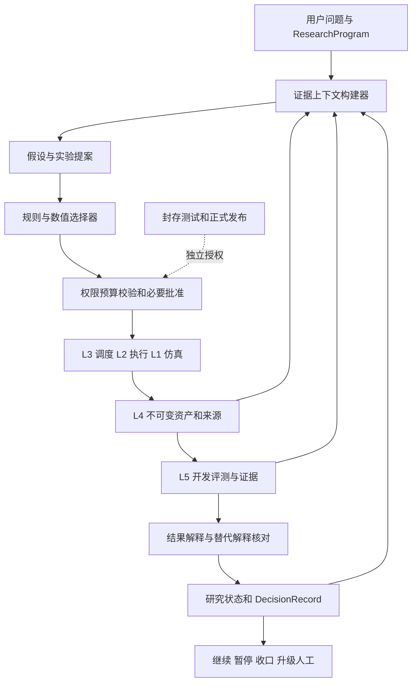

# 05 Lesson 05 Research Agent 与自适应实验决策

> 来源：[ChatGPT Space 原页](https://chatgpt.com/space/page_50ad9569c65881919236d6d80d2ab5fd) · 页面序列 1 · 导出日期 2026-11-06（Asia/Singapore）
> 本文件为阅读副本：正文保留，已知空间内链接改为本地文件。原始正文见 [originals](../originals/lesson_05_research_agent.md)。

---

本课承接 [第四课 模型评测与证据体系](lesson_04_evaluation_evidence.md)，设计 L6 Research Agent 如何使用前五层选择、组织和解释下一轮实验。核心不是让大模型连续调用训练脚本，而是让研究问题、竞争性解释、实验决策、证据变化与停止原因都有可追溯记录。

**建议将 Research Agent 定义为受实验协议、证据和预算约束的研究决策层。LLM 可以提出解释与方案，数值工具负责计算，运行时负责权限与资源，L5 负责评测和限定用途的验收。**

版本 0.1，2026-11-06。本文为课程与架构建议；文中的风力兽失败现象是教学假设，不是本轮新发现或实跑结果。本文不修改仓库、不启动训练，也不代表用户已逐项批准新增设计。统一入口见 [研究目录](space_directory.md)。

# 1 原始设计 为什么自动调参还不是完整研究

最简单的闭环是“选参数 → 训练 → 评测 → 选择更好的参数”。这已经可以有自适应能力，不需要每一轮都调用 LLM。Ax 官方文档提供 ask–tell 模式，也提供通过 Runner 与 Metric 对接执行、取回观测和继续生成候选的编排模式。[Ax 官方文档](https://ax.dev/docs/tutorials/automating/)

在 Beest 中，我们建议区分四种任务，而不是把它们都命名为寻找最优模型。

| 任务 | 需要作出的决策 | 适用方法 |
|---|---|---|
| 参数优化 | 固定目标下哪个参数更好 | 随机搜索、CMA-ES、贝叶斯优化 |
| 数据选择 | 下一批采集或仿真哪些条件 | 覆盖采样、主动学习、实验设计 |
| 机制辨别 | 哪个实验能区分失败的不同解释 | 对照、消融、可辨识性分析 |
| 研究管理 | 当前应核查数据、复验、改模型还是停止 | 规则、研究状态机、LLM 提案与人类审查 |

这是一种本项目的职责划分，不是排他的学科分类。一个优秀的数值实验设计器也能完成机制辨别；一个 LLM Agent 也可能只做参数搜索。研究能力取决于问题与验证方式，不取决于是否使用 LLM。

我们的 L6 应同时支持两条路径：**改进可用模型**与**减少对现象的疑惑**。证明一个改进无效、发现模拟器缺陷、明确目前数据无法辨识原因，都可能是有价值的结果；不能把“产生正向指标提升”作为所有研究轮次的唯一奖励。

## 1.1 贯穿案例

教学假设：某个冻结模型在开发集上一步误差尚可，但阵风突变后自由滚动误差明显增加。原始轨迹、模型制品和 L5 结果都可访问。

错误反应是直接增加 Transformer 层数。合理起点是提出不同解释，并先核对观测本身。

| 候选解释 | 可以区分它的实验 | 结果解释的边界 |
|---|---|---|
| H0 时间或风场输入未对齐 | 核对原始时钟、重采样、因果特征与输出时间；受控错位测试 | 工程检查先于模型归因 |
| H1 历史信息不足 | 同模型族不同历史长度、容量和计算控制；必要时比较可观测状态与额外状态 | 有历史更好不自动证明物理系统具有某一种记忆机制 |
| H2 训练目标与自由滚动不匹配 | 固定观测和数据，比较一步目标与规定的多步目标 | 改善说明方案在范围内有效，不是唯一原因证明 |
| H3 训练分布缺少阵风过渡 | 固定总样本或明确新预算，对照补充过渡数据与等量随机补充 | 不能仅因多用了数据就归因过渡采样 |
| H4 参考模拟器或记录有问题 | 时间步收敛、记录覆盖、适用范围内独立核对 | 模拟器之间一致仍不等于实物验证 |

这些解释可以同时成立，不应强制设为五个互斥类别。还要保留未列出的解释和噪声、计算预算、可观测性等干扰因素。

# 2 数学原理与机制 怎样选择下一轮实验

## 2.1 把假设写成可以遭遇反例的对象

建议一个 Hypothesis 至少保存：解释的现象与观测引用、适用工况、机制陈述、成立时预期看到的差异、削弱它的结果、潜在混淆因素、可执行的对照，以及当前证据状态。

“加历史可能更好”过于模糊。更可执行的表达是：“在指定开发数据、相同未来信息权限和既定预算下，增加历史的受控变体应在阵风后滚动误差上产生超过预先约定实用幅度的改善；若差异不稳定，或提升完全可由容量对照解释，则本次证据不支持将改善归因于历史。”

判定规则应允许 supported_in_scope、weakened_in_scope、inconclusive 与 needs_revision。没有显著改善不等于证明没有任何效应；程序失败也不是该科学假设被否定。

## 2.2 优化价值 信息价值与决策价值

优化实验问的是“谁更好”；辨别实验问的是“哪些解释更符合观察”。高不确定性区域也未必值得测量，例如噪声大但无法减少的区域，或者与当前决策无关的物理量。

在能够定义概率模型时，可以用贝叶斯实验设计表达信息价值。设 D 为已有证据，e 为候选实验，Y 为未知结果，Φ 为关心的参数或解释组合：

```math
\operatorname{EIG}(e\mid D)=\mathbb{E}_{Y\sim p(Y\mid e,D)}\left[D_{\mathrm{KL}}\big(p(\Phi\mid D,e,Y)\,\Vert\,p(\Phi\mid D)\big)\right].
```

它衡量实验前后对 Φ 的预期认识变化，而不是模型最终分数。这一框架要求可说明的先验和结果模型，并可能有很高的计算成本；模型设定错误也会影响选择。[Modern Bayesian Experimental Design](https://arxiv.org/html/2302.14545v2)

在本项目中，首版不要求计算通用 EIG。建议先用明确的提案排序规则：先处理阻断结论的数据质量问题，再比较实验能否区分关键解释、是否可辨识、是否与目标相关，以及成本和实施可行性。优先采用不能同时被所有解释轻易解释的结果。

不能让 LLM 写出“信息增益 0.93”就把它当作算出来的量。无概率模型时保存定性排序、依据、未知项与备选方案；有可靠生成模型时，再通过数值工具估计 EIG、预测性能收益或其他任务相关效用。信息价值与性能收益的单位不同，不直接任意加权成一个貌似精确的总分。

## 2.3 计算交给适当的方法

连续超参数优化可调用已有优化器；固定设计族中的采样可调用覆盖策略或主动学习；校准问题可调用参数后验与可辨识性分析。LLM 主要负责把研究意图转换为可执行提案、枚举替代解释、识别欠缺证据和解释有来源的结果。

Ax 的 Generation Strategy 将候选生成方法及其切换条件表达成状态机，是“研究决策策略与执行器分离”的一个参考，而不意味着要照搬它的整个领域模型。[Ax Generation Strategy](https://ax.dev/docs/generation_strategy/)

对复杂方案也可以维护候选分支。AI Scientist-v2 使用实验管理 Agent 与渐进式树搜索组织探索，提供了分支式实验管理的实例；这一实现不能单独保证 Beest 的物理证据、数据隔离或研究结论正确。[原论文](https://arxiv.org/abs/2504.08066)

## 2.4 外层研究循环与内层执行图

L6 的循环是“证据 → 提案 → 选择 → 解释 → 下一轮”；L3 的 Job DAG 是某一轮已批准方案的计算依赖图。它们不是同一个循环。

```text
ResearchProgram 维护长期问题与总预算
    ↓
ResearchCycle 冻结本轮可见证据
    ↓
Hypotheses → 候选 ExperimentProposals → DecisionRecord
    ↓
策略校验与必要的人类批准
    ↓
Experiment 协议 → L3 编译 Job DAG → L2 执行
    ↓
L4 保存产物 → L5 计算指标和整理证据
    ↓
更新研究状态 → 下一轮 或 暂停 或 收口
```

旧实验协议、已完成 Run 和原始证据不随新结论被覆盖。允许按事先批准的自适应策略追加 Trial，但要保存生成策略版本、已见数据和选择原因。新科学变量或评测定义改变时产生新版本，不能伪装成执行重试。

## 2.5 事件驱动与研究状态恢复

建议 ResearchCycle 使用 drafting、awaiting_approval、submitted、waiting_results、analyzing、concluded、blocked、cancelled 等状态。Job 完成、评测产物提交、数据质量告警、预算触底或人工反馈可以触发一次决策；训练运行期间由调度器维护进度，不要求 LLM 反复轮询和重新规划。

持久化内容是已批准提案、证据视图、关联 Experiment/Job、待到达结果、预算与公开决策理由，而不是依赖一段越来越长的聊天上下文。重启后先查询已有提交，不能直接再次启动训练。

同一事件与提案提交需要幂等身份。重复事件只能更新一次本轮状态；统计复验需要显式 purpose、种子与独立重复身份，不能被参数相同的去重规则吞掉。异步并行候选还要记录 pending 集合，避免把尚未返回结果的方案当作从未提出过。

# 3 设计局限 自动研究最容易在哪些地方失真

## 3.1 解释流畅不等于来源可信

Agent 的报告必须区分 Observation、Hypothesis、Decision 和 Claim。Observation 指向数据、指标或已有文献；Hypothesis 是待检验解释；Decision 是下一步选择；Claim 则绑定 L5 的范围化证据。一个来源被反复转述不会变成多份独立证据。

原始工具返回、日志、论文和检索片段都作为数据处理，不能授权修改权限、删除实验或读取封存测试集。所有数字应来自可定位的计算产物；缺失字段保持未知。LLM 审查意见可以帮助找缺口，但多个 Agent 赞同同一个解释不等于获得独立验证。

## 3.2 评分器和实验代码必须有权限边界

Agent 可以在授权实验区调整模型或提出代码补丁；不能同时自由改模型、测试数据、评分器和通过门槛。实际执行应使用隔离工作区、只读的输入快照、固定身份的评测器，以及受控的工具入口。提示词里的“不要修改测试”不是这种隔离的替代。

若确实发现评测器或模拟器缺陷，走独立的修复提案：记录问题，审查补丁，给出新实现身份，再复跑受影响比较。旧结果保留并标为待复核，不能为了让当前候选通过而偷偷改变规则。

## 3.3 测试反馈与知识记忆也会泄漏

沿用 L5 的 development 与 sealed test 分离。L6 默认只接收开发反馈；封存测试的授权、运行和披露由独立流程控制。最终测试结果一旦用于下一轮方案选择，记录曝光并重新安排独立确认。不能通过报告摘要、缓存或记忆检索绕过同一限制。

公开仓库里名为 blind 的文件不是天然保密的数据；允许任意读仓库和执行 Shell 的 Agent 可能访问它。首版可以做接口限制与功能测试，但严格封存需要独立评测工作区和权限隔离，且仍需考虑公开数据或历史结果的既有曝光。

## 3.4 自适应选择和提前停止需要保持统计语义

探索阶段可以根据开发结果分配预算，但不能将不断试错后最漂亮的一次当作未经选择的确认实验。确认阶段冻结候选、主指标、重复数量或有效的序贯分析政策。优化用的 Trial 提前终止可以节约成本，但用于解释机制的对照不能仅因暂时分数差就被单边删掉。

记录无效、失败、中止、未决和否定性结果；不能把“找到正结果”设为唯一停止条件。没有可行的区分实验时，正确输出是当前数据不足、需要何种观测，而不是继续换提示词直至出现肯定答案。

# 4 改进思想 受控的 Research Agent 架构

## 4.1 单控制器起步 职责可拆 权限独立

建议首版采用一个研究控制器，配合上下文构建、方案生成、选择、分析和记忆模块。必要时把提案、批评和数值分析分开，但不预先组建一整套多 Agent 科研组织。真正需要独立的是评测权限、发布权限与预算控制，未必是模型数量。



六层分工：L1 提供领域能力；L2 执行具体任务；L3 保证调度、幂等、资源和可靠提交；L4 保存对象与来源；L5 输出可核查的评测和声明；L6 提出下一步研究决策。预算账本、权限校验和最终写入不由 LLM 自己维护。

## 4.2 最小持久化对象

| 对象 | 必需内容 | 与前几课关系 |
|---|---|---|
| ResearchProgram | 长期问题、范围、阶段、总预算、授权策略、停止政策 | 可包含多个 Experiment |
| ResearchCycle | 本轮证据快照、候选、选定提案、执行引用、结果解释 | 一次外层决策与观测过程 |
| Hypothesis | 现象、预期、反例、适用条件、混淆因素、证据状态 | 与 Claim 分离 |
| ExperimentProposal | 目的、控制与干预、数据与模型引用、预期模式、成本、停止条件 | 审批后形成 Experiment 或受控扩展 |
| DecisionRecord | 备选方案、简要选择理由、证据引用、未知项与决策版本 | 不要求保存模型内部思考过程 |
| AuthorizationRecord | 授权主体、提案或策略哈希、资源上限、对象范围、期限 | 由运行时验证，不由 Agent 自签 |

EvidenceView 是本轮允许看到的证据清单，可作为 ResearchCycle 的嵌入式字段，无需独立服务。BudgetLedger 复用 L3 的持久化账本。不要再造互不关联的 Run、日志或资产系统。

## 4.3 记忆按研究问题组织

建议保留三层记忆。第一层是原始来源、指标和产物，带稳定引用；第二层是当前假设、已批准方案、证据依赖和未解决问题；第三层是可检索的总结、历史教训和操作经验。总结只是索引，不能替代底层证据。

Context Builder 每轮取当前问题范围内的现象、正反证据、近期失败、约束和未决项，并保留来源版本。不能只召回支持当前假设的材料。上游测量、模拟器或评测实现失效时，沿依赖关系将相关解释与 Claim 标成 needs_review；不能继续使用旧摘要作为有效事实。

假设状态是可修订视图，研究事件与原始记录追加保存。新来源推翻旧解释时保留变化原因，而不是让知识库看上去从未判断错误。

## 4.4 权限与预算应如何实现

首版建议采用“提案审查后执行”：只读检索、草拟解释可自动；耗预算任务先审批。在验证机制后，允许用户授予有期限的任务级授权：限定实验类型、参数范围、数据域、工具、计算与 API 成本上限。无需每个低风险工具调用都人工点击。

| 动作 | 建议授权 |
|---|---|
| 查询已许可的开发轨迹和结果 | 自动，只读审计 |
| 在白名单范围内提出和比较方案 | 自动生成草稿 |
| 执行获批的开发实验 | 策略与预算校验后执行 |
| 改模型代码或新建数据生成逻辑 | 隔离分支、补丁与依赖检查，按策略审查 |
| 改评分器、门槛、封存数据访问 | 独立审查和协议版本 |
| 操作实体设备、外部发布、扩大付费预算 | 明确人工授权及相应安全流程 |

授权绑定提案内容哈希或自适应策略与范围，而不是一个可重用的 approved=true。修改代码、数据域或资源边界超出范围后，旧授权失效。权限检查位于工具网关与调度层；更换提示词、重启会话或增加子 Agent 不应扩大权限。

预算需要跨研究轮次、会话、重试和并行分支持久化。运行前原子预留，运行中检测，结束后按实际消耗结算，未用预留释放。失败尝试和 LLM 调用也计费；到期或达到上限进入停止流程。终止存在实际延迟，应记录潜在超额窗口，不能只凭预检查承诺零超额。

## 4.5 工具协议和 Skills 的分工

建议对 L6 提供能力受限的接口，例如查询证据、提交提案、查询实验、请求取消、记录决策、请求人工测量。执行层接收结构化、版本化参数，不直接相信自然语言报告中的文件路径与分数。

可把假设检查、实验设计、失败归因、结论范围检查封装为 Skills；它们决定工作方法，不能承担真正的安全边界。额度、授权、数据隔离、不可变版本和发布门禁由程序强制执行。

需要新分析代码时，可委派一个受限的 Coding Agent 生成补丁和测试；不能因此把整个系统转回软件交付主线。研究控制器仍负责说明该代码要验证哪个问题，评测器身份保持独立。

## 4.6 停止也是一种研究决策

首版至少支持 budget_exhausted、objective_addressed、no_discriminating_experiment、requires_external_measurement、reference_unreliable、repeated_execution_failure、human_cancelled 等停止或阻塞原因。若使用“连续若干轮无收益”，轮数、收益定义与判定方式应预先配置，不能随结果改动。

一份有效的收口记录应写清：哪些问题得到范围内证据、哪些未解决、为何继续试验暂时价值有限、需要补充什么数据，以及哪些历史结论待复核。负面结果和 INCONCLUSIVE 都可以是正常出口。

# 5 实验验证 用风力兽走通一轮 并评测研究控制器

## 5.1 教学案例的完整一轮

以下是条件式演练，没有新实跑数字。

开始时，Agent 从 L5 开发结果定位阵风后误差增大的 episode，并同时检索稳定风场对照。它建立 H0–H4，而不是直接把误差归因于模型容量。第一批任务核对时间对齐、观测权限、参考审计和简单基线，避免在错误数据上继续训练。

若发现时钟错位，生成数据处理修复提案、新 ProcessingRun 与新 Snapshot；所有方法在相同新版本上重新比较。旧结果保持可读，并撤回依赖错误对齐的解释。

若前置检查未发现问题，下一轮可以选择历史长度对照：固定数据和可见未来信息，明确容量与计算预算对照，用已确定的开发 Suite 测量阵风前后分时段结果。提案提交前写下支持、削弱与不确定三类结果如何解释。

若历史变体稳定改善而容量对照不能解释全部收益，只能表述“在此范围内，历史信息对预测有贡献”；不能直接宣称已发现真实风力兽的某种内部记忆机制。若差异不稳定，保留未决状态，按预算判断增加独立重复是否有价值。若所有变体仍失败，考虑多步训练目标或数据覆盖；如果独立核对不足，则暂停物理结论并请求补证。

确认某个工程方案时，再冻结候选交给 L5 的独立确认流程。最终反馈如用于新一轮开发，标记其曝光。新模型进入发布候选与允许部署是两个步骤。

## 5.2 研究 Agent 自身也需要评测

不能用报告长度、想法数量或实验运行次数当作主要成功标准。建议同时检查研究有效性、证据纪律与资源效率。

MLAgentBench 将读取文件、修改代码、运行实验和检查结果纳入机器学习实验任务，适合作为执行与迭代能力参考。[MLAgentBench](https://proceedings.mlr.press/v235/huang24y.html)

ScienceAgentBench 使用来自论文的研究任务，检查程序、运行结果与成本，可补充评测数据分析任务。它不能单独证明 Agent 会做风力兽物理验证或选择高信息量实验。[ScienceAgentBench](https://proceedings.iclr.cc/paper_files/paper/2025/hash/f12b4df26344f3be803c06b555252efe-Abstract-Conference.html)

本项目建议另设 prospective 研究任务：冻结开始时可见的真实项目材料、动作权限和预算，再让不同策略推进。以固定专家计划或规则流程为主基线；在相同参数搜索子任务上比较随机搜索、CMA-ES 或贝叶斯优化；不要用只能调参数的基线去比较权限更大的全研究任务。

总成本包含提案、代码生成、审查、训练、仿真、评测与失败重试，分别报告计算、LLM、墙钟和人工介入，不把它们无单位地混成一个分数。比较多次独立研究会话，保存搜索轨迹和未完成任务。只挑最好一轮同样会误导。

| 指标类别 | 建议评测方式 |
|---|---|
| 结果可复核 | 方案能否在固定条件下执行并重现主要结果 |
| 声明有效 | 范围化结论是否由真实产物支持，是否保留反证与局限 |
| 决策价值 | 是否选择能排除关键解释或改善既定用途的实验 |
| 成本 | 达到可复核结论所需预算、时间与人工介入 |
| 约束执行 | 越权、超预算、重复提交和测试污染是否被拒绝 |
| 正确停止 | 证据不足或缺测量时是否停在正确状态，而非伪造结论 |

没有可靠真值的科学问题不能凭一个 LLM 裁判给“发现正确率”。可先对已知故障与具有明确参考的任务使用客观指标，对开放解释用盲审量表和来源审查，保留审查分歧。

## 5.3 三类验证材料分开记账

第一类是故障注入与确定性测试，用于验证权限、幂等、状态与计费，明确标成工程样例。第二类是项目既有真实执行轨迹与历史问题，做材料截断后的诊断回放；公开历史可能已被模型见过，不能把回放当作完全独立的新发现。第三类是前瞻性的新实验，使用真实可追溯输入、冻结协议和独立确认，才用于检验新的研究价值。

生成的仿真数据仍然是仿真数据。现有实测不足时，执行器可以验证软件链路，Agent 应产出 MeasurementRequest，写明待测物理量、工况、误差要求与它能区分的解释；它不能把新模拟数据改标为实测，也不能越权驱动设备。

# 6 现有代码映射与迁移建议

本轮静态读取了以下文件；文件身份是 blob SHA，不是整个仓库 commit，未运行仓库测试。

| 入口 | 已看到的能力 | L6 接入边界 |
|---|---|---|
| docs/AGENT-TOOLS.md | 类型化工具、四种权限、审计；说明会话预算及单进程限制 | 复用入口，增加长期研究状态与持久化预算 |
| packages/agent/src/strandbeest_agent/registry.py | Session、Budget、Registry.call；调用前权限与预算检查 | 不把会话对象当作长期授权与成本账本 |
| packages/agent/src/strandbeest_agent/bench.py | 可见场景工具限制、设计盲测与搜索基线 | 设计优化基准不等同 Research Agent 基准 |

[工具文档](https://github.com/meiluosi/strandbeest-evolution/blob/main/docs/AGENT-TOOLS.md)记录预算在进程重启后重新计数；[registry.py](https://github.com/meiluosi/strandbeest-evolution/blob/main/packages/agent/src/strandbeest_agent/registry.py)的已读路径在 handler 正常返回后才累加耗预算工具的运行次数和耗时。因此新长期研究流程需要结算失败尝试与在途预算，不能只继承成功调用计数。该观察针对已读路径，不是对整个仓库的安全认证。

[bench.py](https://github.com/meiluosi/strandbeest-evolution/blob/main/packages/agent/src/strandbeest_agent/bench.py)从包内文件读取 blind 场景，其工具白名单不能被当作任意代码执行环境下的保密保证。隔离评测工作区是新增约束，不要仅修改工具描述就声称完成。

建议新增 research 模块保存研究对象、上下文构建器、提案与决策控制器，并通过接口调用 L3、L4、L5。继续使用现有 Schema、资产身份、操作日志、证据和工具注册机制。不要在 API、MCP 和 LLM 会话中分别维护三个互相矛盾的预算与实验状态。

文件身份：AGENT-TOOLS.md 为 d1f066972611b77acd559a9eebff3fd35a559898；registry.py 为 b84bad6747d19fd6a527d6892b50873ca5048d4e；bench.py 为 9155f8052b8ceecc1474c9f9c28c8b35cb4a6a8d。后续开发前需重新核对默认分支与实际调用路径。

# 7 开发交接附录

## 7.1 ExperimentProposal 草案

以下 YAML 是待实现契约示例，不是已存在 API，也不授权实际执行。null 表示必须绑定真实资产或明确审批；缺少必需项不得提交。

```yaml
schema_version: 1
proposal_kind: controlled_comparison
stage: development
research_program_ref: null
research_cycle_ref: null
question: 历史信息是否改善阵风后长期预测
hypothesis_refs: []
evidence_view:
  artifact_refs: []
  exposure_class: development
  source_validity_checked: false
experiment:
  dataset_snapshot_ref: null
  evaluation_suite_ref: null
  model_spec_refs: []
  control: 无历史变体
  treatment: 有限历史变体
  fixed: [数据切分, 未来信息权限, 评测时长和指标]
  capacity_control_ref: null
  budget_matching_rule: null
  replication_plan_ref: null
interpretation:
  supports: 改善超过预先约定实用幅度且容量对照不足以解释全部差异
  weakens: 精度足够的对照排除约定幅度的收益或表明容量变化可解释改善
  inconclusive: 差异不稳定或参考不可靠或区间精度不足
  no_claim: 不直接推断真实物理记忆机制
resources:
  compute_limit_ref: null
  llm_limit_ref: null
  wall_time_limit_ref: null
  shared_budget_ledger_ref: null
execution:
  proposal_hash: null
  authorization_ref: null
  idempotency_key: null
  allowed_tool_set_ref: null
  code_change_policy: review_required
stop_policy_ref: null
```

提案引用的 EvaluationSuite 负责指标和统计政策，避免重复定义两套互相冲突的门槛。若实验目的、资源或可见信息改变，重新生成提案身份并检查授权。

## 7.2 故障与验收矩阵

| 验收项 | 注入或检查 | 期待结果 |
|---|---|---|
| 来源真实性边界 | 报告中引用不存在的结果或错版本文件 | 不进入已支持 Claim，给出缺来源原因 |
| 幂等恢复 | 同一完成事件重复到达，或提交后失去响应 | 查询既有状态，不重复启动训练 |
| 复验身份 | 相同配置但明确新增独立种子 | 保留为计划内新 Trial，不被错误去重 |
| 预算跨会话 | 重启控制器，或创建子 Agent | 共享剩余额度不重置 |
| 失败成本 | 仿真或训练消耗后异常退出 | 实际成本进入账本，失败记录保留 |
| 批准绑定 | 批准后改变数据域、代码或预算上限 | 旧批准失效或被策略拒绝 |
| 评分隔离 | 实验代码尝试修改指标实现或访问封存输入 | 执行边界拒绝并记录 |
| 负结果保留 | 无改善或无法区分的结果 | 正常记账，不删除、不伪造成功 |
| 记忆失效 | 上游模拟器或标定证据被撤回 | 依赖解释转为待复核，旧历史仍可读 |
| 证据不独立 | 两份报告引用相同 Run | 不重复计作独立证据 |
| 正确停止 | 不存在许可范围内的区分实验 | blocked 或 inconclusive，并列补证需求 |
| 信息权限一致 | 某变体读取未来风或额外内部状态 | 拒绝比较或明确另立评测轨道 |

## 7.3 实施顺序

先做只读研究助手：从已冻结轨迹和评测生成有引用的假设、候选实验和 DecisionRecord，不自动运行。再接提案审查后的单轮执行，跑通从协议到 L5 结果的可恢复链路。最后才开放限定范围、限定轮数和预算的自适应研究循环。

首轮不以多 Agent、论文写作、通用自主科学家或实体设备自动执行为验收目标。先证明同一问题中它能提出可执行对照、使用真实结果修订判断、遵守限制并正确停止。

## 7.4 会话上下文与状态

用户已确认：以现有 strandbeest-evolution 为基础，保留风力兽设计、演化、仿真、制造与实测特色；发展六层模型实验 Harness；遵循研究问题优先、结果可追溯可复现、AI 加速而证据需把关三原则；每课在本 Space 保存，供其他 Agent 后续实施。本会话继续架构研究，不直接修改代码。

本课新增建议：L6 作为受约束的研究决策层；区分优化、数据选择、机制辨别和研究管理；一个持久化 ResearchProgram 组织多个决策轮次；支持数值实验设计但不伪造概率；单控制器起步；独立评测与授权边界；跨轮预算与状态；以证据价值及正确停止评估 Agent。这些详细设计仍需后续实现与测试。

下一课整合六层为系统开发蓝图：模块和进程边界、Schema/API、UI 旅程、存储与迁移、任务拆分、端到端验收。模型、数据、调度、评测与 Research Agent 的实际实现状态应逐项列出，不能用课程完成替代工程验收。

# 参考资料与适用范围

[Modern Bayesian Experimental Design](https://arxiv.org/html/2302.14545v2)用于说明期望信息增益及其建模前提；[Ax 编排](https://ax.dev/docs/tutorials/automating/)与[候选生成策略](https://ax.dev/docs/generation_strategy/)用于说明数值自适应实验接口；[AI Scientist-v2](https://arxiv.org/abs/2504.08066)用于说明分支式实验管理；[MLAgentBench](https://proceedings.mlr.press/v235/huang24y.html)与[ScienceAgentBench](https://proceedings.iclr.cc/paper_files/paper/2025/hash/f12b4df26344f3be803c06b555252efe-Abstract-Conference.html)用于研究 Agent 评测参考。它们不是本项目已经具备这些能力的证据，也不是对截至今日全部自动科学研究的穷尽综述。
