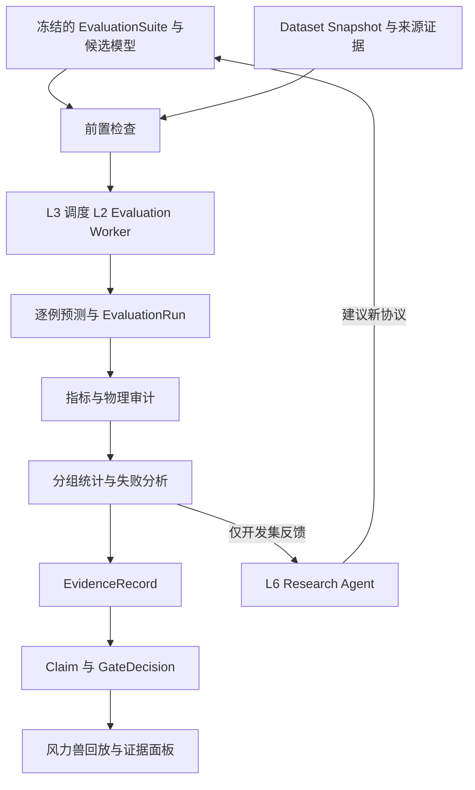

本课承接 [Lesson 03 数据与模型生命周期](https://chatgpt.com/space/page_6aeca3d3ccec8191a6020c75d829be68)，设计六层架构中 L5 Evaluation and Evidence 的职责、评测协议与结论边界。贯穿案例仍是风力兽学习型动力学模型。

**核心结论：评测不仅产生分数，还应给出适用范围、失败情况、统计不确定性和支持某项声明的证据。运行成功、指标改善、物理核对通过、真实世界验证是四件不同的事。**

版本 0.1，2026-11-05。课程与建议规格已形成；新增架构尚待实施和验收。本文不包含新模型实跑结果，不修改 GitHub 仓库，也不把建议记为用户已经批准的实现决策。

# 1 原始设计 从一个分数到一个可检验问题

最简单的评测是加载权重、读取测试数据、计算 MSE，然后宣布低分模型更好。它只能回答某个数据和指标下的问题，不能直接回答长期预测、设计筛选或真实部署是否更好。Lambert 等的研究指出，一步动力学预测目标与下游控制性能可能不一致。[原论文](https://proceedings.mlr.press/v120/lambert20a.html)

本课采用更明确的问题：**在冻结的数据、观测条件和训练预算协议下，加入有限历史的预测器，是否比无历史预测器和简单运动基线具有更好的长时预测表现？这种差异能否在未见风场中维持？**

要检验历史的作用，主比较应是同一模型族的有历史与无历史变体，并记录容量和计算量的变化；MLP、GRU、Transformer 横向比较可以作为附加工程比较，但不能单独归因于历史或模型规模。第一课用不同架构、近似相同参数量描述“模型规模问题”的示例需要据此澄清：研究容量应固定模型族改变规模；研究架构应明确预算与输入信息的比较口径。

## 1.1 先定义允许得出的声明

| 目标声明 | 必须提供的证据 | 不能自动推出 |
|---|---|---|
| 更接近指定模拟器 | 固定模拟器版本、留出轨迹和独立评测 | 更接近真实世界 |
| 长期预测更稳定 | 自由滚动、误差曲线、失效时间和失败率 | 更适合所有控制任务 |
| 能迁移到新风场 | 预先留出的风场族或参数区间 | 能迁移到新结构或真实设备 |
| 可辅助筛选设计 | 固定候选池、独立复核与排名表现 | 已找到物理最优设计 |
| 在真实设备上有效 | 可追溯测量、标定、留出与明确工况 | 任意设备和场景均有效 |

“不再只是记忆统计规律、已经懂物理”不是可直接验收的字段。我们检验可观察的预测与迁移能力，尝试排除具体的简单解释，而不是用一次基准宣布获得了普遍物理理解。

# 2 数学原理与机制 怎样构成有效评测

## 2.1 冻结问题和协议

每次正式比较应绑定候选模型制品、数据 Snapshot、观测契约、评测代码身份、基线、预测时长、场景切片、统计方法、失败政策、资源计量与测试查询记录。接受门槛必须在正式测试前有来源和版本；尚无依据的门槛保持未设置，发布判断为 INCONCLUSIVE，而不是填一个方便通过的数。

预算要明确是相同训练样本曝光、相同更新次数、相同估计 FLOPs，还是相同设备时长。它们不等价，也通常不能同时严格相等。固定主比较口径并报告其他成本；训练与调参成本、模型加载与预热成本分别记录。比较历史输入时还要固定可用信息边界。

## 2.2 一步预测与自由滚动必须分开

设状态为 s，外部条件为 c，设计参数为 d，真实可操纵动作存在时才记为 a。对被动风力兽，风是外部驱动，不是控制器自主选择的动作。

一步评测每次从参考轨迹中的实际状态预测下一步；自由滚动只用起始观测初始化，后续把模型自己的预测作为下一步输入。二者的差别正是误差是否会在预测循环中积累。Talvitie 分析了模型误差反复组合的问题；GNS 工作也将长时滚动及累积误差处理列为重要内容。[Talvitie 2017](https://ojs.aaai.org/index.php/AAAI/article/view/10850) · [GNS 2020](https://proceedings.mlr.press/v119/sanchez-gonzalez20a.html)

```math
\hat{s}_{t+1}=f_\theta(s_t,c_t,d),\qquad
\hat{s}_{t+h+1}=f_\theta(\hat{s}_{t+h},\tilde c_{t+h},d)
```

如果采用历史窗口或递归隐藏状态，上式只是简写。窗口更新和隐藏状态重置规则也属于评测协议。不得在自由滚动中偷偷用参考状态、参考接触标签或未来观测纠正模型。定期重新观测是另一种合法任务，但应单独命名为重观测预测，不与自由滚动混报。

未来风场必须显式区分：**给定未来风场的条件预测**，与**只使用当时可获得信息的运行预测**。前者可用于隔离动力学误差，不代表实际运行时拥有未来风场；后者需要保持、预测或采样未来风，且把该方法固定。不同方法不能享有不同的未来信息。

预测时长使用秒，并同时保存采样间隔与步数。示例时长可取 0.1、0.5、1、2 秒，但这只是协议起点，必须根据轨迹长度、步态周期和用途确认，不能作为已验证门槛。

## 2.3 误差指标必须有单位和聚合口径

位置用米、角度用弧度、速度用米每秒分别报告。角度误差采用周期距离，避免把跨越零点的微小转动判成巨大误差。

```math
d_\theta(\hat\theta,\theta)=\operatorname{atan2}\big(\sin(\hat\theta-\theta),\cos(\hat\theta-\theta)\big)
```

跨变量汇总时使用预先冻结的权重与尺度。尺度 q_j 可以来自训练集统计或外部物理参考，并设置事先定义的正下限；不得用测试集重新拟合尺度。下式定义到 H 步的累计滚动误差，终点误差应作为另一指标独立保存。

```math
E_{i,H}=\frac{1}{H}\sum_{h=1}^{H}\sum_{j=1}^{p}w_j\left[\frac{d_j(\hat s_{i,t+h,j},s_{i,t+h,j})}{q_j}\right]^2,
\qquad \sum_j w_j=1,\quad q_j>0
```

先按独立轨迹汇总，再按设计、场景切片和训练重复汇总，保存每层权重。否则一条更长或采样更密的轨迹可能支配平均值。主指标之外，保留不同预测时长误差、尾部误差、数值发散率、首次超出容忍带的时间、事件时间误差和完整预测覆盖率。

归一化与有拟合参数的预处理只能在训练集拟合，再应用于验证和测试集。这与 scikit-learn 的防泄漏建议一致。[官方文档](https://scikit-learn.org/stable/common_pitfalls.html)

## 2.4 基线 消融和场景切片

建议先比较保持当前状态、恒速或恒角速度、简单线性动力学、无历史学习器和带历史学习器。已有简化物理模型可作为额外基线，但输入信息、适用范围和计算成本必须公开。若某模型访问模拟器内部完整状态，而另一个只访问可部署传感器观测，应分成不同评测轨道。

消融可检验移除历史、风场输入、设计参数或某项约束后的变化。为了研究模块贡献，应重新训练对应变体；仅在测试时删除输入衡量的是缺失输入鲁棒性，不等同于训练消融。改变多个因素的比较只能支持整个方案的差异，不能直接归因某一个因素。

| 切片 | 留出方式 | 主张边界 |
|---|---|---|
| 同分布 | 按完整 episode 分组；禁止把同一轨迹的窗口分到不同集合 | 相同生成分布下的预测 |
| 风场迁移 | 留出风场族或参数区间 | 该风场范围内的泛化 |
| 结构迁移 | 留出设计族及其近重复或派生版本 | 该结构分布上的迁移 |
| 参数扰动 | 预先指定摩擦、质量、噪声范围 | 这些扰动下的鲁棒性 |
| 跨求解器 | 相同工况、语义对齐并记录共享实现 | 模型间一致性，非实物真值 |
| 真实测量 | 按实体、采集批次或工况独立留出 | 对应被测量与工况的验证 |

Design ID 不同不足以证明结构独立；同一设计的缩放、镜像、微小编辑可能仍是近重复。跨后端对照也不天然独立：共享几何、数据处理或假设必须登记。不同求解器的差异既可能来自学习模型，也可能来自接触定义与物理假设；不能不经对齐就归因。

## 2.5 多种子统计不能把每一帧当独立重复

设 e(c,s,g) 为条件 c、训练重复 s、测试独立组 g 的误差。可先在相同测试组上比较候选与基线，再对组与训练重复汇总。相同 seed 整数不意味着不同架构具有相同初始化，只能按预先规定的配对设计解释。

训练重复和测试设计组通常是交叉因素，不可把所有 seed × 窗口的数当作独立样本。固定 checkpoint 的区间可以只针对测试组抽样；方法级区间还应考虑训练重复，使用与数据层级匹配的分组或多层统计方案。重采样保持配对关系，不拆散相关帧。[Agarwal 等 2021](https://proceedings.neurips.cc/paper_files/paper/2021/hash/f514cec81cb148559cf475e7426eed5e-Abstract.html)说明少量训练运行下仅比较点估计可能误导，支持同时报告区间和结果分布；它不直接替本项目决定抽样单位。

三个种子可用于链路预检，但不是“证明可靠”的通用数量。正式数量需由预实验方差、最小有意义改进、区间精度和预算决定，并保留全部运行。重试不是新的独立重复。

建议对主指标同时报告绝对差、相对改进、置信区间和最小实用效应。基线误差接近零时相对比值不稳，应优先绝对差。存在多个指标和切片时，预先固定主检验，其余标为探索或采用明确的多重比较控制。不能先看结果再挑一个好看的 horizon。

## 2.6 物理一致性检查需要适用条件

几何闭环、接触穿透、速度位置一致性、能量账目和适用的对称性都值得检查，但只有在输出量和建模假设允许时才可计算。

风力兽是受风输入、摩擦耗散并可能储能的系统，不应要求机械能恒定。能量检查应使用明确的系统边界：

```math
r_E=E_{t+H}-E_t-W_{\mathrm{in}}+W_{\mathrm{out}}+D
```

E 包含该边界内显式建模的储能，D 为耗散；外功按符号政策登记，不能重复计入。缺少足够状态、力、储气或耗散观测时，完整能量审计为未验证，而非自动通过。MuJoCo 文档明确区分执行器、被动力与约束力，能量解释必须匹配实际模型。[官方计算文档](https://mujoco.readthedocs.io/en/stable/computation/)

构造上强制连杆闭环的模型可能天然通过几何检查，这说明结构约束成立，不证明动力学准确。永远输出静止也可能不违反某些约束，但不能解释真实行走。物理检查必须与预测和事件评测并列。

稀疏输出帧只能支持采样时刻的检查，不能证明帧间无穿透。必须记录检查频率与覆盖率。现有仓库已经记录日志采样导致审计变化的案例；不得为了得到“通过”而修改容差或漏掉峰值。[项目验证规则](https://github.com/meiluosi/strandbeest-evolution/blob/main/docs/VALIDATION.md)

## 2.7 预测不确定性与统计区间是两回事

模型的预测区间回答某次未来状态可能在哪里；性能差异的置信区间回答有限测试和训练重复下平均差异有多不确定。两者不得共用一个没有类型的 uncertainty 字段。

预测区间至少报告覆盖率与宽度，并按时长、变量和场景切片检查。把区间无限放宽可以提高覆盖率，却没有决策价值；适用时补充 CRPS、区间分数或负对数似然及其计算定义。区间校准只使用开发或专门校准集，不能用最终测试集拟合。

Kuleshov 等表明，贝叶斯预测给出的名义区间也可能失准；采用贝叶斯或集成方法并不自动保证校准。[原论文](https://proceedings.mlr.press/v80/kuleshov18a.html) 同分布校准良好也不自动覆盖新风场或新结构，需要重新检验相应切片。

# 3 设计局限 哪些好分数仍然不能相信

## 3.1 模拟器不等于实物真值

用 MuJoCo 生成训练与测试数据，检验的首先是对该模拟器的近似。换 K2 提供另一种模型证据，但共享几何与假设仍可能产生共同偏差。公开测量也要检查被测对象、标定、单位、时间同步和适用范围，不能用四连杆局部扭矩证据为整只风力兽的起步能力背书。

数学上，学习模型到现实的误差还包含模拟器到现实的误差项；即使前者对模拟器拟合极好，也不会自动消除后者。对于不完全可观测、接触敏感或存在多种合理未来的过程，远期单一路径误差还可能混合模型误差和固有不确定性，应结合分布、事件和任务相关指标。

## 3.2 执行失败 预测失败 任务失败不能混成一种

| 现象 | 类别 | 处理 |
|---|---|---|
| Worker 被终止或文件损坏 | 执行失败 | 按规则重试，保留 Attempt |
| 模型输出 NaN 或滚动发散 | 模型失败 | 计入模型失败率，不能删样本美化均值 |
| 低风速下参考走兽真实停转 | 物理任务结果 | 保留为可预测事件，不自动当坏数据 |
| 模拟器闭环破坏 | 数值有效性问题 | 隔离或降级；记录排除与参考有效性 |
| 缺实测或缺能量所需通道 | 证据不足 | UNVERIFIED，不当零误差或通过 |

所有正式报告保存计划样本数、有效参考数、模型成功数、模型失败数、执行未完成数和预先排除数。准确率或成功率必须带分母。成功样本上的误差应明确标为条件统计；正式门禁还要检查失败率与覆盖率，不能只报告幸存样本。

## 3.3 反复使用测试反馈会破坏最终留出的意义

系统分离 development 和 sealed test。前者允许 Research Agent 查看详细失败并提出改进；后者用于冻结候选后的确认，不进入同轮自动调参循环。保存查询次数、访问权限与曝光记录。若已用某个测试结果决定下一轮方案，就将其标为已暴露，后续用新的独立确认集或明确的再验证设计，而不是继续把它称作全新测试。[自适应数据分析研究](https://pubmed.ncbi.nlm.nih.gov/26250683/)

这里的隔离是一套权限与流程约束，不保证阻止有全部管理员权限的人故意取数。可信结论还依赖来源审查和行为审计。

# 4 改进思想 把 L5 建成评测与声明管理层

## 4.1 模块如何协作



L2 执行计算，L3 调度计算，L4 保存不可变产物与来源，L5 定义怎样测量、比较与作出限定声明，L6 在授权范围内提出下一轮研究。L5 不接管所有任务调度，也不让 LLM 自己写分数并宣布合格。

## 4.2 最小对象契约

| 对象 | 关键内容 |
|---|---|
| EvaluationSuite | 任务、数据引用、观测政策、场景切片、基线、时长、指标、失败与统计协议 |
| MetricDefinition | 名称、版本、单位、方向、所需通道、适用条件、聚合、缺失语义 |
| EvaluationRun | 模型与 Suite 身份、逐例预测、Job 和 Attempt、执行状态、覆盖统计、结果索引 |
| EvidenceRecord | 来源、独立性、审查者、受支持物理量、工况、时长、检查状态与局限 |
| Claim | 被声明的能力、目标对象、指标、范围、证据引用和有效状态 |
| GateDecision | 门禁版本、逐项理由、PASS 或 FAIL 或 INCONCLUSIVE、批准的使用范围 |

这些是新增逻辑对象，不要求马上拆成六个微服务。保留现有 SimulationRun 领域语义；TrainingRun、EvaluationRun 与证据资产通过引用相连。

## 4.3 四个状态轴必须分离

**执行状态**描述是否完成计算；**检查结果**描述适用检查是 passed、failed、unverified 还是 not_applicable；**证据级别**描述项目现有 E0–E3 的来源与审查范围；**发布门禁**决定是否允许某个限定用途。not_applicable 只能在前置规则确认不适用时使用，缺数据不是不适用。

现有 E0–E3 继续兼容，但不是行业统一标准，也不是模型整体理解能力的排名。数据来自真实测量，不等于模型已由真实测量验证；独立几何证据不能自动转移给扭矩或动态稳定性。

## 4.4 当前代码中需要注意的接缝

2026-11-05 静态读取的 [evidence.py](https://github.com/meiluosi/strandbeest-evolution/blob/main/packages/common/src/strandbeest_common/evidence.py) 已支持逐指标 claims，但 evaluate_evidence 顶层 level 使用各 claim 的最高等级。它的注释说明只能合并已经审查的检查，不能鉴别来源真实性。新发布门禁不能把最高等级徽标当作所有声明均满足；应对每一项必需声明逐项验收。

同文件 audit_run_evidence 把 stalled_run 列为降级原因。新的预测评测不能直接继承“停转必然无效”的解释：低风速停转可能正是任务目标。适配层应区分物理停转、数值发散、执行故障和证据不足；这是一项新边界建议，不在本课改写旧实现或历史结果。

现有 [audit.py](https://github.com/meiluosi/strandbeest-evolution/blob/main/packages/sim/src/strandbeest_sim/audit.py) 明确记录参考适用条件，并说明审计通过不自动把 E0 升成 E1–E3。这一边界应保留。

## 4.5 证据失效与回溯

发现上游模拟器、测量标定或评测代码错误时，保留历史产物与当时结果，追加失效理由和影响边，不覆盖旧记录。对依赖该来源的 Claim 标记 needs_review 或 retracted，并按修订后的 Suite 重新评测。有效性取决于具体声明和依赖，不能把新实现身份补写进旧 Run。

# 5 实验验证 先检验评测器 再评价学习模型

第一阶段用确定性小样例检验指标与流程，这些测试只验证工程机制，不作为世界模型科学结论。包括相同轨迹零误差、角度跨零点、时间错位、泄漏检测、缺失通道、重复提交、重复 Attempt 不增样本量，以及旧证据失效后门禁变化。

第二阶段使用有来源的冻结轨迹，先跑保持状态、恒速和线性基线，再接无历史与有历史学习器。仿真数据明确是模型内数据；原数据存在未解决的物理适用性问题时，可用于隔离的探索管道，但不能越过现有证据门槛发布物理或设计排名声明。

第三阶段在开发集检查链路与方差，确定正式重复数、主时长、最小实用效应和门禁。随后冻结候选，在未暴露确认集运行完整比较，报告所有失败与条件。没有实测时，真实验证部分明确未完成，不为补齐表格而制造数据或把公开示例当实测。

对被动风力兽，首个下游用途更适合“候选设计筛选”，而不是不存在的在线动作控制。固定候选池、真实仿真预算和复核协议，观察排序、前 k 个候选的独立复核表现与计算节省。只有支持可控调帆或电机变速后，才另建控制评测轨道。预测分数不能替代下游评测。[目标不一致研究](https://proceedings.mlr.press/v120/lambert20a.html)

## 5.1 用户界面保留原项目特色

在现有风力兽回放中叠加参考轨迹与模型预测，时间轴标出首次发散、落脚和停转预测偏差。点击一个异常能追溯到对应 episode、模型制品、输入快照和评测定义。旁边显示按风场或结构切片的结果以及“哪些声明有证据、哪些仍未验证”。不要只新增一个通用排行榜。

## 5.2 本课验收出口

能够从一个冻结 Suite 得到逐例预测、指标、分组统计、失败清单、证据记录和限定用途的门禁结果；能拒绝泄漏、未来信息越权、缺失审计通道和最高等级误读；能沿来源图撤销受污染声明。上述都是待实现的验收目标，不是本轮执行结果。

# 6 会话交接与下一课

已确认的用户要求保持不变：本分支研究主线 B；保留风力兽平台特色；六层架构和三项原则作为方向；每课保存到现有 Space，供其他 Agent 开发；本轮不修改仓库。

本课新增的是评测协议、范围化声明、逐项门禁与失败分类的建议规格。后续实施者需重新检查仓库当前版本，优先把这些语义映射到现有 Schema、audit 与 evidence，避免复制第二套互不兼容的证据系统。

下一课研究 Research Agent：在这些边界下如何提出可区分假设、选择下一轮实验、使用开发集反馈、控制预算，同时不能修改评分器、越过封存测试集或自行批准现实部署。

# 参考资料

[仓库验证规则](https://github.com/meiluosi/strandbeest-evolution/blob/main/docs/VALIDATION.md)、[证据实现](https://github.com/meiluosi/strandbeest-evolution/blob/main/packages/common/src/strandbeest_common/evidence.py)、[仿真审计](https://github.com/meiluosi/strandbeest-evolution/blob/main/packages/sim/src/strandbeest_sim/audit.py)。本课静态读取的文件 blob SHA 分别为 fd2efec18add19190b09b2d13357e5d389e02b57、9c65306775f0ada06af75c6d58e348cb49de1fed、9bf93116b0cade1fd95636c6852d3e320126ffd6；它们是文件身份，不是整个仓库 commit。本课未运行仓库测试。

外部方法依据分别为：一步目标与控制错配的 [Lambert 等 2020](https://proceedings.mlr.press/v120/lambert20a.html)，误差组合的 [Talvitie 2017](https://ojs.aaai.org/index.php/AAAI/article/view/10850)，学习型物理模拟的 [Sanchez-Gonzalez 等 2020](https://proceedings.mlr.press/v119/sanchez-gonzalez20a.html)，有限训练重复统计的 [Agarwal 等 2021](https://proceedings.neurips.cc/paper_files/paper/2021/hash/f514cec81cb148559cf475e7426eed5e-Abstract.html)，回归校准的 [Kuleshov 等 2018](https://proceedings.mlr.press/v80/kuleshov18a.html)，自适应复用留出集的 [Dwork 等 2015](https://pubmed.ncbi.nlm.nih.gov/26250683/)，以及 [scikit-learn 防泄漏](https://scikit-learn.org/stable/common_pitfalls.html) 和 [MuJoCo 计算文档](https://mujoco.readthedocs.io/en/stable/computation/)。这些来源支持对应的方法问题，不构成本项目新增功能已通过的证明。

# 开发交接附录 协议骨架与故障验收

以下 YAML 是待实现的契约草案，不是现有项目可运行的配置。占位引用、采样间隔、主预测时长、重复数和门槛必须在开发预检后确定并冻结；使用未批准门槛不能产生发布 PASS。

```yaml
schema_version: 1
suite_id: beest-history-rollout-draft
stage: development
claim_target: simulator_dynamics_prediction
model_ref: <immutable-model-artifact-ref>
dataset_snapshot_ref: <immutable-snapshot-ref>
reference_implementation_ref: <simulator-identity-ref>
observation:
  contract_ref: <observable-fields-and-units-ref>
  privileged_state: forbidden
  future_exogenous_policy: hold_last_observed
rollout:
  mode: free_running
  initialization: observed_context_only
  resampling_spec_ref: <frozen-resampling-spec-ref>
  horizons_seconds: null
  reference_state_reset: forbidden
metrics:
  primary_metric_ref: <frozen-rollout-metric-ref>
  secondary_metric_refs: []
  normalizer_ref: <train-only-normalizer-ref>
statistics:
  estimand: method_performance_on_declared_test_population
  training_replicate_ids: []
  test_group_manifest_ref: <design-family-and-episode-groups-ref>
  procedure_ref: <reviewed-grouped-statistical-procedure-ref>
  attempts_are_replicates: false
failure_policy:
  model_nan: record_model_failure
  infrastructure_error: bounded_retry_with_attempt_log
  invalid_reference: quarantine_with_reason
  physical_stall: valid_task_outcome
  missing_required_channel: unverified
release_gate:
  policy_ref: null
  default_decision: INCONCLUSIVE
  required_claims: []
access:
  sealed_test_read: forbidden
  evaluator_mutation_by_research_agent: forbidden
```

阶段必须在创建 EvaluationRun 时验证。development 允许详细反馈；sealed test 使用独立授权、冻结候选和访问日志。此处的统计方法引用避免把所有层级机械塞进同一个 bootstrap；实施者应按固定模型或方法级估计目标选择方案。

## 验收矩阵

| 测试 | 注入条件 | 应有结果 |
|---|---|---|
| 指标正确性 | 预测等于参考；角度跨越零点 | 对应误差为零或正确周期距离 |
| 时间一致性 | 输入标签错一帧或采样间隔不符 | 对齐检查拒绝或记录失败；不能静默修正 |
| 数据隔离 | 同一 episode 或近重复设计跨集合 | 泄漏检测拒绝正式比较 |
| 未来信息隔离 | 自由滚动读取未来参考状态或接触标签 | 接口拒绝；审计记录越权 |
| 失败不消失 | 某模型在部分样本输出 NaN | 保存失败清单；分母不缩成成功样本数 |
| 缺证据不通过 | 缺力或能量通道 | 能量检查 UNVERIFIED，非零误差或 PASS |
| 状态正交 | 低风速下模型正确预测参考停转 | 执行可成功，预测可正确，运动任务仍停转 |
| 最高等级不泛化 | 足端几何 E2，但扭矩无独立证据 | 扭矩用途门禁仍不通过或证据不足 |
| 重试不增样本 | 同一 Trial 产生两次 Attempt | 统计只计一个逻辑重复，保留执行历史 |
| 数据上游撤回 | 某测量标定或模拟器版本失效 | 相关 Claim 待复核；历史产物与旧结论保留 |
| 门槛冻结 | 正式测试后降低验收阈值 | 必须新建协议版本，原结果不重标为通过 |
| 结果可复算 | 只读取已保存逐例预测重算指标 | 在声明容差内与记录一致 |

这些测试中可控的小样例只用于工程检验；科学结果必须来自可追溯的真实执行数据，仿真来源与实测来源分别记账。

## 首版迁移顺序

先实现 EvaluationSuite、MetricDefinition 与冻结输入的预检；然后由现有 L3 调度 Evaluation Worker，保存逐例预测和失败记录；再添加分组统计和每项 Claim 的证据绑定；最后添加用途门禁、撤回传播与界面。不同模块可以同处一个 Python 包，不必先拆分服务。

旧 Run、旧 E0–E3 字段和历史审计继续读取。新增适配层不得把旧顶层最高等级解释为整组物理量的证明，不得为旧产物补造未执行过的审查。开发前重新确认 main 分支及实际调用路径。

## 保存与实施状态

本课正文、协议骨架、验收矩阵与会话交接要点已归档为规划材料；没有运行训练、执行新增验收或修改 GitHub。已回读正文结构与引用；公式和 Mermaid 的编辑器视觉渲染尚未单独核验。
