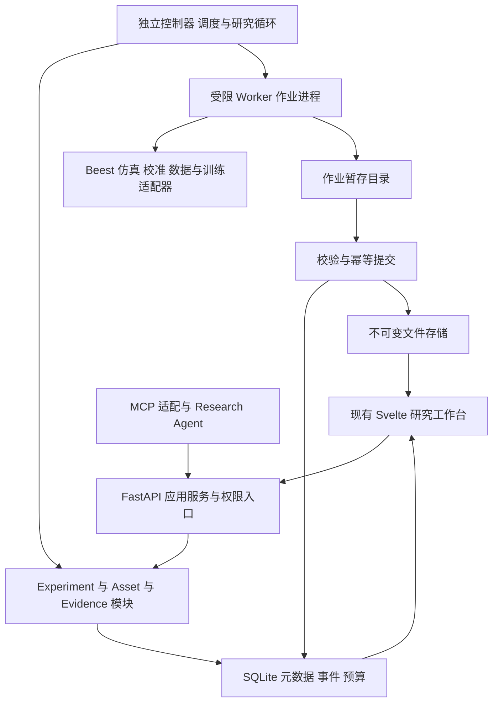

本课把前五课整合成可以实施的 Beest Model Experiment Harness 蓝图。目标是在保留风力兽设计、仿真、演化、制造和测量特色的基础上，贯通数据、训练、评测、证据和研究决策；不是重新开发一套通用机器学习平台。

**首版建议采用模块化后端、独立作业进程、统一资产与证据协议，以一个小型动力学预测实验贯穿六层。六层是职责划分，不等于六套微服务，也不是所有请求都必须逐层经过的串行管道。**

版本 0.1，2026-11-06。本文中的新增模块、接口和验收要求属于建议规格；本轮只归档文档，没有修改仓库、运行训练或证明模型能力。前置课程与后续开发入口统一见 [研究目录](https://chatgpt.com/space/page_6aeca3efb2ac8191bd53aaf9156103c2)。

配套 [实施交接规格 契约 接口 迁移与验收](https://chatgpt.com/space/page_89779898fc6c8191a40b24a0d0f87a90) 已单独归档，包含 12 项系统不变条件、应用接口草案、8 个工作包和 20 项故障与端到端验收。后续开发先从 M0 基线核对与 M1 手动贯通开始。

# 1 原始设计 用一个完整研究旅程约束架构

首个贯穿问题建议是：在冻结的设计族、场景分布和观测权限下，有限历史是否帮助预测风力兽的长期运动？首先验证对指定模拟器的近似，不把这个结果表述为实物验证。

用户从现有设计器选择设计与场景，查看已有运行及其来源，形成实验协议，检查预算与比较条件，批准执行。在原有回放里查看预测和参考轨迹的偏离，再打开比较与证据面板；Research Agent 读取开发反馈，给出有来源的下一轮提案，用户决定是否继续。

```text
设计和场景 → 有来源的仿真轨迹 → 冻结数据与分组切分
    → 基线和学习模型 → Checkpoint 与模型制品
    → 独立评测 → 轨迹回放与限定范围的结论
    → Research Agent 提案 → 批准或停止
```

完整研究流程应可由固定脚本和人工决策运行，LLM 不可用不应导致基础实验室失效。对用户而言不强迫每次填完所有研究表单；新增研究可以展开完整协议，小型复验则复用已有协议并明确新 Trial 身份。

首版验收的是这条真实计算链路可用、可恢复、可追溯。模型没有优于恒速基线，也应产生有效的比较与否定性结果。漂亮曲线、绿色任务状态或自动生成报告都不能单独构成验收。

# 2 数学原理与机制 六层怎样形成一个系统

## 2.1 六个职责与三个协作面

| 层 | 主要责任 | 不承担的责任 |
|---|---|---|
| L1 Domain Engine | 现有几何、物理后端、设计、测量、校准能力 | 决定研究结论或调度全部实验 |
| L2 Worker Runtime | 执行仿真、数据处理、训练、评测等算子 | 修改冻结协议、自行扩预算 |
| L3 Execution | 编译任务图、领取任务、租约、重试、取消、计费 | 决定一个科学假设是否成立 |
| L4 Assets | 不可变输入、模型制品、大文件、来源关系 | 将文件存在解释为真实可靠 |
| L5 Evaluation | 评测协议、统计、物理适用性、Claim 与用途门禁 | 为候选偷偷修改测试标准 |
| L6 Research | 读取允许的证据、提出实验、解释并选择下一轮 | 直接写成功状态或批准自己越权 |

工程上用三个协作面理解它们更直观。控制面保存目标、协议、授权、任务和状态；计算与数据面运行任务并传输文件；证据面追踪数据、实现、结果与限定声明。L4 和 L5 横向服务多个阶段，不是运行结束才补一条日志。



图中箭头表示调用或数据关系，不意味着各框都需要部署成服务。依赖方向应通过接口约束：领域核心不导入 FastAPI、Svelte 或 LLM SDK；研究模块通过应用服务调用执行与资产能力；Worker 适配器持有具体训练或仿真依赖。

## 2.2 对象关系不是一棵简单的目录树

前几课的 Experiment → Condition → Trial → Job 是教学简图。实现时还存在共享数据 Job、跨 Trial 的汇总 Job、一个训练过程跨多次 Attempt，以及一个 Job 产生多个领域 Run。

建议区分三类关系。归属关系描述 ResearchProgram、Experiment、Condition 和 Trial；计算依赖关系构成 Job DAG；来源关系把 Dataset、Run、Checkpoint、预测与 Claim 连接起来。不要用一个 parent_id 同时表达三类语义。

训练 Trial 是统计重复，Attempt 是进程尝试。相同配置的新独立重复与因响应丢失造成的重复提交不能混淆。共享数据准备被多个 Trial 引用，不必复制多份数据和处理执行记录。

## 2.3 四种身份必须各司其职

业务 ID 回答“哪个对象”；修订号和内容摘要回答“哪份内容”；幂等键回答“这是不是同一次提交”；缓存键回答“能否复用已经计算过的结果”。四者不能合并成一个哈希。

科学输入身份建议覆盖数据 Snapshot、SplitManifest、ModelSpecRevision、训练配置、随机性、评测与观测政策。执行身份还覆盖实际实现、依赖、数值后端与兼容政策。路径、显示名称、latest 标签和模型别名不能充当冻结身份。

```math
K_{cache}=H(\text{operation},\ \text{protocol revision},\ \text{input digests},\ \text{effective config},\ \text{implementation identity},\ \text{randomness},\ \text{numerical compatibility policy})
```

复现实验需要明确请求新计算；缓存引用不能计作新统计证据。缓存命中也保留本次请求与历史结果的关系，并重新检查权限、对象完整性和来源有效性。过期授权或被撤回的证据不能通过缓存绕过检查。

# 3 设计局限 现有系统不能怎样直接扩展

本轮将 main 解析并固定到 commit `610dafc4f00de6e70b2807c07f3932f639c28a37` 后读取关键文件。这是本课现状的快照，不保证未来开发时 main 仍相同。

[当前架构](https://github.com/meiluosi/strandbeest-evolution/blob/610dafc4f00de6e70b2807c07f3932f639c28a37/docs/ARCHITECTURE.md)描述了 TypeScript、Svelte、FastAPI、SQLite、Rust 双端内核及 MuJoCo/K2 路径，也明确功能存在不等于物理验证通过。[前端依赖](https://github.com/meiluosi/strandbeest-evolution/blob/610dafc4f00de6e70b2807c07f3932f639c28a37/apps/web-demo/package.json)与 [API 入口](https://github.com/meiluosi/strandbeest-evolution/blob/610dafc4f00de6e70b2807c07f3932f639c28a37/apps/api/src/strandbeest_api/app.py)支持保留现有前后端，而不是为了模型实验改成另一套 UI 技术栈。

## 3.1 现有线程锁不是多进程领取协议

当前 [jobs.py](https://github.com/meiluosi/strandbeest-evolution/blob/610dafc4f00de6e70b2807c07f3932f639c28a37/apps/api/src/strandbeest_api/jobs.py)的 claim_next 在实例内 threading.Lock 下先 SELECT 再 UPDATE，连接采用自动提交。这个边界不能直接推广成多个独立进程安全领取任务的保证。

新领取路径要用短数据库事务，将状态条件更新、Attempt 创建、资源与预算预留一起提交；处理并发冲突并核对实际更新行数。SQLite 支持多个读事务，但同时只有一个写事务，BEGIN IMMEDIATE 也可能遇到 SQLITE_BUSY。[SQLite 事务文档](https://www.sqlite.org/lang_transaction.html)

## 3.2 API 重启与 Worker 生死需要分离

当前 create_app 调用 store.recover，后者将 running 作业标成 failed。这对应现有进程模型；加入独立 Worker 后，API 重启不再意味着训练进程已经死亡。新控制器要核对 Worker 身份、心跳、子进程与最后提交，不可直接照搬全量标失败。

失联只说明“还不能确认状态”。租约过期可撤销提交权限，但不保证旧进程已停止消耗 CPU 或显存。需要实际终止确认或将资源隔离为状态未知；不能仅依据租约过期把同一设备再次发给新任务。

## 3.3 可重建索引不能承载唯一来源事实

当前 JobStore.clear_run_index 同时删除 runs 索引和整个 provenance_edges。原方案以文件为来源重建索引；若直接把新训练、评测和研究血缘塞进同表，再照旧清空，会产生丢失新关系的风险。

首版建议新增有前缀的权威关系与状态表，保留 legacy 只读适配；旧 reindex 只能重建自己负责的索引。以后合并时通过独立迁移和校验完成，不依赖隐式重建。新增事实不能只有向量库、日志摘要或旧缓存中的一份副本。

## 3.4 六层不能顺势变成六套重复基础设施

不能在 API、MCP、Research Agent 各自维护独立 Job 队列、预算和资产版本；也不能把加入 MLflow 或工作流框架视为领域协议已经完成。外部工具应通过接口接入，内部权威状态与结果归属必须清晰。

首版不要求集群调度、多用户租户、在线机械控制、大规模视频模型、端侧部署、多 Agent 团队或自动论文发布。排除的是首版基础依赖，不是否定长期演进。

# 4 改进思想 首版架构与具体设计

## 4.1 保留现有技术栈 模块化而非重写

建议新增 `packages/harness` 作为本课能力的逻辑入口，内部先按 contracts、assets、experiments、execution、evaluation、research、adapters 分目录。目录名是建议，不是已存在路径。API 和 MCP 调用同一应用服务；现有 sim、opt、rig、calib、fab 与 common 继续作为领域能力复用。

通用 Schema、单位、ID 和规范化摘要规则继续利用现有公共机制，避免在新包复制第二套。只有当模块已有独立依赖、发布需求或团队所有权时再拆包；不要为了六层图预先制造六个部署单元。

## 4.2 进程布局与默认运行方式

本机首版建议采用一个 Web/API 进程、一个控制器进程，以及有界 Worker 子进程。控制器可运行 Scheduler 和受约束 Research Loop；LLM 调用以异步或独立任务方式进行，不能阻塞租约续期、取消与预算检查。训练和批量仿真在 Worker 里执行，Web 负责查询与交互。

FastAPI 官方说明重型后台计算可由其他多进程任务工具承载；本项目可先保留自己的持久化作业机制并补齐可靠性，而不是立刻引入 Celery 等整套依赖。[FastAPI 后台任务文档](https://fastapi.tiangolo.com/tutorial/background-tasks/)

普通研究状态更新优先使用可重连的单向事件流或轮询，沿用已有 WebSocket 处理确实需要双向控制的仿真交互。每个事件有 cursor，断线后从服务端持久化状态补齐，不能把浏览器内存当作任务真相。

## 4.3 数据库与文件存储

新任务、Attempt、资源租约、预算、授权、结果提交和事件 outbox 尽量在同一 SQLite 数据库事务边界内，使用命名空间区分旧表。一个控制器作为调度领导者，但领取和提交仍必须事务化，不能只依赖“理论上只有一个进程”。

WAL 可以改善读写并行，但仍是单写者，且其正常共享内存机制不支持把数据库放在网络文件系统供多机直接使用。[SQLite WAL 文档](https://www.sqlite.org/wal.html) 首版采用本地磁盘；扩展远程 Worker 时通过服务协议领取任务和上传产物，不挂载数据库文件。只有实际写竞争或多机控制面需求出现时再评估 PostgreSQL。

大文件放在 ArtifactStore：轨迹、视频、Parquet、Checkpoint 和预测结果不塞进元数据表。保存内容哈希、格式、大小、创建者、用途与来源；缓存和临时文件与研究证据分开。原始来源、冻结 Snapshot、模型与证据引用需要保留策略，不可因清缓存而删除。

备份同时覆盖一致的数据库快照与其引用的完整产物；恢复演练必须验证引用闭合。不能只复制 SQLite 主文件而忽略活跃 WAL，也不能只备份指标不备份模型与轨迹。

## 4.4 可靠提交 不承诺计算恰好执行一次

建议采用“任务可能重复尝试，正式结果唯一提交”的语义。

```text
提交协议 → 短事务登记作业和预算预留
    → Worker 领取 Attempt 和提交代次
    → 在该 Attempt 暂存区运行
    → 完成文件写入与完整性校验
    → 发布不可变文件
    → 数据库事务核验代次并登记 Run 来源和事件
    → 对外可见成功结果
```

文件系统与数据库没有天然跨系统原子事务。先完成不可变文件，再事务性地登记可见引用；崩溃留下的未引用对象可延后回收，不能让数据库指向半写入文件。成功只发生在持久化提交完成之后，而不是训练函数返回之后。

每次领取递增 fencing token，即当前允许提交的代次。旧 Worker 在超时后回来提交必须被拒绝，不能覆盖新 Attempt 的结果；提交成功但响应丢失时重试返回原提交记录。高频进度不是权威事件，不必每一 step 同步写主库。

控制面关键状态变化与 outbox 事件在同一事务中登记，消费者按事件 ID 去重。第一版用数据库轮询派发即可，不需要消息总线；采用状态表加可审计事件，也不必全面引入事件溯源架构。

## 4.5 训练恢复与前课语义校正

第二课中“租约过期后释放资源”在此收紧为先撤销写权，再核实计算终止；“OOM 后降低 batch”不能被默认为同一科学条件下的重试。自动改变有效 batch、样本量、精度、模型或学习率会影响比较，必须进入已批准适配政策或新 Condition 修订，并记录实际配置。

只恢复权重是 warm start；完整恢复还需要优化器、调度器、随机状态、采样进度等。严格轨迹恢复要求相应环境和实现经过验证，不能跨设备自动承诺逐位一致。PyTorch 官方明确提醒跨版本、平台或 CPU/GPU 的完全复现并不受保证。[PyTorch 可复现性](https://docs.pytorch.org/docs/2.13/notes/randomness.html)

第一课线性对象图仅作教学视图；第三课 ModelVersion 在内部进一步明确为 ModelSpecRevision 与 ModelArtifact 两种身份，前者是结构与 I/O，后者是学习权重和前后处理。外部工具的同名概念通过适配器映射，不把结构版本和训练产物混用。

## 4.6 本机资源与可移植性

针对用户的 MacBook Air M4 16GB，首版建议从 CPU 可运行的小状态模型和小批次开始；MPS 是可选执行能力，不是启动平台的前提。PyTorch 提供 MPS 后端及可用性检查，但每个所用算子、精度和恢复路径仍需本机预检。[MPS 文档](https://docs.pytorch.org/docs/2.13/notes/mps.html)

本机 profile 起步只调度一个训练任务，仿真并行量通过实测再增加，显式预留系统与浏览器余量。记录 cpu、mps、cuda 作为不同能力；Apple 共享内存环境不建模成额外独立的一份 CUDA 显存。容器与原生 macOS 路径分开验收，不能因为 Docker 构建通过就声称 MPS 可用。

资源额度、预测时长、训练规模与统计种子数在预检中确定，不在规划里伪装成已经测试的性能指标。Python、前端、Rust 和训练依赖分别锁定实际版本，先沿用工作仓库而不顺手升级所有框架。

## 4.7 前端是一条研究旅程而非管理表格合集

建议在现有实验室内增加三个关联视图。

实验设计视图展示问题、数据来源、比较组、预算、控制变量与协议差异。运行与回放视图展示任务进度、当前 Attempt、有效恢复点、数据质量与预测叠加；关闭浏览器不终止已批准任务。比较与证据视图展示分场景指标、失败分母、适用范围、Claim 和下一轮提案。

用户在风力兽回放中点击一次异常，可定位 episode、模型制品、输入 Snapshot、评测定义与来源。需要审批时显示将增加的成本和变更内容；证据不足呈现为正常状态，不用“全绿”诱导修改门槛。静态站点保留画廊与已有结果展示，新增训练与资产写入需显式连接后端，不假装静态页面已经完成计算。

## 4.8 权限与封存评测

API、CLI、MCP 使用相同服务层授权逻辑，但凭据不同。Worker 只获得本次 Attempt 所需的输入与暂存区权限；Research Agent 不持有数据库管理员凭据，也不直接写正式 Run 或 GateDecision。

本地单用户不等于无安全边界。服务默认 loopback，使用显式会话凭据、来源检查和最小网络权限；模型密钥不进入日志或浏览器持久化产物。执行不可信生成代码时使用具有文件、进程和网络限制的环境。普通子进程隔离只能改善故障隔离，不能自动成为安全沙箱。

封存测试不能只藏在文件名里。在真实封存模式下，模型加载也视作执行面；不可信模型实现与参考标签、评分器、后台凭据隔离，标签仅在评分侧使用，输出和网络限制按威胁模型验收。首版仅能实现可信内置模型的隔离时，应明确能力上限，不能宣称支持任意恶意代码的严格盲测。

# 5 实验验证 先完成一条纵向切片

## 5.1 贯穿案例的执行顺序

第一步读取明确来源的 SimulationRun 或 Measurement，核对通道、单位、时间与审计范围。存在未验证物理来源时允许标为探索数据，但不得绕过既有物理证据要求。

第二步创建 DatasetSnapshot、SplitManifest 和训练集拟合的变换资产。先按 trajectory 和设计族分组，再生成窗口；不同 ID 不自动代表独立设计。

第三步冻结无历史、有历史及必要容量对照的 ModelSpecRevision 与有效训练预算。链路预检可以只用少量 Trial，但不输出“已证明泛化”的结论。统计重复数由正式协议决定。

第四步编译并执行 data → train → evaluate → aggregate 的 DAG。训练保存 Checkpoint 与模型制品；至少完成一次人为中断和恢复，仍是同一 Trial 的新 Attempt。

第五步 L5 按冻结规则生成逐例预测、失败清单、误差与物理适用性检查，界面同步回放；研究结论引用实际结果，而非占位报告。

第六步 L6 读取开发反馈生成下一轮提案，先经人工审查；受控自动循环是后续阶段，不把第一次界面贯通等同于自主研究已经有效。

## 5.2 工程通过与科学结论分开验收

工程验收包括旧功能兼容、端到端真实计算、资产可追溯、失败不隐藏、恢复不重复、权限和预算有效。科学验收包括模型预测是否改善、跨场景是否成立、实物证据是否足够。前者通过不能代替后者；后者没有正结果也不等于平台无用。

首版故障验收必须覆盖旧索引重建不删新血缘、API 重启不误杀独立任务、两次领取竞争、失联 Worker 的迟到提交、半写文件、失败费用、Snapshot 冲突、自由滚动读取未来状态、NaN 分母、上游证据撤回和停转事件分类。

## 5.3 里程碑按出口而不是按层堆砌

| 阶段 | 主要内容 | 进入下一阶段的证据 |
|---|---|---|
| M0 基线与契约 | 固定 commit、运行原测试、枚举资产和协议 | 可定位的基线结果与兼容样例 |
| M1 手动贯通 | Snapshot、一个训练器、评测与回放 | 不依赖 LLM 的真实端到端结果 |
| M2 可靠性 | Attempt、幂等、恢复、预算、事件与迁移 | 故障注入测试及无丢失恢复 |
| M3 受控研究 | 只读提案再到获批单轮执行 | 来源正确、预算一致、权限拒绝和正确停止 |
| M4 发布候选 | 文档、依赖锁、备份恢复、完整浏览器回归 | 可交付实验室；科学能力单独列证据 |

M0–M4 是新增工程分期，不替代仓库既有 H 类加固任务编号。若物理审计或独立测量依然未完成，明确保留阻塞，不能为展示新 Harness 而修改通过条件。

# 6 当前决策建议与扩展触发条件

| 主题 | 首版建议 | 何时重新评估 |
|---|---|---|
| 架构 | 模块化后端与受控 Worker | 独立扩缩容、权限或团队边界出现 |
| 调度 | 强化现有单机持久化任务基础 | 多机、长队列、公平调度成为实测瓶颈 |
| 存储 | 本地 SQLite 与不可变文件 | 多机控制面或写竞争经实测成立 |
| 前端 | 保留 Svelte 和现有仿真回放 | 现有框架不能满足具体需求时 |
| 训练 | CPU 基线加可选 MPS，小模型 | 研究问题确实需要更大规模时 |
| Agent | 单控制器、先提案后执行 | 基线对照证明多角色带来净收益时 |
| 集成 | 定义接口，不同时接入多套平台 | 明确缺失能力且能保留权威状态时 |

所有建议尚需实施者与用户在开发启动时确认，不作为已批准的仓库 ADR。发生设计变更时记录原因、影响、兼容方案和新验收，不静默篡改历史课程。

# 7 会话交接与课程收口

用户确认的方向是“面向物理世界模型与具身智能研究的实验编排、模型训练、仿真验证和证据管理平台”，以 strandbeest-evolution 增量发展；保留三项原则和既有风力兽特色。本会话负责研究架构与保存文档，其他 Agent 后续开发；本课没有对仓库写入的授权扩展。

第一课定义对象，第二课定义执行，第三课定义数据与模型，第四课定义评测与证据，第五课定义研究决策，第六课将它们合成工程蓝图。当前可以说“首轮六课规划已经形成”，不能说“六层系统已经实现”。

交接优先阅读本课与配套实施规格，再按任务回查对应课程和当前仓库。课程保存的是讨论整理、设计与来源，不是逐字聊天转录。下一阶段最小开发任务应是 M0 与 M1 的纵向切片，而不是一次性创建全部空模块或直接开放无人值守研究。

# 来源与核查范围

代码快照为 commit `610dafc4f00de6e70b2807c07f3932f639c28a37`。主要静态依据为 [ARCHITECTURE.md](https://github.com/meiluosi/strandbeest-evolution/blob/610dafc4f00de6e70b2807c07f3932f639c28a37/docs/ARCHITECTURE.md)、[jobs.py](https://github.com/meiluosi/strandbeest-evolution/blob/610dafc4f00de6e70b2807c07f3932f639c28a37/apps/api/src/strandbeest_api/jobs.py)、[app.py](https://github.com/meiluosi/strandbeest-evolution/blob/610dafc4f00de6e70b2807c07f3932f639c28a37/apps/api/src/strandbeest_api/app.py)、[前端依赖](https://github.com/meiluosi/strandbeest-evolution/blob/610dafc4f00de6e70b2807c07f3932f639c28a37/apps/web-demo/package.json) 和 [Measurement Schema](https://github.com/meiluosi/strandbeest-evolution/blob/610dafc4f00de6e70b2807c07f3932f639c28a37/schemas/measurement.schema.json)。本轮没有运行仓库测试，静态读取不构成全库审计。

外部机制依据为 [SQLite 事务](https://www.sqlite.org/lang_transaction.html)、[SQLite WAL](https://www.sqlite.org/wal.html)、[FastAPI 后台计算](https://fastapi.tiangolo.com/tutorial/background-tasks/)、[PyTorch MPS](https://docs.pytorch.org/docs/2.13/notes/mps.html) 与 [PyTorch 可复现性](https://docs.pytorch.org/docs/2.13/notes/randomness.html)。这些来源支持各自机制边界，不证明本项目新增实现已经通过。
