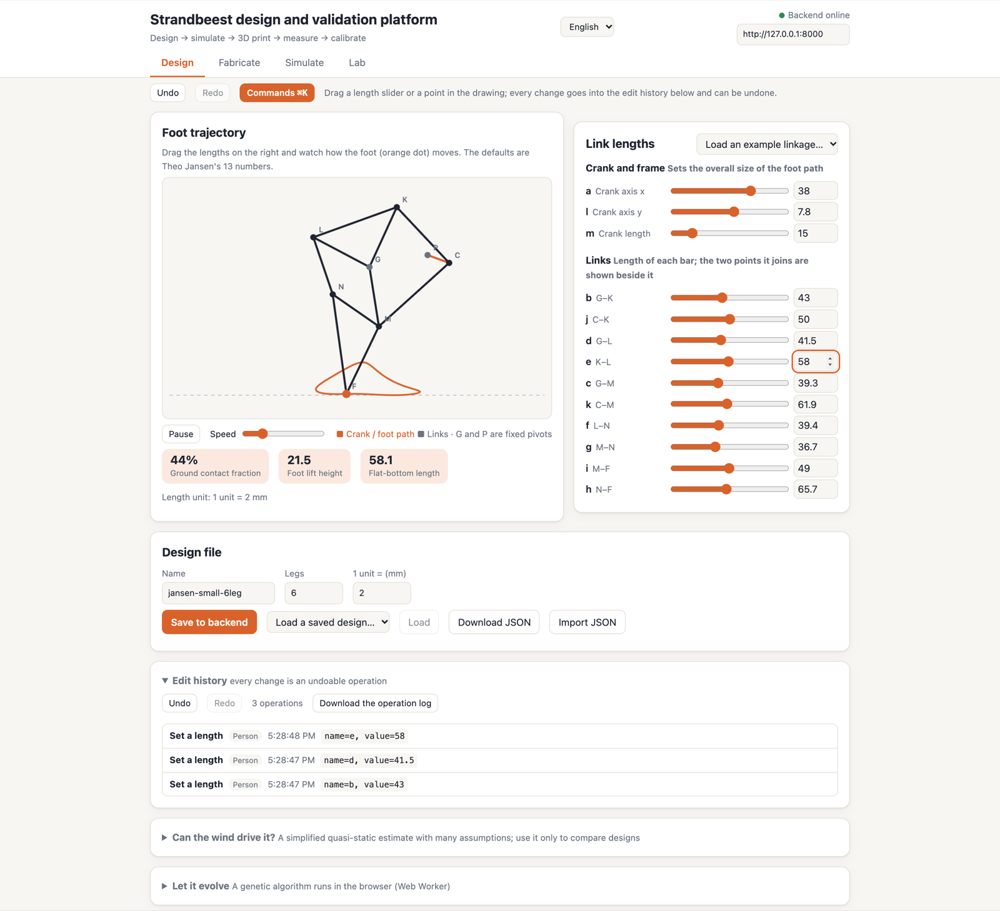
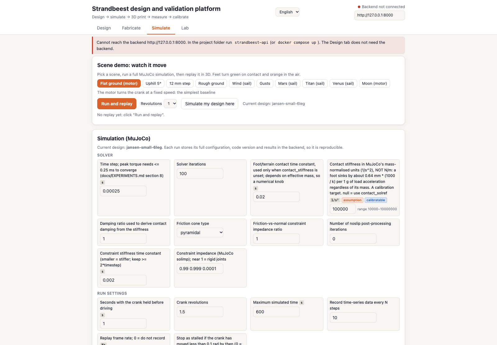
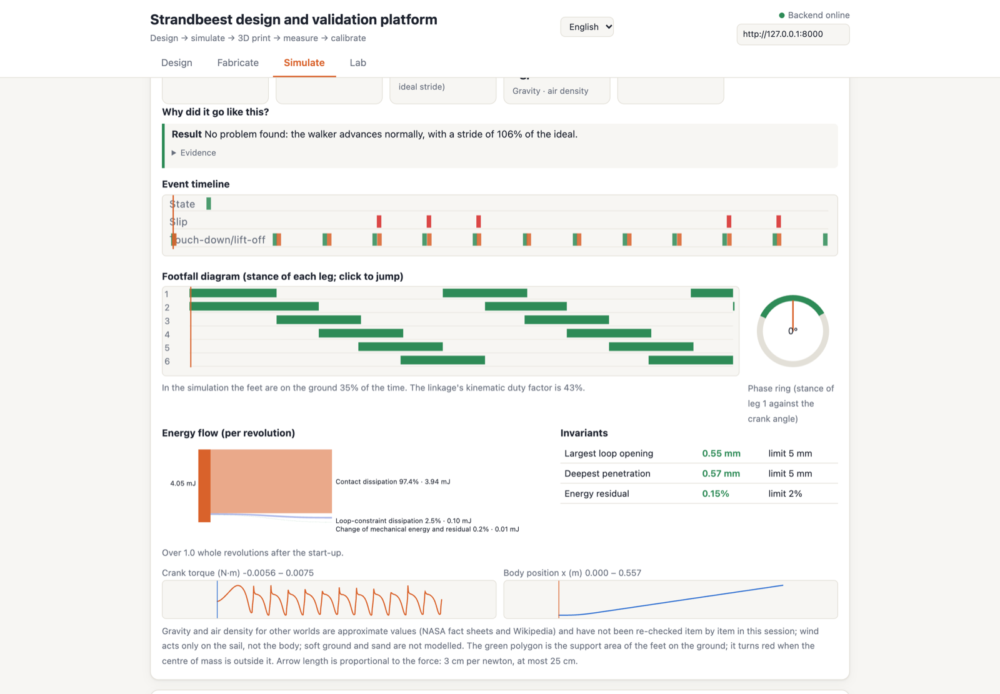
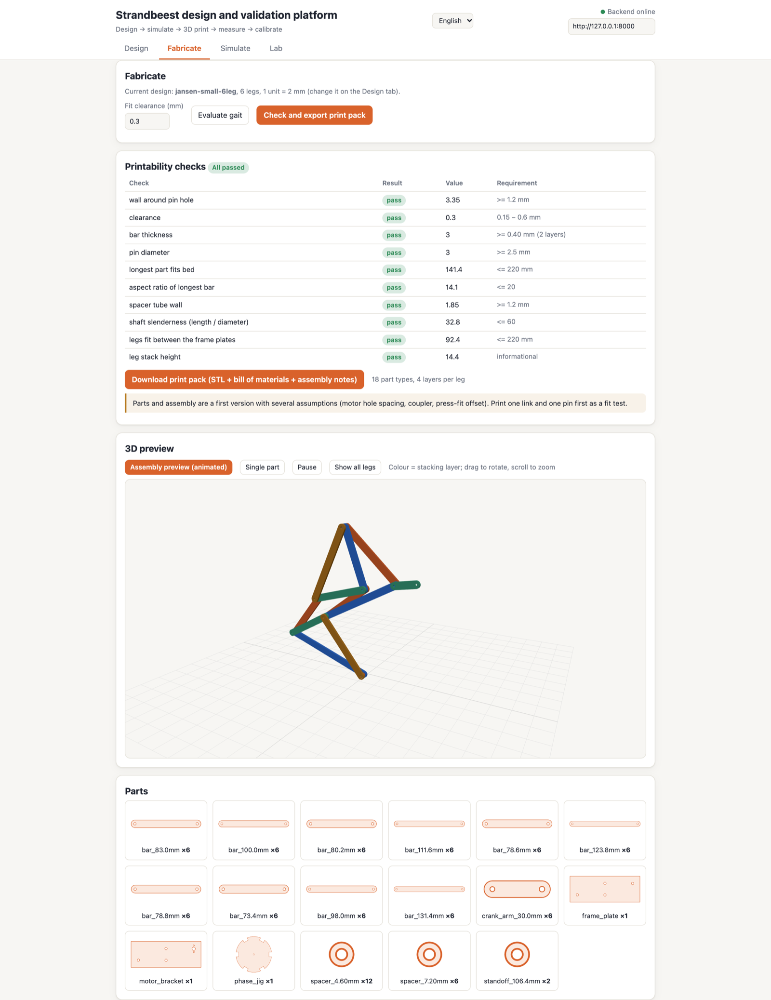
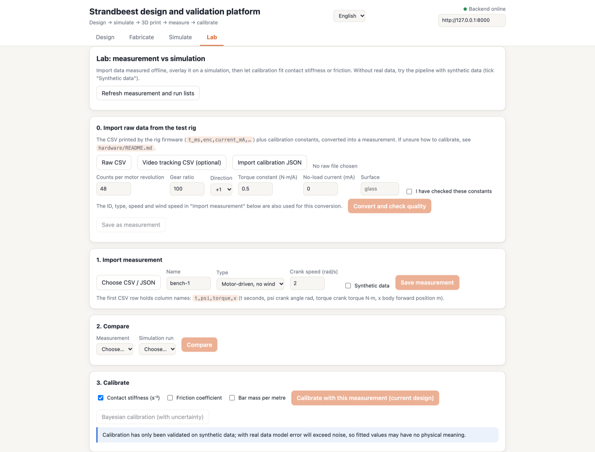

# Strandbeest Lab · strandbeest-evolution

Adjust link lengths, watch the gait, and export parts for 3D printing: an open-source lab for exploring Theo Jansen's Strandbeest through design and simulation.

**[▶ Try it online (no install)](https://meiluosi.github.io/strandbeest-evolution/)**: drag the linkage, let it evolve itself, simulate your own design with MuJoCo in the browser (motor or a sail in the wind), and share it as a link.

[中文](README.md) · **English** · [Get started](#run) · [Features and screenshots](#what-it-does) · [Experiment log](docs/EXPERIMENTS.md)

> **Preview (alpha) · Not yet validated against real hardware.** The software chain works end to end and is tested. It is suitable for exploring, teaching and building on. The simulator is not yet robust to small design changes; do not treat simulated numbers as measurements. See [honest caveats](#honest-caveats).


*This is a kinematic illustration. The MuJoCo simulation shown below lets you inspect contact forces, slipping and stability.*

## Run

**Quickest way to start the local lab:** install Git and Docker (including Compose), then run:

```bash
git clone https://github.com/meiluosi/strandbeest-evolution.git
cd strandbeest-evolution
docker compose up --build
```

Open [http://localhost:8080](http://localhost:8080). Adjust link lengths in Design, inspect the gait in Simulate, or export parts in Fabricate. The API runs at [http://localhost:8000](http://localhost:8000). See the [deployment guide](docs/DEPLOY.md) for persistent data and configuration.

<details>
<summary>Without Docker: local development, CLI and AI tools</summary>

Run from the repository root. Node.js ≥ 22, pnpm and Python ≥ 3.10 are required; the setup script creates a Python virtual environment and installs dependencies.

Terminal 1: start the API.

```bash
./scripts/setup-python.sh && source .venv/bin/activate
strandbeest-api                             # http://127.0.0.1:8000
```

Terminal 2: start the web UI.

```bash
pnpm install
pnpm --filter @strandbeest/web-demo dev      # http://localhost:5173
```

Other commands (activate the virtual environment above before running Python commands):

```bash
strandbeest-pipeline run schemas/examples/design-jansen-small-6leg.json out/   # evaluate → print pack → simulate
strandbeest-mcp --workspace ./agent-workspace --actor my-agent                  # MCP server (stdio)
pnpm check                                   # format checks + type checks + tests
pnpm experiment flat 1 80                    # evolution experiment
pnpm dynamics                                # dynamics comparison
```

</details>

## What it does

**Design.** Directly drag joints on the 2D sketch or fine-tune the 13 link lengths while watching the foot path update in real time. Every change is an edit operation with an actor, a time and an exact inverse (people and AI agents use the same ones); ⌘K opens the command palette.




**Simulate, and see the process.** Pick a scene (flat ground, slope, step, rough ground, wind, and the gravity and atmosphere of Mars, Titan, Venus, the Moon), run a full MuJoCo simulation and replay it in 3D. The replay is more than an animation: contact-force arrows, slip markers, centre of mass and support polygon, dynamometer curves (torque / RPM / power), wind and sail responses, a footfall chart, an event timeline, an energy-flow (Sankey) diagram and an invariant audit (loop opening, penetration, energy residual). Rule-based diagnosis says why the run went the way it did, and says so plainly when the model has come apart and later numbers can't be trusted.





**Fabricate.** Printability checks (hole walls, clearance, layers, bed size…), a parts list, a 3D assembly preview, and export of STL + bill of materials + assembly notes.



**Measure and calibrate.** Turn test-rig data (CSV / video tracking) into quality-checked measurements, overlay them on a simulation, and fit contact stiffness, friction and similar with Bayesian calibration that reports uncertainty and whether the parameter is identifiable at all. **So far verified on synthetic data only.**



**For AI agents.** The same operations are exposed as typed tools (four permission levels: read / write / budget / confirm, budgets, audit log) and run as an MCP server. There is also a "simulator skeptic" (invariant audit + fuzzer + re-injected historical bugs) and an agent design benchmark with blind scenes and baselines. See [docs/AGENT-TOOLS.md](docs/AGENT-TOOLS.md) (Chinese).

**Optimize.** A GA in the browser; CMA-ES, NSGA-II (multi-objective) and quality-diversity (MAP-Elites) on the back end.

## Honest caveats

- **Nothing has been validated on real hardware.** The rig firmware, calibration procedure and data import are written and pass on synthetic data, but nobody has measured a real walker with them. Calibration is verified on synthetic data only; with real data the model error will exceed the noise, and fitted values need not be physically meaningful.
- Contact, friction and joint clearance in the simulator are assumptions; absolute torque depends on the friction model, so the UI reports ranges. Gravity and air density for other planets are approximate. Wind acts on the sail only; soft ground and sand are not modelled.
- **The simulator is not yet robust to small design changes.** Randomly perturbing the default design's link lengths can pull the closed loops apart (the model "comes apart"). Halving the time step from 2e-4 to 1e-4 took 9 failing audits out of 16 random walkers down to none, at about 2.7x the run time; a few designs still open a loop by close to the 5 mm audit limit. The replay says so, but **do not trust a simulated number without looking at the invariant audit.** Record in [docs/EXPERIMENTS.md](docs/EXPERIMENTS.md) (Chinese).
- Sources for Jansen's 13 lengths and the linkage topology are in [research notes](docs/RESEARCH-NOTES.md); the evolution timeline was checked against strandbeest.com's period pages (except Pregluton).
- Our GA is a reconstruction of the *idea* of evolving leg lengths, not Jansen's actual method.

## What's inside

| Path | Contents |
|---|---|
| `packages/core` | Pure TypeScript library (npm: `strandbeest-core`): linkage solver, gait metrics, seeded GA, multi-leg, quasi-static dynamics and sail model, edit-operation algebra (undo/redo) |
| `packages/common` | JSON Schemas for design documents (stable IDs, migrations), generated Python / TS models, contract corpora that check the two languages agree |
| `packages/sim` | Python / MuJoCo simulator: world + entity scenario files, physics-backend interface, glass-box metrics (contact forces, energy, events), the simulator skeptic (see [design](docs/SIM-DESIGN.md)) |
| `packages/fab` | Printability checks and print-pack export |
| `packages/rig` + `hardware/` | Test rig: design and calibration procedures, ESP32 firmware, raw-data-to-Measurement conversion, ArUco video tracking; **not yet run on real hardware**, see [hardware/README.md](hardware/README.md) |
| `packages/calib` | Calibration: least squares and Bayesian (uncertainty, identifiability) |
| `packages/opt` | Optimizers: CMA-ES, NSGA-II, MAP-Elites |
| `packages/agent` | Tool registry, MCP server, agent benchmark |
| `apps/api` | Back end: design / simulation / calibration jobs, reproducible run records |
| `apps/web-demo` | Web front end: Design, Fabricate, Simulate, Lab tabs; Chinese and English UI |
| `scripts/` | Experiment scripts (evolution, re-discovering Jansen, dynamics comparison) and GIF rendering |
| `docs/` | Vision, architecture and decision records, editor notes, experiment log (negative results included), research notes (sources) |

## Further reading (Chinese)

- Vision: [docs/VISION.md](docs/VISION.md); platform and phase plan: [docs/PLATFORM.md](docs/PLATFORM.md)
- Engine-style architecture blueprint: [docs/ENGINE.md](docs/ENGINE.md), decision records: [docs/adr/](docs/adr/); editor and operation log: [docs/EDITOR.md](docs/EDITOR.md)
- What to do next (task cards with acceptance criteria): [docs/ACTIONS.md](docs/ACTIONS.md); experiment log: [docs/EXPERIMENTS.md](docs/EXPERIMENTS.md)

Issues and PRs welcome. Licensing: code under [MIT](LICENSE), design library under [CC BY 4.0](LICENSE-DESIGNS.md) (individual linkage parameters are treated as factual geometry and do not require attribution), and experimental/measured data under [CC0 1.0](LICENSE-DATA.md) (see [docs/LICENSING.md](docs/LICENSING.md)).
