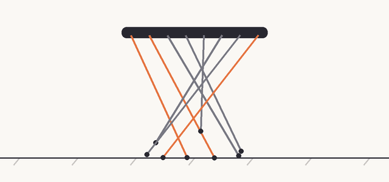
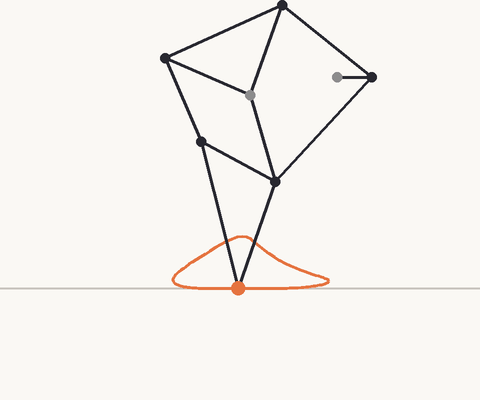
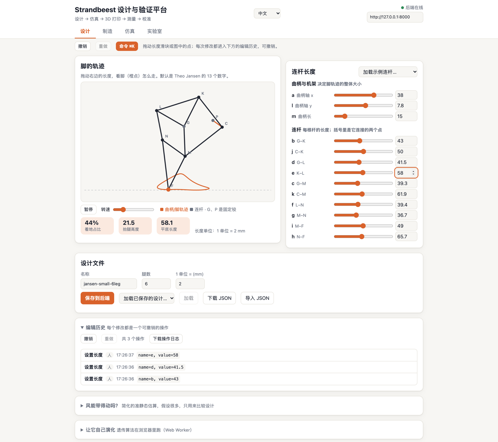
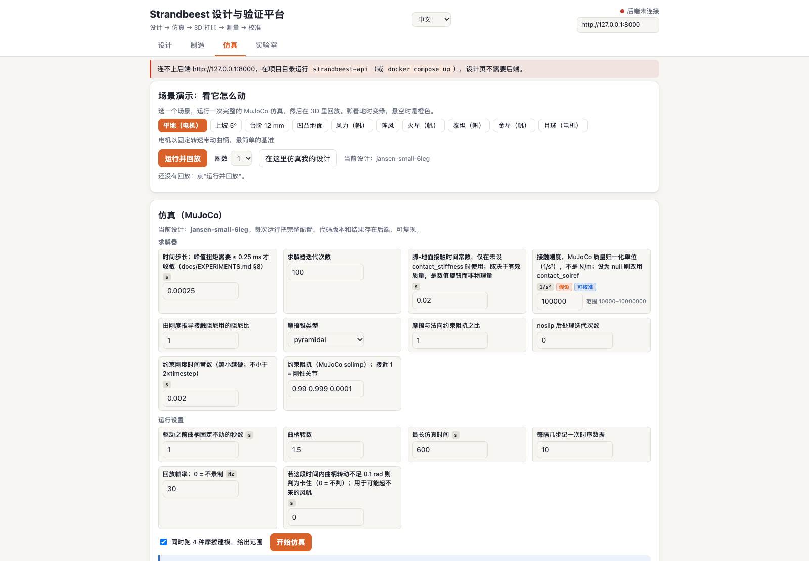
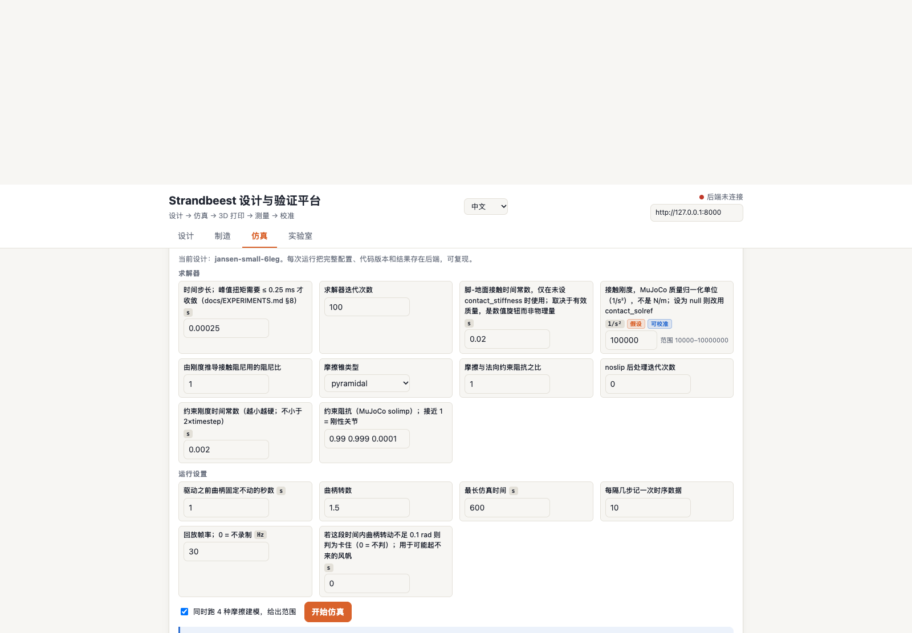
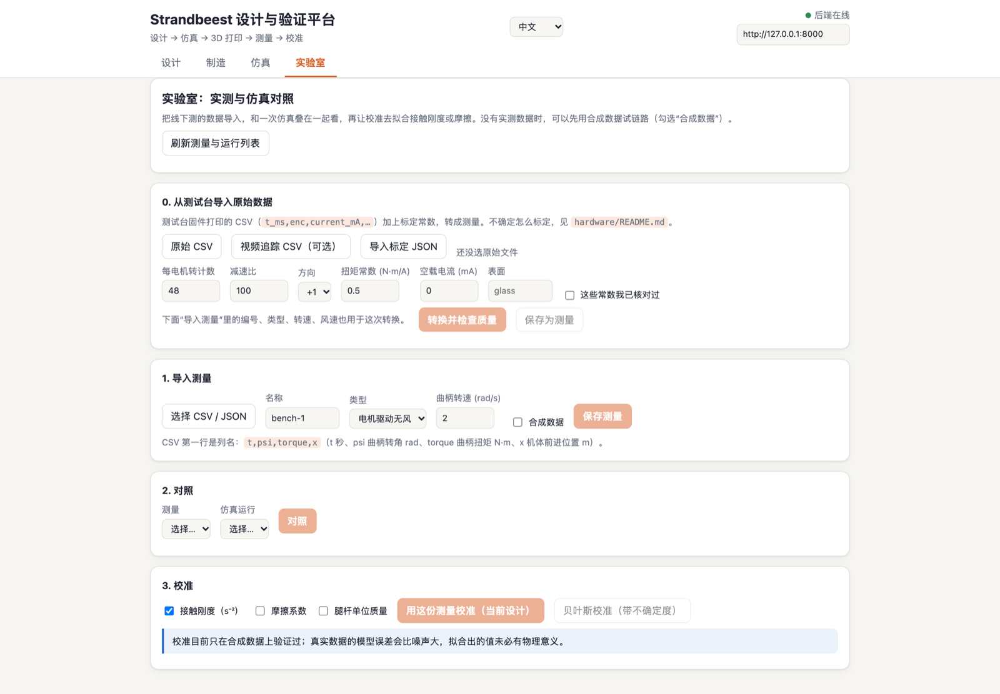

# 风力兽实验室 · strandbeest-evolution

调整连杆、观察步态、导出 3D 打印零件：一个探索 Theo Jansen 风力兽设计与仿真的开源实验室。

**[▶ 在线体验（无需安装）](https://meiluosi.github.io/strandbeest-evolution/)**：在浏览器里拖动连杆、让它自己进化、用 MuJoCo 仿真你自己的设计（电机或风中的帆），分享一条链接。

**中文** · [English](README.en.md) · [开始运行](#运行) · [能力与界面](#能做什么) · [实验记录](docs/EXPERIMENTS.md)

> **预览版（alpha）· 尚未经过真实硬件验证。** 软件链路已走通并有测试，适合探索、教学和二次开发。仿真器对设计的小改动还不够稳健，仿真数字不能当作实测。详见[诚实声明](#诚实声明)。



*上图是连杆运动示意；下面的 MuJoCo 仿真可查看接触力、打滑与稳定性等过程。*

## 运行

**最快启动本地实验室：** 安装 Git 与 Docker（包含 Compose），运行：

```bash
git clone https://github.com/meiluosi/strandbeest-evolution.git
cd strandbeest-evolution
docker compose up --build
```

打开 [http://localhost:8080](http://localhost:8080)，从「设计」页调整连杆，再到「仿真」页观察步态或「制造」页导出零件。后端地址为 [http://localhost:8000](http://localhost:8000)。数据持久化与配置见[部署说明](docs/DEPLOY.md)。

<details>
<summary>不用 Docker：本地开发、命令行与 AI 工具</summary>

在仓库根目录运行。需要 Node.js ≥ 22、pnpm 与 Python ≥ 3.10；脚本会创建 Python 虚拟环境并安装依赖。

终端 1：启动后端。

```bash
./scripts/setup-python.sh && source .venv/bin/activate
strandbeest-api                             # http://127.0.0.1:8000
```

终端 2：启动网页。

```bash
pnpm install
pnpm --filter @strandbeest/web-demo dev      # http://localhost:5173
```

其他命令（Python 命令需先激活上面的虚拟环境）：

```bash
strandbeest-pipeline run schemas/examples/design-jansen-small-6leg.json out/   # 评估 → 打印包 → 仿真
strandbeest-mcp --workspace ./agent-workspace --actor my-agent                  # MCP 服务器（stdio）
pnpm check                                   # 格式检查 + 类型检查 + 测试
pnpm experiment flat 1 80                    # 演化实验
pnpm dynamics                                # 动力学对比
```

</details>

## 能做什么

**设计**：拖动 13 个连杆长度，实时看脚的轨迹；每次修改都是一条带操作者、时间、可撤销的编辑操作（人和 AI 智能体共用同一套），⌘K 打开命令面板。





**仿真，并且看得见过程**：选一个场景（平地、坡、台阶、凹凸地面、风、火星/泰坦/金星/月球的重力和大气），MuJoCo 跑完整仿真，在 3D 里回放。回放不只是动画：接触力箭头、打滑指示、质心与支撑多边形、足迹图、事件时间线、能量流（桑基图）和"不变量"审计（环约束张开、穿透、能量残差）；系统会用规则给出"它为什么是这样"的诊断，并且在模型已经散架时明说"之后的数字不可信"。





**制造**：可打印性检查（孔壁、间隙、层数、床面尺寸……）、零件清单、3D 装配预览，导出 STL + 物料清单 + 装配说明。


**测量与校准**：测试台数据（CSV / 视频追踪）转成带质量检查的测量，与仿真对照，用贝叶斯校准拟合接触刚度、摩擦等参数并给出不确定度和"能否辨识"的判断。**目前只在合成数据上验证过。**



**给 AI 用**：同一套操作以带类型的工具暴露（读/写/耗预算/需确认四级权限、预算、审计日志），可以作为 MCP 服务器接入智能体；另有"仿真器怀疑者"（不变量审计 + 模糊测试 + 历史 bug 回注）和一套带盲测场景与基线的智能体设计评测。见 [docs/AGENT-TOOLS.md](docs/AGENT-TOOLS.md)。

**优化**：浏览器里的遗传算法；后端有 CMA-ES、NSGA-II（多目标）、质量-多样性（MAP-Elites）。

## 诚实声明

- **没有任何东西用真实硬件验证过。** 测试台的固件、标定流程和数据导入已写好并在合成数据上通过，但没有人用它测过真实的步行者；校准只在合成数据上验证过，真实数据的模型误差会比噪声大，拟合出的值未必有物理意义。
- 仿真里的接触、摩擦、关节间隙是假设值；扭矩的绝对水平依赖摩擦建模，所以界面报告的是范围。其他星球的重力和大气密度是近似值。风只作用在帆上；软地面、沙地没有建模。
- **仿真器对设计的小改动还不够稳健。** 随机改动默认设计的连杆长度时，闭环约束可能被撑开（模型"散架"）；我们把时间步长从 2e-4 减到 1e-4 之后，16 个随机步行者全部通过审计（之前 9 个不通过），代价是约 2.7 倍的运行时间。仍然有个别设计的环张开接近 5 mm 的审计上限。系统会在回放里明说，但**请不要在没看不变量审计的情况下相信仿真数字**。记录见 [docs/EXPERIMENTS.md](docs/EXPERIMENTS.md)。
- Jansen 的 13 个长度与连杆拓扑来源见 [研究笔记](docs/RESEARCH-NOTES.md)；演化时期已对照 strandbeest.com 各时期页面核实（Pregluton 除外）。
- 我们的遗传算法是对"演化出腿长"这一思路的重构，并不是 Jansen 实际使用的方法。

## 里面有什么

| 目录 | 内容 |
|---|---|
| `packages/core` | 纯 TypeScript 库（npm: `strandbeest-core`）：连杆求解、步态指标、带种子的遗传算法、多腿、准静态动力学与风帆模型、编辑操作代数（撤销/重做） |
| `packages/common` | 设计文档的 JSON Schema（带稳定 ID 与迁移）、由 Schema 生成的 Python / TS 模型、与 TS 一致性互验的契约语料 |
| `packages/sim` | Python / MuJoCo 动力学仿真器：世界 + 实体的场景文件、物理后端接口、接触力/能量/事件等"玻璃盒"指标、仿真器怀疑者（见 [设计](docs/SIM-DESIGN.md)） |
| `packages/fab` | 可打印性检查与打印包导出 |
| `packages/rig` + `hardware/` | 测试台：设计与标定流程、ESP32 固件、原始数据转测量、ArUco 视频追踪；**尚未在真实硬件上跑过**，见 [hardware/README.md](hardware/README.md) |
| `packages/calib` | 校准：最小二乘与贝叶斯（带不确定度、可辨识性） |
| `packages/opt` | 优化器：CMA-ES、NSGA-II、MAP-Elites |
| `packages/agent` | 工具注册表、MCP 服务器、智能体评测基准（见 [docs/AGENT-TOOLS.md](docs/AGENT-TOOLS.md)） |
| `apps/api` | 后端：设计/仿真/校准作业、可复现的运行记录 |
| `apps/web-demo` | 网页前端：设计、制造、仿真、实验室四个标签页；中英文界面 |
| `scripts/` | 实验脚本（演化、复现 Jansen、动力学对比）与 GIF 渲染 |
| `docs/` | 愿景、架构与决定记录、编辑器说明、实验记录（含负面结果）、研究笔记（史料出处） |

## 延伸阅读

- 愿景与形态：[docs/VISION.md](docs/VISION.md)；平台与阶段计划：[docs/PLATFORM.md](docs/PLATFORM.md)
- 架构蓝图（要做成"引擎"，哪些决定要先定）：[docs/ENGINE.md](docs/ENGINE.md)，决定记录：[docs/adr/](docs/adr/)；编辑器与操作日志：[docs/EDITOR.md](docs/EDITOR.md)
- 下一步做什么（带验收条件的任务卡）：[docs/ACTIONS.md](docs/ACTIONS.md)；实验记录：[docs/EXPERIMENTS.md](docs/EXPERIMENTS.md)

欢迎 issue 和 PR。开发约定见 [AGENTS.md](AGENTS.md)。MIT 许可。
